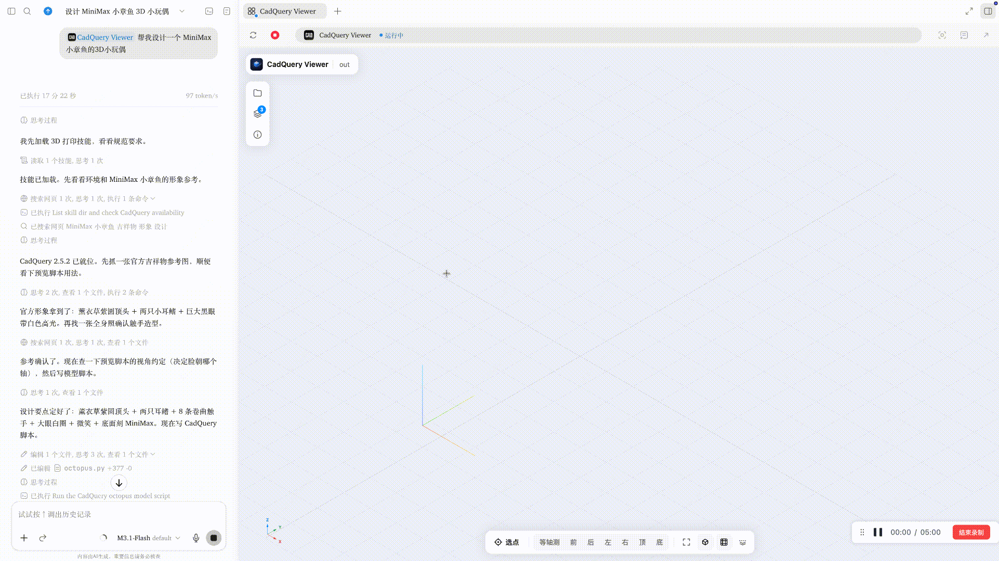
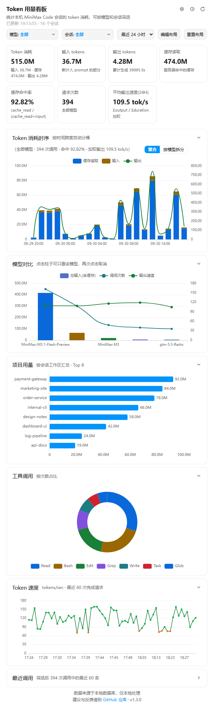
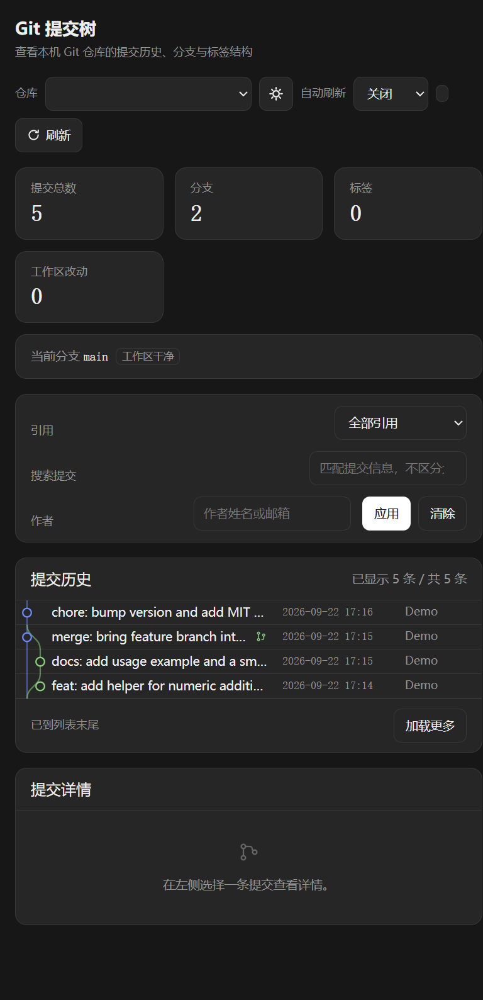

# MiniMax Code MiniApps

English | [简体中文](README.zh-CN.md)

The official community repository for **MiniApps built for the MiniMax Code desktop app**. Discover useful tools, playful experiments, and apps you can make your own.

[Product vision](#pursuing-human-in-the-loop-toward-agent-os) · [Architecture](#architecture) · [Explore MiniApps](#miniapps) · [Get started](#getting-started) · [Contribute](CONTRIBUTING.md) · [Report an issue](https://github.com/MiniMax-AI/MiniMax-Code-MiniApps/issues)

## About

This repository is open to the community: anyone can contribute a MiniApp plugin by opening a pull request. MiniApps are interactive apps packaged as MiniMax Plugins. This repository brings together complete, self-contained plugin packages contributed by developers, with source files and usage instructions alongside each app.

Packages are organized by author under `plugins/<github-username>/<plugin-id>/`. You can download an app, install it manually in MiniMax Code, and use its source as a starting point for your own work.

## Pursuing Human in the Loop, Toward Agent OS

We believe the Agent is evolving into the next-generation operating system (OS). In this paradigm shift, plugins are no longer mere feature extensions: plugins are software, and plugins are apps (MiniApps).

At the same time, real productivity in every industry remains rooted in highly specialized work environments. A conversational interface (Chat UI) alone cannot replace the precise control and rich views of professional tools. Professional workflows of the future should not ask users to leave their workbench to accommodate AI. Instead, professional environments and AI should evolve in deep symbiosis, with AI internalized as a foundational, atomic capability available on demand—like power and water, compute, and storage. By building professional-grade MiniApps that grow on top of the Agent OS, we aim to connect the specialized interfaces of vertical domains with the AI-native compute beneath them, and to reshape how every industry works.

> *Self-drive Route Planner case: an Agent-assisted weekend trip around Shanghai, with the final itinerary and synchronized route workspace visible together.* This case shows the kind of professional workspace a MiniApp can provide: the Agent conversation and complete itinerary are on the left, while the route summary, interactive map, and editable trip workspace are on the right.


> *CadQuery Viewer case: one prompt asks the Agent to design a 3D-printable MiniMax octopus figure, and the model takes shape live beside the conversation.* The Agent looks up the official mascot for reference, writes a parametric CadQuery script, runs and fixes it, and pushes each build to the Viewer on the right. You can orbit, switch views, and section the model at any point, then get print settings and a table of tunable parameters—pick what to change and let the Agent rebuild.



**MiniApp's product stance: keep people involved in collaboration and decisions (Human-in-the-Loop).**

We respect every industry, every profession, and the expertise people build over time. AI should be your smartest executor—amplifying your capabilities rather than pretending to have professional judgment on your behalf. MiniApps reconnect the part of the process that is too often split apart: turning work from something that can be refined into something that can be delivered.

Our aim is to provide every industry with its own **professional IDE framework**: a place where AI can work while people can review, edit, and confirm at any point.

We want users to be able to:

- **Connect capabilities:** Reliably connect and use open-source MCP servers and first-party plugins, bringing data and actions into a professional workflow.
- **Build an interface:** Create a workspace that fits the way each industry actually works.
- **Collaborate at any time:** Make an Agent an always-available, dependable work assistant. And, of course, use it for anything else that is interesting or useful.

In the way of working we envision, a lawyer would not submit an AI-written pleading directly to a court; an analyst would not make an investment decision directly from an AI-generated opinion; and an operator would not launch an AI-generated campaign unchanged.

Instead, they would ask AI to research background, organize material, prepare a first draft, improve the expression, and find omissions—then return to their professional workspace to **review, edit, confirm, and let AI continue.**

## Architecture

MiniApps run inside the MiniMax Code desktop host through four cooperating layers:

- **Host management:** The host provides Electron page hosting, runtime services, plugin installation and publishing, Node process lifecycle, readiness and instance management, and permissions and credentials. It provides control across the stack while business logic remains owned by each plugin.
- **Presentation layer (Chromium / Chrome engine):** The MiniApp page renders HTML, CSS, and JavaScript for filters, tables, charts, and interactive views. Host credentials stay out of the page.
- **Application layer (Node.js):** The Node process owns data aggregation, transformation and processing, business rules, and persistence. Page APIs and Agent tools reuse the same business services. Node can also provide a managed MCP service for the host MCP client.
- **Capabilities and data access:** Plugins can use available Host Connector access, optional plugin-spawned CLI child processes, and the planned unified tool entry for authorized Connector or MCP access to external services, MCP services, local tools, and local data.

The MiniMax Code Agent communicates through the host MCP client. Business requests and page data move between the presentation and application layers, while Agent calls and results are mediated by the host. This keeps credentials and control in the host, and keeps domain logic and persistence in the plugin.


*English architecture diagram: MiniMax Code Desktop Host, presentation, application, and capabilities/data access layers.*

## MiniApps

| MiniApp | What it does | Author |
| --- | --- | --- |
| [AI Office](plugins/cristinamadureira353-svg/ai-office/) | Manage five model-powered employees in a pixel office: client tasks, chats, breaks, meetings and quota-aware offline states; uses your own API keys | [最爱双皮奶](https://github.com/cristinamadureira353-svg) |
| [Token Usage Board](plugins/amszuidas/mcode-token-usage-board/) | Explore local Token usage by date, model, and session, including input, output, and cache usage | [amszuidas](https://github.com/amszuidas) |
| [Token Usage Board](plugins/yanhy2000/mcode-usage-monitor/) | Watch local Token usage, output speed, and cache hit rate in near real time; filter by time range, model, and session | [yanhy2000](https://github.com/yanhy2000) |
| [Model Manager](plugins/ocoomber/openrouter-model-manager/) | Browse, search, and enable/disable models in your `~/.minimax/config.yaml` with instant save, bulk actions, one-click undo, and automatic backups | [ocoomber](https://github.com/ocoomber) |
| [Self-drive Route Planner](plugins/hanzijie/self-drive-route-planner/) | **Official plugin** for planning driving routes with place search, route alternatives, demo mode, and Xiaohongshu 3:4 itinerary cards | [HanZijie](https://github.com/HanZijie) |
| [Git Commit Tree](plugins/microbiosis/git-tree/) | Inspect a local Git repo's commit history with a swim-lane graph, branches/tags, commit detail, and per-file change stats; persisted filter preferences and optional auto-refresh | [Microbiosis](https://github.com/Microbiosis) |
| [Pomodoro Sit Reminder](plugins/1602winxp/pomodoro-sit-timer/) | A Pomodoro timer that only counts: an in-page sit reminder and sound when a segment ends, with no timer lock and no enforced rest length; reminders from a single file or a folder in sequence or shuffled, with single-track loop and loudness matching | [1602WinXP](https://github.com/1602WinXP) |
| [灵签易占 / Chinese Divination](plugins/weekbin/chinese-divination/) | Cast hexagrams with the Plum Blossom method (time, number, three-coin, or daily), read the result through the classical body/use rules, and browse all sixty-four hexagrams with a ganzhi almanac | [weekbin](https://github.com/weekbin) |
| [Session Trajectory](plugins/avatasia/mmc-trajectory/) | Browse a conversation's model trajectory: messages, reasoning, tool calls and results, Token usage, and per-turn timing | [avatasia](https://github.com/avatasia) |
| [CadQuery Viewer](plugins/hanzijie/cq-viewer/) | View STL / STEP models from your project (STEP keeps assembly part names, colours, and real CAD edges), watch models pushed from CadQuery scripts, and mark positions on the model to send to the conversation in one click; MCP tools let the AI add model folders and open models, and a CadQuery parametric-design skill is bundled | [HanZijie](https://github.com/HanZijie) · [flowful-ai](https://github.com/flowful-ai) |
| [MiniMax Bot](plugins/minimax-ai/minimax-bot/) | **Official plugin** that turns MiniMax Code into an always-on team of Bots: a Chief Bot builds the team, group chats hand work between members with `@` mentions, and every Bot has its own memory, scheduled tasks, and usage stats. Requires MiniMax Code 3.1.2 or later | [MiniMax-AI](https://github.com/MiniMax-AI) |
| [心屿 / Xinyu Island](plugins/yujiachen-y/xinyu-daily/) | A cozy daily-mood island that plays like an indie game: an inspiration card shaped by your answers, mood stickers, a joy jar, a decision slot machine, a Book of Answers, and 20 hidden secrets guarded by a grumpy crab. Optionally, Xiaoyu writes you a daily letter and chats with you using your model. Requires MiniMax Code 3.1.2 or later | [yujiachen-y](https://github.com/yujiachen-y) |
| [MoMo Collab](plugins/amszuidas/momo-collab/) | A project steward that turns stray thoughts, screenshots, and links into ideas, writes clear ideas up as tasks, runs each task in its own Agent session with a full handoff, checks the result against your done criteria, and tracks everything on a board. Requires MiniMax Code 3.1.2 or later | [amszuidas](https://github.com/amszuidas) |
| [Anatomy Gallery](plugins/zch0227/anatomy-gallery/) | A gallery for interactive isometric figures made with the anatomy skill: hang them in rooms you organize, view light and dark editions full screen, keep every version, and have an Agent create or edit figures from the gallery with a per-run process log. The anatomy skill is bundled. Requires MiniMax Code 3.1.2 or later | [zch0227](https://github.com/zch0227) |
| [仓库透视 / Repo X-Ray](plugins/yujiachen-y/repo-xray/) | Understand a codebase from its Git history: a code map you can drill into, hotspots and bug magnets, high-risk files, owners and knowledge loss, commit rhythm and firefighting, and the tech stack. Works with GitHub, GitLab, and local repositories; analysis runs on your machine | [yujiachen-y](https://github.com/yujiachen-y) |

<details>
<summary>Preview: Token Usage Board</summary>


The preview uses synthetic data. The app interface is currently in Chinese. See its [README](plugins/amszuidas/mcode-token-usage-board/README.md) for data access, counting rules, and compatibility notes.

</details>

<details>
<summary>Preview: Token Usage Board (mcode-usage-monitor)</summary>



The preview uses synthetic data. The app interface is currently in Chinese. See its [README](plugins/yanhy2000/mcode-usage-monitor/README.md) for data access, counting rules, and compatibility notes.

</details>

<details>
<summary>Preview: Git Commit Tree</summary>



The preview uses synthetic data. The app interface is currently in Chinese. See its [README](plugins/microbiosis/git-tree/README.md) for repository discovery, layout algorithm attribution, and compatibility notes.

</details>

## Getting started

### Requirements

Use a MiniMax Code desktop version that supports MiniApps. Check the app's README for tested client versions, operating systems, configuration, and known limitations. Compatibility is documented per app. Apps that use newer capabilities, such as running Agent tasks or opening in their own window, need MiniMax Code 3.1.2 or later; older versions cannot install them.

### 1. Download

Select **Code → Download ZIP** on this repository and extract the archive, or clone it:

```sh
git clone https://github.com/MiniMax-AI/MiniMax-Code-MiniApps.git
```

Find the app you want under `plugins/<github-username>/` and read its README, including which local files or network services it accesses.

### 2. Install

Copy the **entire plugin directory**, including the hidden `.minimax-plugin` directory, into `<dataDir>/plugins/`.

By default, `<dataDir>` is the `.minimax` directory in your home folder (`~/.minimax`), so plugins go in `~/.minimax/plugins/`. If you have configured a different data directory, use that directory instead.

For Token Usage Board:

```text
Repository: plugins/amszuidas/mcode-token-usage-board/
Install to: <dataDir>/plugins/mcode-token-usage-board/
```

The installed manifest must be at:

```text
<dataDir>/plugins/mcode-token-usage-board/.minimax-plugin/plugin.json
```

The author directory (`amszuidas/`) only groups contributions in the repository. Copy the plugin directory directly into the client's `plugins/` directory, without that extra author level.

These packages use **manual installation**. The client's GitHub plugin import feature does not support these MiniApp packages.

### 3. Open

Restart MiniMax Code, confirm that the plugin is recognized and enabled, and open the MiniApp following its README. For Token Usage Board, ask the Agent to open “Token 用量看板”.

To update an app, close it and exit MiniMax Code, then replace its complete plugin directory. Keep any backup outside `plugins/` and follow the app's instructions for preserving its data. To uninstall, close the app and exit the client before removing its plugin directory; separately stored app data may remain.

## Contributing

Tools, games, visualizations, and small experiments are all welcome. To share a MiniApp:

1. Fork the repository, copy `examples/hello-miniapp/` to `plugins/<your-github-username>/<plugin-id>/`, and build your app there. The package rules are in [`docs/`](docs/package-contract.md); AI coding agents read [`AGENTS.md`](AGENTS.md) automatically.
2. Include a README, a license, and any required runtime files. Document setup, data access, and what you have tested.
3. Add the app to the tables in both root READMEs, run `npm run check`, and open a pull request.

Use a lowercase GitHub username for the author directory. The plugin directory name must match `.minimax-plugin/plugin.json` → `name`, and **plugin IDs must be unique across the repository**, since the author directory is not part of the installed path.

See [CONTRIBUTING.md](CONTRIBUTING.md) for the full contribution guide.

## Questions and feedback

Use [GitHub Issues](https://github.com/MiniMax-AI/MiniMax-Code-MiniApps/issues) to report a problem or suggest an app or improvement. For an app issue, include its ID and version, your MiniMax Code version, operating system, steps to reproduce, and the expected and actual behavior. Remove credentials and private session content from logs and screenshots.

To ask for a runtime capability that MiniApps do not have yet, such as a new `context` API or window behaviour, comment on the pinned [capability wishlist](https://github.com/MiniMax-AI/MiniMax-Code-MiniApps/issues/9) instead of opening a new issue.

## License

This repository is licensed under the [MIT License](LICENSE). Individual MiniApps are governed by the licenses included in their own directories.
