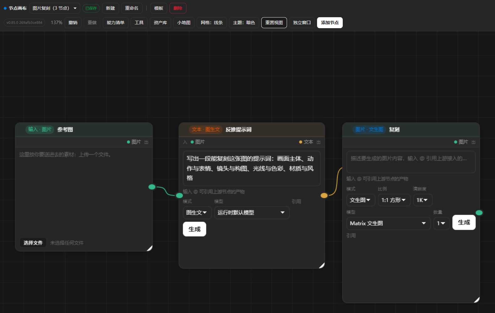
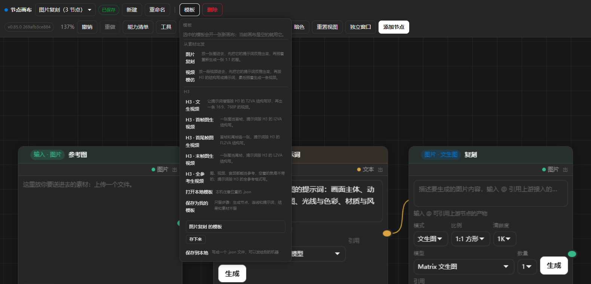

# AI Node Canvas

English | [简体中文](README.zh-CN.md)

An infinite-canvas node graph for MiniMax Code, modelled on the canvas of
`work.batvid.com`.

Author: [antianqi](https://github.com/antianqi) · Version: `0.86.0`





*The preview uses synthetic data. The app interface is currently in Chinese.*

**A run lands on a result node.** An image node makes an image, an audio node
makes audio, and pressing 生成 does not fill the card it was pressed on: the
run drops a **结果** node beside it and draws the line — and that result node is
what the next step reads.

**Two families of node, four kinds of data.** An **input** node holds what goes
in — text, an image, a video or an audio, and the kind is chosen on the card.
A **generating** node produces one of them. A **result** node shows what a
generation produced, and a **group** is a frame around other cards. The kinds
that travel on a line are exactly `text`, `image`, `video` and `audio`: a style
preset and an expanded prompt are text like any other, so neither is a kind of
its own — the style is a text input that was filled from a category template.

Models are **not** called over HTTP by this package. Every run goes through the
Host Agent, which is already running the user's MiniMax models, so there is no
API key to configure, no credential to store, and no outbound request made by
this package.

## What it does

- **Seven kinds of node, and a mode on the card** — a node is a **role**
  (输入 / 生成) and the **data it moves** (文本 / 图片 / 视频 / 音频): an
  **input** node carries one of the four kinds, and a **generating** node
  makes one of the four. A `group` (a frame that carries the nodes inside it)
  and a `result` (it appears by itself when a generation finishes) complete
  the set of seven. The add menus list the six that can be made — the four
  generating nodes, the input and the group — and they are built from the
  same table the cards are drawn from, so the menu and the board cannot fall
  out of step. A **mode** is another way of making the same kind of data: a
  text node writes text, expands a sentence into a prompt (提示词增强), reads a
  picture (图生文) or reads a video back into a prompt (视频生文); an audio node
  speaks or makes music (文生音乐). The mode is a choice on the card, so it
  never gets a row of its own in the menu — and because a mode says what the
  node takes, **it also says which input ports the card draws**: 文生图
  waits for a text, 图生图 waits for a picture as well.
- **视频生文 turns a video back into a prompt** — wire a video into a text node
  in that mode and it writes the prompt that would produce that video: the
  provider's video understanding reads the video shot by shot, and the text
  model turns what it saw into one ready-to-use prompt. The text model never
  sees a video itself, so the runtime reads the video first and hands the
  description over.
- **图生文 does the same for a picture** — the provider's image understanding
  reads the picture, and the text model writes the description. Without that
  step the text model would only get a url, and it cannot look at one.
- **The text box is the text input** — a generating node has a text box on its
  card, and that box is where its text comes in. There is no separate port for
  text: a text line lands on the box. When a text line lands there, the box
  shows that text and stops being editable, because the text is upstream's now.
  The node keeps the prompt you wrote — it comes back when the line is gone —
  but it is not sent this time, so what the card shows and what the model
  receives are the same thing.
- **Every media node generates itself** — output, prompt editor, parameter row and
  a 生成 button live on the same node, so a result can be re-generated, re-tuned
  or re-referenced without leaving the node.
- **Category templates** — a text input can be filled from a category template
  (商品主图 / S+ 详情 / 社媒封面 / 人像写真) with fields and a live preview; its
  text goes downstream like any other text of an input node.
- **Connections are data flow** — the output of every upstream node is injected
  into the downstream prompt as clearly marked reference material. Cycles are
  refused.
- **Inline prompt editor** — the composer is an inline `contentEditable`, not a
  textarea, so `@` references can be embedded in the text as chips with
  thumbnails. IME composition is handled explicitly, and editor keystrokes never
  reach the canvas shortcuts.
- **Provider-specific reference syntax** — mentions are encoded as
  `[[cw:kind:nodeId]]` and compiled per provider family (kling / minimax /
  wanxiang / bytedance) into that provider's own syntax, with the asset URLs
  collected into separate arrays.
- **Model-aware parameters** — the parameter surface follows the generation mode
  *and* the selected model: ratio and resolution for images, plus duration and
  "continue from previous shot" for video, plus voice and emotion for audio.
  Values a model does not offer are snapped onto ones it does. The ratio menu
  says which way the frame lies (16:9 横屏, 9:16 竖屏, 1:1 方形), while the
  value the provider takes stays the ratio itself.
- **A global task table** — several nodes may generate at the same time while a
  single node refuses to run twice. Every run carries a progress log, and
  provider failures are translated into something actionable (402 额度用完 /
  429 限流 / 超时).
- **Human in the loop** — when the Agent asks for a tool permission, the request
  is rendered as a card in the run panel. The page can only answer `allowOnce`,
  and only after the user picks it. The server downgrades any other decision to
  `deny`.
- **Cancel one run at a time** — every run in the progress panel carries its own
  Cancel button. Cancelling stops that run only: the other runs keep going, the
  Agent call behind it is torn down through its own abort controller, and the
  node is free to run again right away.
- **Open in chat** — a run that went through an Agent turn can be opened in the
  Host chat side panel, so the conversation can be continued where the user
  reads it. The generating node keeps a Chat button for the same session, so a
  finished run is still reachable, and a New Chat button that drops the
  session so the next run starts a fresh one.
- **Capability panel** — one `/api/palette` call serves the whole surface
  (node types, sizes, per-mode parameters, per-model limits, templates,
  connector tools) and the UI renders from it, so the panel can never drift from
  the server's own rules. The connector tools are the provider's whole
  inventory, and every row says whether the Host granted it and whether this
  app runs through it — the provider offers more than the app uses, and the
  panel does not pretend otherwise.
- **Local media tools** — 14 transformations that run on the machine: 抽帧 / 宫格抽帧 /
  片段剪辑 / 视频剪裁 / 自动分段 / 音画分离 / 合并视频, plus 字幕擦除 / 视频去水印 /
  背景移除, and 智能抠图 / 变清晰 / 无损改尺寸 / 证件照.
  They are local transforms, not provider features, so they need `ffmpeg` on
  the machine; the panel says so when it is missing.
  Four of the reference product's image tools are deliberately left out — 拼图
  (it needs several pictures, not one), 海报 (the layout comes out too rough),
  去水印 (the user has to place a rectangle first) and 服装换色 (it shifts the
  hue of the whole picture, background included). A tool on a result node is a
  shortcut for that one picture, so it has to work on that picture alone.
- **Video understanding** — 视频拆解 / 爆款分析 read the video through the
  provider's own understanding tool and leave a text node behind.
- **Three roles, three kinds of node** — an **input** node holds what goes in
  (text and local files), a **generating** node holds the prompt, the model and
  the parameters, and a **result** node appears next to it when the run
  finishes. A generating node has no result of its own, so the chain reads
  left to right: input → generate → result → generate → result.
- **Local files** — an input node takes an image, a video or an audio file
  from the machine. The file is kept under the runtime's own data directory
  and served from there; when it is used as a generation reference it is
  uploaded to the provider first, because the provider cannot reach the
  loopback address.
- **Drag to empty space** — pulling a line from a node's right port into
  empty space opens a picker with the node types that can actually take what
  that node offers, and the one you pick is created there and wired up.
- **Ports follow the mode** — a generating node has one port per input kind
  it can take, and the kinds follow the model it selected: an image model
  offers a text and a picture slot, a video model that takes references
  offers text, picture, video and audio. Pulling a line from an input port
  into empty space creates the input node that slot needs, already wired up.
  A line starts and ends on the ports themselves, so a node with several
  ports has one line per port.
- **Every card declares its sockets** — the strip under the header says what
  the node takes and what it hands on, the way a ComfyUI node names its
  inputs and outputs: what goes in on the left, what comes out on the right.
  The kinds follow the model, so a card never offers a socket it could never
  fill. **An input that is still waiting is a hollow ring with `待接入` next
  to it**, a plugged-in input is a filled dot, and an output is the kind the
  node produces — so what is still missing can be read off the card without
  touching anything.
- **The mode follows the inputs** — a picture on an image node turns it into a
  图生图 node, and the options that need it only show when it is there.
- **A prompt node** — a sentence and a template, expanded by the text model
  into a prompt that meets the template. The template is picked from a
  drop-down of presets or written by hand. Besides the shop and social
  presets, the drop-down offers one shape per **MiniMax H3 generation mode**:
  the three-field format for each of the four base tasks (T2VA / I2VA /
  FL2VA / L2VA) and the six-section full-reference format, taken from
  MiniMax's own prompt-writing guides. The structure is written in English and
  the dialogue keeps its own language.
- **The pictures are named the way the request names them** — an `@` in the
  prompt points at a result on the board, and the runtime compiles it to the
  provider's own reference syntax (`@图片1`, `@视频1`, `@音频1`). **The number
  is the place the material has in the request**, so the picture the prompt
  calls `@图片1` is the first picture the request sends — the prompt and the
  request can never mean two different pictures. The Agent that writes the
  prompt is told the same numbers, so what it writes binds to the same
  material.
- **The `@` menu offers the whole board** — not only the chain above the node.
  A prompt may be about a picture that sits somewhere else, and naming it is
  what brings it in. The ones above the node come first.
- **Naming a material wires it in** — a mention says "this prompt is about
  that material", so the node that generates from the prompt has to receive it
  as an input of its own. The app does that: an **输入** node is created to
  hold the material, and a line carries it to every node that takes that kind
  and does not have it yet. The user does not draw that line a second time,
  and the same picture is never held twice. The node that names the material
  then names the holder — the one the request actually carries — so the
  number in the prompt and the picture in the request are the same picture.
- **The alignment line belongs to the runtime** — MiniMax's H3 guide puts one
  line on the very top of the prompt of a picture-to-video request, saying
  which picture is the first frame and which is the last one. The runtime
  writes it, because the runtime is the one that knows what the request
  carries and how long the clip is: `For the target video, at 0.00 seconds
  into the target video, @图片1 (from [Shot 1]) is fully referenced.` for a
  first-frame request, and the two-picture form for a first+last one, with
  the length of the clip and the index of its last shot filled in. The
  templates do not write it, so the prompt never carries two of them.
- **A picture the request will not send is refused** — a first-frame request
  carries one picture and the provider cannot take a reference set at the
  same time, so naming another picture in that prompt would leave a number
  pointing at something the model never sees. The run says so and stops
  instead of sending it.
- **A number that is out of range is refused** — the same rule, checked on
  the text that reaches the provider: a prompt that says "照着 @图片2 写"
  while the request carries one picture would quietly produce something
  else. The run is refused with the reason, so the mismatch is fixed instead
  of being paid for.
- **A generated text takes over the prompt** — when a text result is
  connected upstream, the node's own prompt box turns into a read-only panel
  showing the text it was given, because there is nothing left to type.
- **A result can be handed to the user** — the file is on this machine (the
  runtime keeps it so the canvas can point at it), and the card has a **保存**
  button that hands it over, named after the node it belongs to. The right
  click menu says the same thing.
- **There is a library of the local files** — everything the runtime
  produced and everything the user picked sits in a folder on this machine.
  The **资产库** panel shows it: an asset can be **插入** back into a flow as
  an input node, **保存** to the machine, or **删除** when no canvas uses it
  any more. A file that a canvas still points at is never deleted — the
  library says who uses it. **清理未引用** takes away the files nothing
  points at, so the folder does not grow for ever.
- **The result sits in the middle of the chain** — when a generating node
  feeds another generating node, its result is placed between the two and the
  line is rewired through it, so the chain reads 生成 → 结果 → 生成 and the
  next node reads the result.
- **A chain runs itself** — pressing 生成 on the last node of a chain runs the
  generating nodes upstream that still owe a result, deepest first. A node
  that already has a result is used as it is and never run again. Running a
  step again replaces its result instead of piling up a second one.
- **Several assets in one run** — there is a **数量** (count) drop-down next to the
  生成 button, with 1 / 2 / 3 / 4 / 6 / 8. Asking for four gives four versions.
  **The Host stops a connector call that takes too long (30 seconds by default)**,
  so four assets are **four calls of one asset each** — every call gets its own
  window — and not one request carrying four of them, which would run into the
  limit and may already have been charged. **Every asset gets its own card,
  laid out in one row**, so the versions can be compared side by side; when one
  of them fails the others still show up and the run log says which one is
  missing. A video is one task per clip and a text is one Agent turn, so
  neither of them is batched and those two modes have no count to choose.
- **One slow call at a time** — the window belongs to a single call, so a call
  that shares the machine with another one is the call that runs over it. The
  slow calls (pictures, speech, music, video submits) therefore wait for each
  other: the second angle of one picture starts when the first angle is done,
  and each of them gets a window of its own. A call that fails does not stop
  the ones behind it. The run log says how long a call waited, and a failed
  call says it too, so "the provider was slow" and "it waited its turn" are
  never confused.
- **Cards are spaced by their own size** — the results of one run, the tiles
  of a 宫格切分 and the children a tool produces are all placed by one rule: the
  distance between two cards is the size of a card plus a gap. The size of a
  card is the one the page measures — the preview follows the media's own
  ratio and the tool bar wraps — so a batch is placed again once its cards are
  measured. Two result cards that are sixty pixels apart cover each other, and
  the picture under them is then hidden.
- **A card never covers another one** — a card that lands on another one
  pushes it aside, to the right, where there is room. The result of one
  多角度 branch would sit on top of the branch next to it; the branch steps
  aside instead.
- **A material this machine has lost is left out** — the chain above a node
  is the reference, and a file that is not on this machine any more cannot be
  sent to the provider either. The run says which material was left out and
  goes on with the rest, instead of dying on it.
- **A palette that follows the system** — the page follows the system theme
  until the user picks a side, and the choice is remembered.
- **The Agent can read the canvas** — this Mini App serves a hosted MCP server
  (`servers.mcp.json`), so the Agent gets tools of its own: `canvas_list` names
  the canvases, `canvas_read` returns the nodes, the connections and the
  slots of one — the same three states the card shows — and
  `canvas_list_templates` names the ready-made workflows. All three are
  read-only.
- **The Agent can change the canvas** — six more tools write to the board:
  `canvas_add_node`, `canvas_connect`, `canvas_update_node`,
  `canvas_apply_template`, `canvas_remove_node` and `canvas_run`. They change
  what the user sees, so they are never read-only and they say so in their
  description.
- **The package tells the Agent how to use it** — a Skill
  (`skills/ai-node-canvas/SKILL.md`, written in Chinese) says what the canvas
  is for, when the **prompt node** is the right step (the H3 templates carry
  the provider's own prompt shape, and writing one by hand loses it), how the
  reference numbers work, which chains are worth building, and what the
  models refuse. The Agent reads it when the request is a generation chain
  rather than a single prompt.
- **A template is the skeleton of a chain** — the 模板 menu holds
  **seven ready-made workflows**, under the headings they belong to:
  - *从素材出发* — a picture **imitated** and a clip **imitated**: the material
    is read back into a prompt and the prompt is what is generated from;
  - *H3* — one for each shape the request can carry: T2VA (words), I2VA (a
    first frame), FL2VA (a first and a last frame), L2VA (a last frame) and the
    full-reference set. Each of them carries the **prompt node** that writes the
    structure H3 expects — the runtime adds the line that names the picture.

  These seven are **files** (`miniapp/templates/*.json`), not code: a template
  is data, the user opens one, changes it and keeps it, and changing one of the
  shipped ones is a change to a file rather than to the code.

  A template carries the **steps** only — the nodes, the lines, the prompts and
  the parameters — and never what a run left behind, so it works on another
  machine and does not come out as a canvas full of broken pictures. Putting one
  on the canvas does **not** run it: the money is spent when the user presses
  生成.
- **One button, one menu, two ways in and two ways out** — the toolbar carries a
  single **模板** button, and the menu it opens holds:
  - **我的模板** — the chains the user kept. They live in the runtime's own
    template folder, so they are there whatever happens to a file. The Agent
    sees them too: `canvas_list_templates` lists them, `canvas_apply_template`
    puts one on the canvas.
  - **打开本地模板** — a template file that is on this machine, picked by the
    user.
  - **保存为我的模板** — the canvas that is open now becomes one of the user's
    own, under a name they give it. The steps are kept; the results and the
    material are left behind.
  - **保存到本地** — the canvas that is open now becomes a file, in any folder
    the user names: the Downloads folder, the desktop, the documents, or any
    folder the user types. The runtime writes it and says where it went.

  There is no third way in and no second way to keep a file: a folder to look
  in, a button that keeps a file, and a second way to pick a file were three
  ways to say the same thing.
- **A template that is picked gets a canvas of its own** — the canvas that is
  open now is a piece of work in progress and is left alone; a template opens a
  new canvas under the name of the template (an empty canvas is used as it
  is: there is nothing on it to lose). A file carries the steps and nothing
  else, so it opens whole on another machine: no results, no material, nothing
  that would break. The empty input a chain starts from **does** travel, so the
  person who puts the template on their board puts their own file in it.
- **A template of the user can be managed** — every template of the user
  carries a delete button next to it (the question is asked in the page, like
  every other question here). The ready-made ones are not the user's to take
  away. **Deleting a template of the user cannot be undone**: the file is
  gone, and there is no copy of it anywhere.
- **The canvas is a workbench, and it saves itself** — a change is written
  down about a second later, and the state beside the canvas name says
  whether it happened, so the toolbar has no **保存** button: a button that
  does by hand what the page already does is only a second way to do it. A
  window that goes away takes the local draft with it, so a change made
  between the timer and the close is still there when the canvas is opened
  again. What is worth **keeping** is a **template** (the steps) and the
  **results** (in the library, savable to the disk) — and the delete dialog
  says so before it takes anything away.
- **The prompt node carries the template** — `canvas_add_node` and
  `canvas_update_node` take a `templateId`, so a prompt node the Agent makes
  expands the sentence with the same template the page would pick, the H3
  shapes included. The page and the Agent ask one rule for it.
- **The page stays the only writer** — a canvas lives in the page's memory, and
  the store refuses a write that is based on an older version of it. So a change
  from the Agent is never written to the stored document behind the page's
  back. The page **claims** the canvas before it reads it; while the claim is
  alive the runtime does not write that canvas, and the change is handed to the
  page as an *action*. The page applies it with the very same rule the runtime
  would have used — one rule, in one place — and answers, and only then is the
  canvas saved. A claim and a write take turns on the same lock, so a change can
  never land between the claim and the read. When nobody has the canvas open,
  the runtime applies the action itself, and the result of a run it started
  lands on the canvas on its own. **Either way the canvas looks the same**,
  because the rule that places a node, draws a line and puts down a result is
  the same function on both sides.
- **One rule for colour** — the board has two families of colour, and each
  means one thing:
  - The **content colour** follows the kind of data: amber for text, green
    for a picture, blue for video, violet for audio.
    The node header, its ports, its socket chips and the line between them
    share that colour, so a chain can be read by colour alone.
  - The **interaction colour** is always the accent: selection, focus and
    hover are it, and it never mixes with a content colour.
  - A port carries the colour of what flows through it; an **output is a
    filled dot and an input is a hollow ring until something is plugged
    into it**, so the empty slots are obvious.
  - While a node is selected, **the nodes and lines around it stay bright
    and the rest of the board steps back**, so the eye lands on the chain.
  - The capability list carries a legend of the data colours.
- **State is never carried by colour alone** — a selected node shows a `Selected`
  chip and its accessible name carries `(selected)`; every node is a named
  group, the prompt editor has a name of its own, the progress panel is a
  `role="status"` area, and a failure banner is a `role="alert"`.
- **The card follows the media** — a generated image or video is previewed at
  its own ratio, and the card is sized around that preview instead of
  squeezing it into a fixed frame. A tall 9:16 asset gives a narrow, tall
  card; a wide 16:9 asset gives a short one. A card the user resized by hand
  keeps the width they chose.
- **Undo / redo, multi-select, minimap, draft recovery** — snapshot history over
  nodes, connections and viewport; `Shift`-drag marquee; a live overview of the
  graph; and a local draft that can be restored after a crash.
- **The page asks in itself** — a new canvas, a new name and a deletion are
  settled **inside the board**: the name is typed into the header and the
  deletion is confirmed in a dialog that belongs to the page. A native
  `prompt()` or `confirm()` is a separate OS window that never reaches the
  screen inside the MiniApp host, so a question asked that way is a question
  nobody answers — and the button looks as if it did nothing.

## Connections

A connection says how material travels, and it also says what a node takes.

The input ports on the left of a generating node — how many there are and what
kind each one carries — **follow the mode the node is in** (the mode is the
choice on the card: 文生图 / 图生图 …). So:

- **A line comes in**: if the kind it carries (text / image / video / audio) is
  one the current mode does not take, the node **moves to a mode that takes it**
  — the mode that takes the new kind *and* everything already connected. A
  picture turns 文生图 into 图生图. When no mode takes it, the line is refused
  and the reason says which mode would.
- **A mode is picked by hand**: a line the new mode does not take has no port
  to land on, so it is removed and the user is told how many went.
- The rule exists once. A line dragged by hand and a line the Agent asks for
  through MCP land in exactly the same shape.

There are four refusals: a node connecting to itself, the same line twice, a
line that would close a cycle, and a line whose kind **no mode of the target
takes**.

### A picture becomes a video in several ways

The provider has **several different requests** for turning material into a
video. They are not one request with different parameters:

| Request | What is sent | Who can run it |
| --- | --- | --- |
| First frame | `input_image` + `reference_type: first_frame` | all three models |
| First+last frame | the first frame + `last_frame_image` | H3 and H3-Max |
| Last frame | `input_image` + `reference_type: last_frame` | H3 and H3-Max |
| Reference set | `reference_images` / `reference_videos` / `reference_audios` | H3 only |

So the **mode says which request is wanted** and the **model says which
requests exist** — two different questions. The video node has five modes, and
every one of them has an exact list of what it takes: what it takes is what the
request carries.

| Mode | What it takes |
| --- | --- |
| 文生视频 | a text box |
| 图生视频·首帧 | a text box, a picture (first frame) |
| 图生视频·首尾帧 | a text box, a picture (first frame), a picture (last frame) |
| 图生视频·末帧 | a text box, a picture (last frame) |
| 参考生视频 | a text box, a picture, a clip, a sound |

- The first+last frame mode needs **two pictures**, so the card has two picture
  ports and the slot strip names them **首帧** and **尾帧**; the line that lands
  on a port is the picture that request carries. **With only one picture it
  falls back to a first-frame request** — the provider does not take a
  first+last request that has no last frame. The last-frame mode is the same
  request at the other end: the picture is the ending, and it is sent as the
  single `input_image` with `reference_type: last_frame`.
- The reference set is **one request**, and the set may hold pictures, videos
  and audios together: nine pictures, three videos and three audios, twelve
  items in all. So the mode carries all three kinds, and the ports it shows
  are the ones the model really takes — H3 shows picture, video and audio, and
  a model without a reference set does not show the mode at all. A clip and a
  sound are references like a picture is: they tell the model what to follow,
  and the soundtrack is still the model's own.
- Three of the provider's own rules are enforced before the run is sent, because
  the page cannot see any of them: **a reference set needs at least one item**,
  **an audio reference never comes alone** (it needs a picture or a video), and
  **the set holds twelve items in all** (nine pictures, three videos and three
  audios is fifteen — refused). A run that breaks them is refused with a
  reason instead of being sent and coming back with a provider error.
- The ratio control follows the **request**, not the model: the two keyframe
  requests follow the frame, so the card offers no ratio there; a
  text-to-video run and a reference set can pick one.

### The options follow the model

The video node's model decides what the card offers, because the three video
models are not the same model. The numbers come from the connector's
conditional schema, not from taste:

| | MiniMax-H3 | MiniMax-H3-Max | MiniMax-Hailuo-2.3 |
| --- | --- | --- | --- |
| Modes | 文生视频 · 首帧 · 首尾帧 · 末帧 · 参考 | 文生视频 · 首帧 · 首尾帧 · 末帧 | 文生视频 · 首帧 |
| Duration | 4–15 s | 5–15 s | 6 s or 10 s |
| Resolution | 768P, 2K | 480P, 768P | 768P; 1080P only with 6 s |
| Ratio | 6 ratios + `adaptive` (follows the first frame) | 6 ratios + `adaptive` (it is in the H3 family) | none — it is not in the H3 family |
| References | up to 9 pictures, 3 videos and 3 audios, twelve items in all | one picture, and it is the first frame | one picture, and it is the first frame |
| Sound | renders its own synchronized track | **silent** — use H3 for a voice | silent — add a speech node on top |
| Billing | account credits | account credits | Token Plan |

So the card follows the model: switching to H3-Max takes the **reference set**
(it has none) and the audio port off the table; switching to Hailuo leaves
only 文生视频 and 首帧. The same rule runs when the Agent changes the model
through MCP, so the canvas is the same whoever asked.

> H3 and H3-Max are paid from the **account balance**, and the provider
> refuses them while the account has no **按量自动扣费** (pay-as-you-go) turned
> on — so a clip that should have a voice comes back refused instead of
> silent. Hailuo runs on the Token Plan, but it is the silent one.

> The card has **no sound switches**. There used to be two (sync dubbing,
> ambient sound), but a video run goes straight to the connector and the place
> those switches landed — the Agent's prompt — is not on that path, so
> flipping them did nothing. The sound is decided by two things now: the
> **mode** says whether the request carries an audio reference, and the
> **model** says whether the picture comes with a track (that is in the model
> dropdown's note).

### The text box is the text input

A generating node has a text box on its card, and that box is where its text
comes in. The text has **no port of its own**: a text line lands on the box,
not on the edge of the card, and the slot strip does not list the text either —
one thing, one place.

When a text line lands on the box, the box shows that text and turns read-only:
the text belongs to upstream now, so there is nothing to type there. The node
keeps the prompt you wrote — it comes back when the line is gone — but it is
not sent this time, and the text that handed over is no longer repeated as a
reference. So the card and the run always say the same thing: what you see in
the box is what the model receives.

What a connection *does* depends on the kinds involved:

| Upstream | Downstream | Effect |
| --- | --- | --- |
| `text` (an input, a text result, a text node that has run) | a generating node | The text takes over the downstream node's text box: the box shows it and cannot be typed in, and that text is the prompt of this run. |
| `image` / `video` / `audio` | `text` | The output is injected into the Agent turn as a clearly marked reference block. |
| `image` / `video` / `audio` | `image` / `video` / `audio` / `music` | The asset is sent to the provider as a reference, carried by the connection. A mention in the prompt says which part of it the prompt talks about and, for that kind, its own list wins. |
| `group` | any | A group is a frame, not a data source: it carries no output into the downstream node. |

The provider's per-model limits still apply — nine images, three videos and
three audios at most — and they are checked on the server before a run
starts, so a connection that would exceed them is refused with a clear
message rather than failing at the provider.

## Install

Copy the whole `ai-node-canvas` directory, including the hidden `.minimax-plugin`
directory, into your MiniMax Code data directory:

```text
Repository: ai-node-canvas/
Install to: <dataDir>/plugins/ai-node-canvas/
Manifest:   <dataDir>/plugins/ai-node-canvas/.minimax-plugin/plugin.json
```

The default data directory is `~/.minimax`, so the destination is normally
`~/.minimax/plugins/ai-node-canvas/`.

Restart MiniMax Code, confirm the plugin is recognised and enabled, then ask the
Agent to open "节点画布" — or open it from the plugin list.

## Usage

1. Right-click empty canvas space to add a node, or double-click to drop an
   image node.
2. Add an `输入` node, pick `文本`, fill it from a category template and apply
   it — the text now applies to everything downstream.
3. Select a node, write a prompt, choose a model and parameters, and press
   **生成**. The result replaces the node's own output.
4. Type `@` in a prompt to reference an upstream node's output.
5. Drag the circle on the right edge of a node onto another node to connect
   them.

### Keyboard

| Keys | Action |
| --- | --- |
| `Ctrl+Z` / `Ctrl+Shift+Z` / `Ctrl+Y` | Undo / redo |
| `Ctrl+C` / `Ctrl+V` | Copy / paste selected nodes |
| `Delete` / `Backspace` | Delete the selection |
| `Shift`+drag | Marquee select |
| `Shift`+click | Toggle one node in the selection |
| `Escape` | Close mention menu → panel → menu → deselect |

## Tested environment

- MiniMax Code 3.1.2 on Windows 11 (Node 22)
- MiniMax Code 3.1.2 on macOS 15
- Requires a desktop client that supports MiniApps and Agent turns.

## Local media tools

The 14 media tools are local transformations, so they need `ffmpeg` and
`ffprobe` on the machine. The binary is looked up on `PATH`, in the WinGet
links and package folders, and in the usual install locations; `NXC_FFMPEG`
overrides the search. The binary is not bundled: a packaged ffmpeg is several
times larger than the package size limit.

When ffmpeg is missing, the tool buttons stay disabled and say what is
missing, and the media status route reports the same. Everything else — the
generating modes, the canvas, the text tools — works without it.

A card holding a **video** shows no tool bar at all: the finished clip is a
deliverable, not a working material, and a dozen buttons under it are noise.
No empty strip is left under the clip either — no tools, no footer.
The video tools stay in the runtime, so the Agent can still call them through
the MCP server.

### The tools that draw in the browser

Two of the tools work in the page rather than on this machine: **宫格切分**
cuts a picture into a grid, and **剪裁** keeps the part of it the user drags
out. They need no ffmpeg and no credit.

The page draws the result and hands the bytes to the runtime, which publishes
them into the asset folder like any other produced file. The result is
therefore a real file: it can be saved to the user's machine, it shows up in
the asset library, and the next tool can read it. A data URL would have lived
inside the canvas document and nowhere else. **剪裁** leaves a picture of its
own behind, so the original stays where it was.

### The tools that ask the model

**多角度** and **打光** run the Agent on the picture. 多角度 takes several
angles, and one run cannot answer two angles with one picture, so the tool
runs once per angle and each run names its own. Every run is a generation, so
it costs the user's credit; the panel says how many runs a selection will take
before the button is pressed.

### One chain, all the way down

Every tool leaves a **result node** behind, whichever way it was made. Only a
result node carries the tool bar, so the picture a tool produced can be
worked on again: 智能抠图 → 变清晰 → 宫格切分 is one chain, not three
separate pictures.

## Data & access

- **What the connector is for** — the `matrix` connector is used for media
  generation only: images, video, speech and music, plus reading a video
  back for understanding. The Host holds the credentials and the egress;
  this package never touches an account of its own.
- **Files read** — only this package's own page assets, read from `context.pluginRoot`
  (`miniapp/client/index.html`, `app.js`, `mention.mjs`, `tools.mjs`,
  `forms.mjs`, `actions.mjs`, `styles.css`).
  No Host file is read; there is no supported API for that.
- **Files written** — canvas documents only, under `context.dataDir/canvases/*.json`,
  written atomically (temporary file in the same directory, then renamed). The media
  tools additionally write working files and published results under
  `context.dataDir/work/` and `context.dataDir/assets/`, and an uploaded file is
  kept under `context.dataDir/uploads/`.
- **The one write outside that folder** — **保存** on a node, or on an asset in the
  library, copies the file into the user's **Downloads** folder under the name
  the node carries. It happens only when the user asks for it, and the page says
  where the file landed. A file that is already there is never overwritten: the
  copy gets a number.
  **保存到本地** writes there too — the runtime writes the file and
  says where it went, because a download the browser starts inside the Host
  never arrives under the name it was given. The folder is the one the user
  named in the export panel; it has to be a folder that is there, and the file
  name has to be one plain name.
- **What is read of a file of the user** — only the file the user picked in
  **打开本地模板**, and only when it is a template by the one rule that reads a
  template. A file that is something else is refused and never offered. No
  folder of the user is scanned: a file is read when the user hands it over.
- **The library reads those two folders** — the asset folder and the upload
  folder are what the **资产库** panel lists, and **清理未引用** deletes the
  files in them that no canvas points at any more. A file a canvas still
  points at is never deleted by the library.
- **Network hosts** — the asset host that the generation provider returns in
  `get_asset_url` (the provider's own object storage domain), and the host the
  provider's upload command returns a temporary link on. Nothing else.
  The Node service downloads a produced asset so the canvas keeps a link that
  does not expire, and uploads a local file when it is used as a generation
  reference, because the provider cannot reach the loopback address. Every
  other request — image, video, audio, music, voice catalogue, video
  understanding — goes through the Host connector (`context.hostConnector`),
  and the Host owns the credentials and the egress.
- **The addresses a download may go to** — a link that points at this machine
  or at the network it sits in is refused: the loopback, the private ranges,
  the link-local range, the shared space of a carrier and the reserved ranges,
  in IPv4 and in IPv6 alike — including the forms that carry an IPv4 address
  inside an IPv6 one (`::ffff:7f00:1`, `::7f00:1`, `64:ff9b::7f00:1`). The
  name is looked up **once**, and the address that was judged is the address
  that is connected to, so a name cannot answer one thing for the check and
  another for the connection. Every hop of a redirect is judged the same way.
- **The two steps of an upload** — the provider's upload command does not take
  a local path, because the provider cannot read this machine's disk. It takes
  the file name and the media type and answers with a signed form; the runtime
  then posts the bytes to the host that form points at, as
  `multipart/form-data` (the form's own fields carried over, the file in the
  part named by `file_field_name`). The `temp_url` in the answer is the address
  the provider can fetch. The form host has to be https (a loopback address
  excepted), and that one request is made by the runtime itself rather than
  through the Host connector.
- **How long a connector call may take** — the Host puts a timeout on one
  connector call (30 seconds by default). A call that runs over it is aborted
  and reported as an unknown outcome: it may have been dispatched, and it may
  have been charged, so it must never be retried automatically. A slow
  generation (an image generation with a reference is the one that hits it
  most often) can therefore fail once; the message names the tool and how long
  it ran. Video is submitted and then polled, so it is not affected.
- **Processes spawned** — `ffmpeg` and `ffprobe`, and nothing else. Both are
  looked up on the machine and run with an argument array, never through a
  shell, so no part of a path or a parameter can be read as shell syntax.
  The commands are:
  - `ffmpeg -hide_banner -loglevel error -y <input> …` — one call per media
    tool: a frame extract (`-ss`, `-frames:v 1`), a grid tile
    (`fps=…,tile=CxR`), a trim (`-ss`, `-to`, libx264/aac), an aspect crop
    (`crop=W:H:X:Y`), a scene-detect pass (`select='gt(scene,…)',showinfo`),
    an audio split (`-an` / `-vn`), a concat (`-f concat -safe 0 -i <list>`),
    a chroma key (`chromakey=0xRRGGBB`), a logo removal (`delogo=x:y:w:h`),
    and the image passes (`colorkey`, `scale`, `pad`, `crop`, `unsharp`,
    `hqdn3d`).
  - `ffprobe -v error -print_format json -show_streams -show_format <input>` —
    to read the duration, the size, the frame rate and whether the file has
    an audio track.
  Every parameter that reaches a filter string is validated first: numbers are
  coerced and clamped, and every option value comes from a fixed list. A value
  from the page can never become filter syntax. The spawned children are
  tracked and stopped when the runtime is disposed.
- **Credentials** — none are read, stored, or forwarded. The Host authenticates the
  loopback port and strips its credential before a request reaches this package.
- **The hosted MCP server** — `servers.mcp.json` declares one Streamable HTTP
  server, mounted on `/mcp/canvas` by `miniapp.json`; the Host rewrites its
  address and authenticates it like the rest of the port. The server speaks
  stateless JSON-RPC (`initialize`, `ping`, `tools/list`, `tools/call`) and
  offers three reading tools and six writing ones:
  - `canvas_list` — the canvases with their id, title, node count and last
    change.
  - `canvas_read` — one canvas: its nodes (type, title, status, model,
    parameters, and what went wrong if something did), the connections, and
    for every node the slots it declares with the state the card shows
    (`filled`, `ready`, `open`, `out`) — a port that has a role says which one
    it is, so the first frame and the last frame are two ports.
  - `canvas_list_templates` — the ready-made workflows and the templates of
    the user's own.
  - `canvas_add_node`, `canvas_connect`, `canvas_update_node`,
    `canvas_apply_template`, `canvas_remove_node`, `canvas_run` — add a node,
    draw a line, change a node, put a workflow on the canvas, remove a node,
    run a node once.

  The reading tools only read the canvas documents under
  `context.dataDir/canvases/`. They never write, never start a run and never
  call the provider, so the Agent can look at the board without touching it.
  The writing tools go through the **action** channel: when the page holds the
  canvas the change is handed to it and applied there, and when nobody has it
  open the runtime applies it itself — **never** a write behind the page's
  back. The endpoint needs no dependency of its own: the dependency folder is
  not published with the package, so the protocol is spoken by hand.
- **Connector access** — the manifest declares the `matrix` provider under
  `hostConnectorAccess`. The Host grants it at install time, and this package
  does call it:
  - Image, video, audio and music are produced by the Node service itself
    through `context.hostConnector` (`generate_image` /
    `submit_video_generation` / `query_video_generation` /
    `synthesize_speech` / `batch_text_to_music`); the produced asset is turned
    into a short-lived display URL with `get_asset_url`, and the drive node id
    is stored so an expired link can be refreshed.
  - The voice drop-down is live data too: `/api/voices` reads the real TTS
    catalogue while handling a request.
  - 视频拆解 / 爆款分析 read the video with `videos_understand`. The provider
    fetches the asset itself, so those two tools work on a generated video; a
    file this MiniApp produced locally is served from the loopback address and
    the provider cannot reach it.
  - The call path does not change the billing: same connector, same account.
    The model decides the pool (H3 and H3-Max use account credits,
    Hailuo-2.3 is Token Plan eligible).
  - Text has no connector tool, so it keeps the Agent turn.
- **Agent turns** — yes, but only for the text mode and prompt work. Pressing
  **生成** in the text mode runs an Agent turn through `context.agent` with the
  user's full Agent capabilities: files, shell, Skills, and MCP, including
  this Mini App's own tools. The Agent may therefore read and write files, run
  shell commands, and call MCP tools on the user's behalf.
  Permission requests are surfaced in the run panel and are answered with
  `allowOnce` only after the user chooses; the page never answers automatically. The
  server downgrades any decision that is not `allowOnce` to `deny`.
  Text coming from the page, from files, or from the network is treated as data, not
  as instructions.
- **State location** — `context.dataDir`, a private directory the Host creates and
  owns for this plugin. The location is treated as opaque and may change between
  versions; do not hard-code it. The browser also keeps a local draft in its own
  storage for crash recovery.
