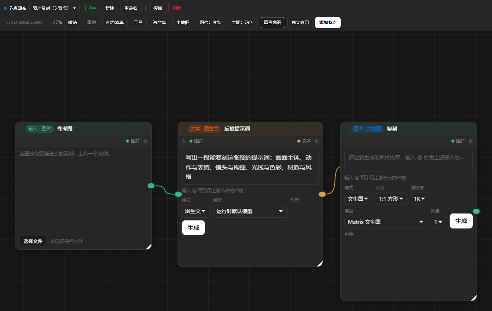
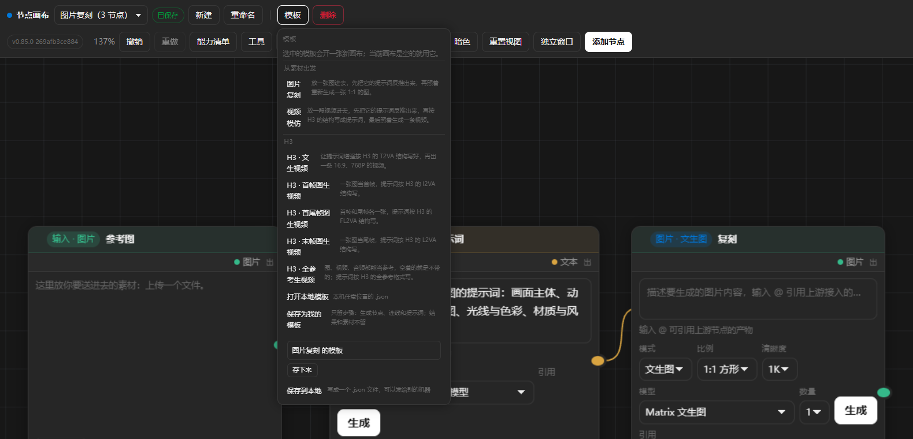

# AI 节点画布

[English](README.md) | 简体中文

MiniMax Code 里的无限画布节点图。每个节点是一次模型运行，每条连线是一条数据通路——
把文本节点连到图片节点，上游文本会自动注入下游提示词。

作者：[antianqi](https://github.com/antianqi) · 版本：`1.22.8`





*预览图使用合成数据。界面目前是中文。*

模型**不是**由本包直连 HTTP 调用的。图片/视频/音频/音乐由本包的 Node 服务通过宿主连接器
（`context.hostConnector`）直接调用，文本模式走宿主 Agent——跑的都是你的 MiniMax 模型：
不需要配 API Key、不存凭据，宿主掌握凭据与出网。

## 能做什么

- **无限画布** — 平移缩放的节点图。节点是 DOM 元素，连线是一层 SVG，整个场景挂在
  一个 CSS transform 下。网格是 CSS 背景，滚动和缩放都零重绘。
- **两族节点、四种数据、七种节点** — **输入**节点装着要送进去的东西（文本 / 图片 / 视频 / 音频，
  类型在卡片上选），**生成**节点产出其中一种；还有**结果**节点（工具和批量产物长出来的）
  和**分组**框。线上流动的数据种类就 `text` / `image` / `video` / `audio` 四种：
  **风格预设和提示词扩写都是文本**，所以它们不是新的种类——风格就是一个用「品类模板」
  填好的文本输入。所以画布上一共 **7 种节点**：输入 1 种（装什么在卡片上选）、生成 4 种，
  再加结果和分组。两个添加菜单（空白处右键、
  右上角「添加节点」）列的就是能加的 6 种（结果节点不由菜单添加），
  **和卡片读的是同一张表**，菜单和画布不会对不上。
  **模式**是同一种数据的另一种做法，放在卡片上选：文本节点可以写文本，也可以把一句话扩写成
  提示词（提示词增强）、读一张图（图生文）、把一条视频反推成提示词（视频生文）；音频节点可以
  配音，也可以写歌（文生音乐）。所以模式不进菜单。
  而且模式说明了这个节点「要什么」，所以**左侧的入端口由模式决定**：文生图等一个文本，
  图生图再等一张图。
  所有形态写在**一张表**里，页面和服务端读的是同一张。
- **视频生文把视频反推成提示词** — 把视频接进文本节点的「视频生文」模式，它会写出能生成这条
  视频的提示词：provider 的视频理解逐镜头读视频，文本模型把它看到的东西写成一条能直接用的
  提示词。**文本模型自己看不见视频**，所以运行时先把视频读一遍，再把描述交给它。
- **图生文对图片做同一件事** — provider 的图像理解先读这张图，文本模型再写描述。
  少了这一步，文本模型只会拿到一个 URL，而它打不开 URL。
- **提示词不在卡上，在卡下的操作面里** — 生成节点的卡片上只有产物，没有文本框：提示词编辑器
  浮在卡片下面，选中才出现。文本**从端口进**：文本线接到卡边的文本口上，插槽条里也列文本
  ——一件事只在一处。
  文本线接进来后，操作面里的编辑器变成只读面板（标着「来自上游」），显示接过来的那段文字；
  你自己写的提示词**保留在节点里**（断开这条线就回来），但**这一次不发送**，
  所以卡片上看到的就是模型收到的。
- **连线即数据流** — 上游节点的产物会作为「参考材料」注入下游提示词。环路会被拒绝。
- **节点内嵌提示词编辑器** — 用的是 contentEditable 而不是 textarea，所以 `@` 引用
  可以直接嵌在正文里。中文输入法组合输入单独处理，编辑器里的按键不会触发画布快捷键。
- **`@` 引用芯片** — 引用是带缩略图的不可编辑芯片。引用的素材一旦消失，芯片会变成
  **孤儿态**并明确提示。
- **按厂商编译的引用语法** — mention 在内部编码为 `[[cw:kind:nodeId]]`，再按厂商家族
  （kling / matrix / minimax / wanxiang / bytedance）编译成该厂商自己的引用写法，同时把素材 URL
  收进独立数组一起交给模型。图片模型（MiniMax-H3-Image）的参考图写作 `图1`、`图2`——
  它自己的接口就这么点名；视频模型还是 `@图片1`。
- **随模型能力变化的参数** — 参数面收在**一枚摘要芯片**后面（`16:9 · 2K`），数量另有
  自己的一枚芯片（`× 1`），模型有自己的按钮。点开芯片才是各项控制：芯片和浮层读同一份数据，不可能对不上。参数随生成类型和**所选模型**走：图片有比例和清晰度；
  视频再加时长和「续写上一镜头」；音频再加音色和语音情绪。模型不支持的取值会被自动
  吸附到它支持的档位上。比例这一栏会**标出画面朝哪边**（16:9 横屏、9:16 竖屏、1:1 方形），
  但发给 provider 的值还是那个比例本身。图片模型还有`自适应`这一档（画面跟着提示词走），
  清晰度**默认 4K**——所以图片节点什么都不填时，画幅自适应、尺寸 4K。
- **引用上限由服务端强制** — 不信任页面。超过模型上限、或超过全局 16 个引用的上限，
  都会在任何 run 启动**之前**就被拒绝。
- **能力清单面板** — 展示每种生成模式的实时参数面，以及宿主 matrix provider 的**全部**连接器
  工具和它们的授予状态。provider 提供的工具比本 App 用到的多，所以每一行会标出
  **「未授予」**（宿主没给）和**「本 app 不用」**（本 App 没有功能走它）——面板不替谁吹牛。
- **本机媒体工具** — 14 个跑在本机的变换：抽帧 / 宫格抽帧 / 剪辑 / 视频剪裁 /
  自动分段 / 音画分离 / 分离音频 / 合并视频，外加字幕擦除 / 视频去水印 / 背景移除 / 音频剪辑，以及
  智能抠图 / 变清晰。它们是本机变换而不是厂商能力，所以需要
  本机有 `ffmpeg`；没有时按钮会保持禁用并说明缺什么。
  参考实现的六个图片工具是**有意不做的**：拼图（要好几张图，不是一张图的快捷处理）、
  海报（排版太粗）、去水印（得先框出要去掉的矩形）、服装换色（整图色相偏移，背景
  跟着一起变）、无损改尺寸（要填宽高数字，在图上拖「剪裁」更直接）、证件照（只对证件
  规格有用，画布上这张图多半不是要办证）。结果节点上的工具是「对这一张图的快捷处理」，
  所以它必须只对这一张图有效。
- **厂商自己做的两个图片工具** — **AI 抠图**把主体从不是纯色的背景里抠出来，写成透明
  PNG；**AI 放大**用 2× 超分模型把糊图变清晰。它们走 `matrix` 连接器，要的是厂商而不是
  `ffmpeg`。每个工具都写清楚厂商收什么样的图（AI 放大要长边 ≤2048），超限的图在请求
  发出去之前就被拦下来，不会白花钱。
- **视频理解** — 视频拆解 / 爆款分析走 provider 自己的视频理解能力，产出文本节点。
- **人在环内** — Agent 请求工具权限时，审批卡直接长在节点上。只能选「允许一次」，
  且必须由用户先做决定；页面绝不会替用户自动批准。
- **逐次取消** — 左下角运行进度面板里，每一次运行都有独立的「取消」。取消只停这一
  次：其它运行照跑，它背后的 Agent 调用通过自己的中止控制器拆掉，节点也立刻空出来
  可以重跑。
- **在对话里打开** — 走过 Agent 的运行可以一键在宿主的对话侧栏里打开那段会话，直接
  在能读到的对话里接着聊。生成节点上也留了「对话」按钮，所以跑完的会话同样回得去。
  节点上的「新会话」则把这段会话丢掉，下次生成从头开一段新的。
- **产物落在出图的那张卡上** — 生成完成后，产物直接出现在按下「生成」的那张卡里，
  不再另长一张结果卡。画布始终是图，而不是列表。
- **三种角色、三类节点** — **输入**节点装要送进去的东西（文字 + 本地文件），
  **生成**节点管提示词、模型和参数，**结果**节点留给工具和批量产物。
  生成节点跑完，产物就留在它自己这张卡上，所以链条从左到右读：输入 → 生成 → 生成。
- **本地素材** — 输入节点可以直接选本机的图片、视频或音频。文件存在运行时自己的数据目录里
  并从那里提供；当它要作为生成的参考图时，会先上传给 provider（provider 够不到回环地址）。
- **拉到空白处出筛选器** — 从节点右侧出线口拉到空白处松开，会弹出可用节点列表（只列真正
  吃得下这个上游的节点类型），选中即在该处建好并自动连线。
- **端口跟着模式走** — 生成节点按它选的模型给出它吃得下的几种输入端口：图片模型给
  文本 + 图片两个口，支持多模态参考的视频模型给文本/图片/视频/音频四个口。从入端口
  往空白处一拉，就地建出这个口需要的输入节点并自动连线。**线本身也从端口出、到端口止**，
  多个端口的节点就是一根线对一个口。
- **每张卡片都声明自己的接口**（ComfyUI 的做法）— 卡片头部下面那条插槽条直接写出
  **它吃什么、吐什么**：左边「入」是能接进来的数据种类，右边「出」是它产出的种类。
  种类跟着所选模型走，所以卡片不会给出一个永远填不上的口。**还空着的入槽是空心环，
  旁边写着「待接入」**；接上了就是实心点，写「已接入」；节点自己已经写了提示词，
  文本槽就说「已就绪」。不用碰任何东西，就知道还缺什么没接。
- **模式跟着输入走** — 图片节点接上图片输入，就自动变成「图生图」；只有
  真需要这种输入的选项，接上了才出现。
- **提示词增强节点** — 一句话 + 一个提示词模板，经文本模型扩写成符合模板要求的
  提示词。模板可以下拉选预设，也可以直接改写。预设里除了电商主图、短视频分镜这些，
  还有五个 **MiniMax H3 的形状**（T2VA / I2VA / FL2VA / L2VA / 全参考六段）——
  按 MiniMax 官方的提示词指南来：结构用英文写，台词保留原语言。
- **上游生成的文本会接管提示词** — 上游接的是文本结果时，本节点操作面里的编辑器变成只读面板，
  显示接过来的文本，因为已经没有东西可打了。
- **产物留在出图的卡上** — 生成节点后面接的是另一个生成节点时，连线直接从这张卡走到
  下一张，下一个节点读的就是这张卡上的产物。链条读起来是 生成 → 生成。
- **整条链自己跑** — 点链路末端节点的「生成」，会自动把上游还没出结果的生成节点按
  从深到浅的顺序补齐；已经有结果的直接用，不会重复跑。同一步再跑一次是**替换**旧结果，
  不会堆出第二份。
- **一次出多张** — **生成**按钮旁边有一个「数量」下拉（1/2/3/4/6/8）。选 4 就出 4 个版本。
  **宿主对一次连接器调用有 30 秒上限**，所以 4 张是 **4 次调用、每次一张**（每次各自有 30 秒窗口），
  不是一次请求里塞 4 个——那样会超时，而且超时的那次可能已经扣了费。
  **结果每个一张卡、并排排成一行**，方便对着比；出图的那张卡只写「生成了 N 张结果」，
  不替它们挑一张显示。其中一张失败，其余照样出得来，运行日志会说明少了哪张。
  视频（一个片子一个任务）和文本（一轮一个回复）不批量，那两种模式下就没有这个下拉。
- **没出东西的运行算失败，不算完成** — provider 可以回一句「ok」却什么也没留下，
  一张卡片说完成、上面空空如也，那是在骗人。所以运行会带着原因失败；
  provider 真的做出来的文件会被点名（它的 node_id），还能在那边找回来。
  这种文件的链接会问两次：宿主的窗口是 30 秒，问得太早可能拿不到链接，
  而文件其实已经在 provider 那边了。
- **链上已经有产物的上游不会重跑** — 「整条链自己跑」补的是**还欠产物**的那几步。
  产物落在出它的那张卡上（文本节点的产物就是它自己那段文字），所以上游跑完了，
  下游就直接拿它的产物，不会再偷偷把上游重跑一遍——那会多花一次钱，
  还会把你写好的提示词换成重新扩写出来的另一版。
- **厂商拒了就说它拒了什么** — 厂商拒绝一次请求时，接口回的 `code` 仍然是 0，
  原因写在 `failed_items` 里。只看 `code` 不为 0 的话，厂商的原话会被丢掉，
  用户只看到一句「没有取回来」。现在厂商的 err_code 和原因会原样写进运行日志。
- **重跑失败不会抹掉上一次的产物** — 重跑时卡上留着上一次的结果；这一次没跑出来，
  那张图还在，而不是变成一张空卡。
- **提示词横着读，不竖着堆** — 卡下那块操作面是给提示词用的宽版页面：自己写的编辑器和
  上游接过来的只读面板是同一块。上游接过来的那段文字以前落回窄列，长提示词堆成一根竖柱；
  现在也是同一块横版页面，长了就在盒子里滚。
- **跑不完的回合会自己收场** — 宿主从不给 Agent 回合设超时：它可能在长时间思考、等工具、
  或等用户。运行最多等十分钟，到点就放弃这个回合、让宿主停掉它，并把事情说清楚，
  而不是一直转圈。卡在转的时候还会告诉你它已经转了多久，运行面板里照旧看得见每一步。
- **慢调用一次只跑一个** — 30 秒的窗口是给**一次调用**的，所以和别的调用抢机器的那个才是会超时的。
  于是慢调用（图片、语音、音乐、视频提交）之间会排队：同一张图的第二个角度等第一个角度跑完再开始，
  各自都拿得到完整窗口。**一次失败不会挡住后面的调用**。排队等了多久会写进运行日志，失败时也会写，
  「provider 慢」和「在等机器」这两件事不会混为一谈。
- **卡片之间按卡片自己的尺寸留距离** — 一次跑出来的多张结果、宫格切分的每一块、工具产出的子节点，
  走的都是同一条规则：两张卡之间的距离 = 卡片自己的尺寸 + 一点余量。卡片自己的尺寸是页面量出来的
  （预览框跟着素材的比例走、工具栏会换行），所以一批卡片量好之后会再排一次。
  六十像素就挨着的两张结果卡会互相盖住，盖住的那张图就看不见了。
- **卡片不会压着另一张** — 新放的卡片压到了谁，就把谁往右边让开，那边有地方。
  多角度的一个分支的结果本来会正压在旁边的分支上，现在让开的是分支。
- **这台机器上已经没了的素材会被放在外面** — 节点上面的链条就是这次带的参考素材，而
  provider 那边同样读不到这台机器上已经不在的文件。运行会说清楚少了哪一份，然后带着
  剩下的继续跑，而不是死在它上面。
- **配色跟着系统** — 默认跟随系统的明暗，用户也可以自己选，选完会记住。
- **Agent 能读画布** — 本 Mini App 对外提供一个托管 MCP 服务（`servers.mcp.json`），
  Agent 因此有自己的工具：`canvas_list` 列出画布，`canvas_read` 读回节点、连线
  和每个节点的插槽（和卡片上是同一套三态）。这两个工具**只读**。
- **Agent 能改画布** — 另外五个工具能写画布：`canvas_add_node`、`canvas_connect`、
  `canvas_update_node`、`canvas_remove_node`、`canvas_run`。它们改的是用户看得见的东西，
  所以都不标只读，工具说明里也写明。
- **模板是一条链的骨架** — 「模板」菜单里有一键铺好的**七条现成工作流**，按分组摆：
  - **从素材出发** —— **图片复刻**、**视频模仿**：把素材先读回成一段提示词，
    再拿这段提示词去生成；
  - **H3** —— 每种请求能带的图都有一条：T2VA（文字）、I2VA（首帧）、FL2VA（首帧+尾帧）、
    L2VA（尾帧）、全参考。每条都带一个**提示词增强**节点，按 H3 期待的结构写提示词
    （点名那张图的那一行由运行时补上）。

  这七条是**文件**（`miniapp/templates/*.json`），不是写死在代码里的：模板是数据，
  用户打开一条、改好、存成「我的模板」；要改预置的那几条，也是改文件，不用动代码。

  模板只有**步骤**（节点、连线、提示词、参数），**不带任何跑出来的结果，也不带素材** ——
  所以换个人、换台机器铺出来照样能用，不会像导入一张画布那样满屏裂图。铺完**不自动跑**：钱是你按「生成」
  才开始花的。
- **一个按钮、一个菜单，进两条路出两条路** — 工具栏上只留一个**「模板」**按钮，它打开的菜单里是：
  - **我的模板** —— 你自己留着的链（收在运行时自己的模板文件夹里，文件没了它还在）。
    Agent 也看得见：`canvas_list_templates` 列出全部，`canvas_apply_template` 一键铺一条；
  - **打开本地模板** —— 本机上现成的模板文件，由你自己挑；
  - **保存为我的模板** —— 当前画布变成你自己的一条，起个名字（只留步骤，结果和素材不留）；
  - **保存到本地** —— 当前画布写成一个文件，存到你说的任意文件夹（下载文件夹、桌面、文档，
    或者你自己填的）；文件由运行时写，页面告诉你落在哪儿。

  没有第三条进路，也没有第二种留法：指定文件夹找、给文件按「＋」、再挑一个文件，
  本来就是同一件事的三种说法。
- **在里挑中的会开一张新画布** —— 正在做的画布是进行中的活儿，不去动它
  （当前画布是空的就用它：上面没东西，丢了也不心疼）。
  文件里只有步骤，没有结果也没有素材，所以换台机器打开也是完整的；
  一条链从哪张图起步，那个**空输入位**也跟着走，放的人自己往里放图。
- **自己的模板能管** — 「我的模板」里每一条旁边都有删除按钮（删除前也是在页面里问，
  跟这里别的问题一样）。内置的那些不是你的，删不了。**删掉自己的模板找不回来**：
  文件没有了，机器上也不会留下另一份。
- **画布是工作台，它自己会存** — 改动后一秒左右自己落盘，页头画布名旁边那颗状态芯片说了算，
  所以工具栏上**没有「保存」按钮**：手动再存一次只是把页面已经在做的事做第二遍。
  窗口关掉时那份本地草稿也跟着走，所以「刚改完就关」也不会丢。
  真正值得**留住**的是**模板**（步骤）和**结果**（在资产库里，能存到本地）——
  删画布之前，弹窗会先告诉你这些。
- **这个包会告诉 Agent 怎么用它** — 附了一个 Skill（`skills/ai-node-canvas/SKILL.md`，中文）：
  写清画布是干什么的、什么时候该先走**提示词增强**（H3 那几个模板带的是 provider 自己的提示词结构，
  手写一遍很容易丢掉）、引用编号怎么算、哪些链值得搭、哪些请求模型会拒。Agent 在任务是
  「一条生成链」而不是「一句提示词」的时候会读到它。
- **提示词增强节点带模板** — `canvas_add_node` 和 `canvas_update_node` 都接受 `templateId`，
  所以 Agent 建的提示词增强节点，用的是和页面上一样的模板（H3 那几个也在里面）；页面和
  Agent 问的是同一条规则。
- **页面仍然是唯一写者** — 画布活在页面的内存里，存储层会拒绝基于旧版本的写入。
  所以 Agent 的改动**不会**在页面背后直接写进存储：页面在读画布之前先「认领」它，
  认领有效期间运行时就不写这张画布，改动以**动作**的形式交给页面；页面用运行时本来
  也会用的那一条规则去应用（规则只有一份、在一个地方），然后回执，画布这才保存。
  认领和写入走同一把锁，所以改动不可能落在「认领」和「读取」之间。没人打开画布时，
  运行时自己应用这个动作，它发起的运行结果也会自己落到画布上。
  **两种情况下画布长得一样**，因为放节点、画连线、落结果用的是同一个函数。
- **一条颜色规则** — 画布只有两族颜色，含义固定：
  - **内容色**按数据种类分：**文本=琥珀、图片=青绿、视频=蓝、音频=紫**。
    节点头部、端口、插槽条、连线用同一个色，所以一条链可以只靠颜色读出来。
  - **交互色**统一是强调色（蓝）：选中、焦点、hover 都是它，不跟内容色混。
  - 端口按数据种类上色；**输出是实心圆、输入是空心环，接上以后才变实心** —— 一眼看出哪些口还空着。
  - 选中一个节点时，**周围的节点和线保持满亮，其余退到背景里**，视线自然落在链上。
  - 能力清单面板里有一份「数据色」图例。
- **状态不靠颜色说** — 卡片上没有「已选」标识了，但可访问名里带着「（已选）」；
  节点本身是一块有名字的分组，提示词编辑器有自己的名字，跑进度面板是 `role="status"`，
  出错的横幅是 `role="alert"`。
- **卡片跟着素材走** — 生成出的图片/视频按它自己的比例预览，卡片按预览调整尺寸，
  不再把素材硬塞进固定画框。9:16 的竖图得到窄而高的卡片，16:9 的横图得到扁卡片。
  **手动拖过尺寸的卡片就是一只相框**：图按自己的比例铺满卡的宽度，卡的高度跟着图走——
  卡拖大，图就跟着变大，不会剩下一圈灰边。
- **撤销 / 重做** — 快照式历史，覆盖节点、连线和视口。`Ctrl+Z` / `Ctrl+Shift+Z` /
  `Ctrl+Y`。
- **多选** — `Shift`+拖拽框选，`Shift`+点击增减选择，`Ctrl+C` / `Ctrl+V` 复制粘贴
  （同时写系统剪贴板），拖动时整组一起移动。
- **小地图** — 实时显示全图与当前视口，点击可跳转。
- **草稿恢复** — 画布会同步一份本地草稿；重新打开时若发现更新的草稿会提示恢复。
- **本地持久化** — 画布保存在宿主的私有数据目录，可列出、打开、重命名、复制、删除。
  改动自己会存，不用手动保存；关页面前最后一点改动也会先落进本地草稿。
- **页面自己问** — 新建、重命名、删除三件事都在页面里问：名字直接打在页头的输入框里，
  删除由页面自己的确认框确认。原生 `prompt()` / `confirm()` 是独立系统窗口，在 MiniApp
  内嵌浏览器里根本不弹——那样问出去的问题没人回答，按钮看上去就像没反应。

## 连线语义

连线决定「素材怎么走」，也决定「节点接什么」。

生成节点左边能插几个端点、端点是什么种类，**由它当前的模式决定**（模式就是卡片上的「模式」
下拉：文生图 / 图生图……）。所以：

- **接一条新线**：如果这条线带的种类（文本 / 图片 / 视频 / 音频）当前的模式接不住，下游节点
  会**自动切到接得住的模式**——而且是那种「既接得住新线、又接得住已经连上的所有线」的模式。
  接了图 → 文生图变图生图。没有模式接得住时，这条线被拒绝，并说明
  该切到哪个模式。
- **手动切模式**：新的模式接不住的连线就没有端点可落，会被去掉，并提示去掉了几条。
- 画布上的规则只有一份：手动拖的线和 Agent 通过 MCP 要的线，走的是同一条规则，落点一样。

被拒绝的连线只有四种：自己连自己、同一条线连两次、会形成环路的连线，以及**下游没有任何模式
接得住这条线的种类**。

### 一张图变成视频有几种做法

provider 有**几种不同的请求**把素材变成视频，不是同一个请求换几个参数：

| 请求 | 送什么 | 谁会跑 |
| --- | --- | --- |
| 首帧 | `input_image` + `reference_type: first_frame` | 三个模型都会 |
| 首尾帧 | 首帧 + `last_frame_image` | H3、H3-Max |
| 末帧 | `input_image` + `reference_type: last_frame` | H3、H3-Max |
| 参考集合 | `reference_images` / `reference_videos` / `reference_audios` | 只有 H3 |

所以**模式说的是"要哪种请求"，模型说的是"能跑哪几种请求"**，两件事分开。视频节点有 5 个模式，
每个模式要什么都是**精确的**——它接什么，请求里就有什么（文本走卡片上的文本框，不是端口）：

| 模式 | 它要什么 |
| --- | --- |
| 文生视频 | 文本框 |
| 图生视频·首帧 | 文本框、图片(首帧) |
| 图生视频·首尾帧 | 文本框、图片(首帧)、图片(尾帧) |
| 图生视频·末帧 | 文本框、图片(尾帧) |
| 参考生视频 | 文本框、图片、视频、音频 |

- 首尾帧要**两张图**，所以卡片上有两个图片口，插槽条里写明**首帧**和**尾帧**；线落在哪个口上，
  请求里就是哪一张。**只接了一张图时它退回首帧请求**——provider 不会收一个"没有尾帧的首尾帧请求"。
- 参考集合是**一个请求**，集合里可以同时放图、视频和音频：最多 9 图 + 3 视频 + 3 音频，总共 12 件。
  所以一个模式把这三种都带上，卡片给的端口就是模型真收的那几种——H3 给图、视频、音频三个口，
  没有参考集合的模型干脆就没有这个模式。视频和音频参考跟图片参考是一回事：它们告诉模型跟着什么走，
  音轨还是模型自己生成。
- provider 的三条硬规矩由运行时挡在前面（页面看不到）：**参考集合至少要有一件**、
  **音频参考不能单独来**（要配一张图或一条视频），**集合总共最多 12 件**（9 图 + 3 视频 + 3 音频
  是 15 件，会被拒）。不满足时运行直接拒绝并说明缺什么，不发一个 provider 一定会拒的请求。
- 画幅这一栏跟的是**请求**不是模型：两个首帧请求恒为自适应，卡片上就不给这一栏；文生视频和参考
  集合才可以选比例。

### 选项跟着模型走

视频节点的模型决定卡片上给什么，因为这三个视频模型不是一回事。下面的数字是从连接器那份
**带条件的 schema** 里抄的，不是拍脑袋定的：

| | MiniMax-H3 | MiniMax-H3-Max | MiniMax-Hailuo-2.3 |
| --- | --- | --- | --- |
| 能跑的模式 | 文生视频 · 首帧 · 首尾帧 · 末帧 · 参考 | 文生视频 · 首帧 · 首尾帧 · 末帧 | 文生视频 · 首帧 |
| 时长 | 4–15 秒 | 5–15 秒 | 6 秒或 10 秒 |
| 清晰度 | 768P、2K | 480P、768P | 768P；1080P 只配 6 秒 |
| 画幅 | 6 个比例 + `自适应`（跟随首帧） | 6 个比例 + `自适应`（H3 家族） | **没有**——它不是 H3 家族 |
| 参考素材 | 最多 9 图 / 3 视频 / 3 音频，总共 12 件 | 只有 1 张图，且是首帧 | 只有 1 张图，且是首帧 |
| 声音 | 自带同步音轨 | **成片静音**，要人声请用 H3 | 成片无声，要配音得另接语音合成 |
| 计费 | 账户余额 | 账户余额 | Token Plan |

所以卡片跟着模型走：切到 H3-Max，**参考集合**（它没有参考集合）和音频口都不出现；切到 Hailuo，
只剩文生视频和首帧。Agent 通过 MCP 改模型时走的是同一条规则，所以谁改的，画布都一个样。

> H3 和 H3-Max 走**账户余额**，而账户没开「按量自动扣费」时 provider 会直接拒——本该有声的
> 成片会变成「被拒」，而不是安静地出来。Hailuo 走 Token Plan，但它是静音的。

> 卡片上**没有**声音开关：以前有两个勾（同步配音、允许背景音），但视频运行是直连连接器的，
> 那两个勾落到的地方（Agent 的提示词）根本不在这条路上——勾了等于没勾。声音现在只由两件事决定：
> **模式**说请求里带不带音频参考，**模型**说成片自带不带音轨（写在模型下拉的说明里）。

### 文本框就是文本的入口

生成节点卡片上有一个文本框，文本就从这里进。文本**没有自己的端点**：文本线落在文本框上，不是
落在卡片边缘；插槽条里也不再列文本。一件事只在一处。

文本线接进来之后，文本框变灰、不能输入——文本已经是上游的了。你自己写的提示词**保留在节点里**
（断开这条线就回来，可以继续改），但**这一次不发送**；而交出文本的那个上游也不再作为参考素材
重复出现。所以卡片和实际运行永远一致：**框里是什么，模型收到的就是什么**。

连线「实际做了什么」取决于两端是什么：

| 上游 | 下游 | 效果 |
| --- | --- | --- |
| `文本`（输入节点、文本结果、跑过的文本节点）| 生成节点 | 文本**接管**下游的提示词：操作面里的编辑器变灰、显示上游文本、不可输入；上游文本就是这次的提示词 |
| `图片`/`视频`/`音频` | `文本` | 产物作为「参考素材」块注入 Agent 回合 |
| `图片`/`视频`/`音频` | `图片`/`视频`/`音频`/`音乐` | 素材**顺着连线**发给 provider 作参考；提示词里的 @ 说明提示词在讲它的哪一部分，且该类型以 @ 的清单为准 |
| `分组` | 任意 | 分组只是容器不是数据源，不会把内容带进下游 |

模型的引用上限照旧生效（最多 9 图 / 3 视频 / 3 音频），且由服务端在 run 启动**之前**
校验：超限会明确报错，而不是到 provider 那边才失败。

## 卡片自己的规矩

卡片不是一张参数表，是一张**素材卡**：结果在里面，命令都在别处。

- **卡片留素材，操作浮在卡外** — 卡片上只有素材：跑出来的图、用户传进来的文件，
  或者还没出图时的一个空框。用户能对它**做**的事分成两半：**上方轨道**和**下方操作面**。
  上方轨道浮在卡**上方**：工具坞、「保存」按钮（把素材存到本机）和输入卡的入口；
  下方操作面浮在卡**下方**：提示词编辑器和参数条。两边都是**选中才浮出来**。
  哪一样归哪一层由一条规则说了算，所以卡片和浮层不可能对不上。
- **输入卡按有没有素材换入口** — 空的时候上方只有一颗「⇪ 上传图片」胶囊：没有素材，
  工具坞也不挂，没有可做的事就没有一排点不动的按钮。有了素材，卡身显示那张图，
  上方变成工具坞 + 「保存」+ 一颗「⋯」，菜单里是：换个素材 / 复制素材 / 移除这个素材。
- **边框只有一根发丝线，圆点全撤了，卡面也不写字，卡头整个没有** — 每张卡都是同一根细边框，
  卡面上一个字都没有：没有类型、没有标题、没有状态，也没有插槽条。卡头也整个撤了：
  没有图标、没有「已选」、没有「＋」手柄、没有铅笔、没有 ✓ 记号。**状态由卡面自己说**：
  出图了就是成功，出了错就是那张带四个按钮的失败卡，还没跑就是那个写着「还没有产物」的
  空框。图片在卡里也不带自己的框。插槽和端口都是空心细环，装了东西才填实——
  所以一板子卡片在没活儿的时候是安静的。
- **卡上方只浮工具坞** — 工具坞，加上末尾那几颗小按钮（「保存」、素材菜单）。
  **没有提示浮层，也没有一排插槽胶囊**：能进什么、出什么，卡边的端口已经说了；
  改名在卡片自己的右键菜单里。
- **浮层在任何缩放下都是同一个大小** — 它把缩放抵消掉，写字的地方不会缩成缩略图；
  下方没有空画布时，操作面翻到卡片上方（翻上去时排在工具坞上面，不压着它）。
- **提示词横着写** — 装提示词的操作面是**一页宽**（620px，窗口窄就收窄）：一行字横着排，
  不再顺着一条窄柱往下淌。**框高固定**，提示词再长也只在框里滚（鼠标滚轮），
  操作面不会越撑越高。浮层超出窗口时自动挪回窗口里，提示词不会被屏幕边切掉。
- **文字连线落在该落的地方** — 文本输入卡把文字装在卡上的框里，连线落在框上；
  生成卡的提示词在卡外，所以文本线落在卡边的**文本口**上。两种落点各归各的，
  操作面浮出时连线不会跟着挪位。
- **卡下的条分两行** — **上面一行只放下拉**（写着这个节点要干什么：文本生成 /
  提示词增强 / 图生文 / 文生视频）；**下面一行**是模型按钮（写着当前模型名）、
  一枚摘要芯片（`16:9 · 2K`，只说画幅和清晰度）、数量芯片（`× 1`），
  **「生成」贴在下面一行的最右边**。
  模型不塞进芯片里：它有自己的按钮和自己的浮层。
  **每颗芯片开自己的浮层**：摘要芯片开的浮层是形状和尺寸，数量芯片开的浮层里
  只有数量，标题写「生成数量」，**浮层只有芯片那么宽**，不压着卡片。同一个选项不会在两处出现。
  **打开的芯片自己会亮**——边框就是它和浮层的联系，浮层关掉就暗回去。
- **模式只在条里说一次** — 模式决定这个节点接什么，所以卡边的端口跟着它走；
  模型跑不了的模式根本不出现（只有 MiniMax-H3 能续写视频）。参数浮层里只有值：
  比例、清晰度、时长、音色、情绪，模式不在浮层里再说一遍。
  **所以文本节点也有模式**——它没有芯片可点，但条里的模式下拉一直在；
  切到「提示词增强」，模板下拉就跟着出来。
- **参数浮层画成按钮** — 点开摘要芯片，浮层里是**比例格子**（每个比例画成自己的形状，
  一格一个按钮）、**清晰度分段**（1k / 2k / 4K 一排按钮）、时长、音色、情绪。
  **芯片和浮层读同一份 `metadata`**，所以两者不可能对不上。
- **浮层朝上弹** — 模型列表和参数浮层都从卡下的条里**向上**弹出：条在卡片底部，
  往上弹盖住的是卡片，往下弹盖住的是空画布——空画布上还有下一张卡。放不下才翻到下方。
- **失败是一张带按钮的卡** — 失败的节点不再只有一行红字，而是长出四个按钮：
  **重试 / 取消 / 删除 / 上报**。上报会把节点标题、ID 和错误原因复制到剪贴板。
  只有「生成」节点才给「重试」——它本来就跑不了。
- **选中是画在卡内的等宽描边** — 未选中 1px、选中 1.5px，宽度**除以缩放因子**，
  所以放大缩小时描边在屏幕上的粗细不变。
- **下一张卡是手工连出来的** — 卡片上没有手柄了，所以链条按最朴素的方式搭：
  从添加菜单里加一张卡，再把一张卡的端口拖到另一张卡的端口上。
  线落在哪个口，是那张卡真有的口——端口和「每种节点能吃什么」那张表是同一条规则。
- **右键菜单分五段** — 素材 / 编辑 / 组织 / 视图 / 危险，危险段单独成段且染红。
  组织段里的**编组**把选中的卡框起来；**成员按包含关系算**（框里面的卡就是成员），
  不存名单，所以拖进拖出都不会失步。右键一张已经在选中的卡时，多选保持不变。
- **卡片可以按图例走** — 工具坞挂在**装着素材的卡**上，而且浮在卡的**上方**：
  图片卡挂一排图片工具，**视频卡只挂两个**（分离音频 / 剪辑），**音频卡只挂一个**
  （剪辑）。其余的视频工具留在运行时里，Agent 依然能通过 MCP 调用它们。
- **音频卡是两段式** —— 不交出浏览器那条灰色播放器：声音的形状就长在卡上，
  但**不铺满整张卡**，而是**上面一条波形带、下面一条走带行**。
  波形带上**听过的那段是白的、还没听的那段被压暗**，中间立一根**蓝色播放头**
  标出声音走到哪儿（波形本身是中性色，蓝色只留给播放头）。
  走带行从左到右是**时间读数**（`0:03 / 0:07`）、**白色实心圆播放键**、**下载键**——
  文件**从卡上直接走**，卡上方轨道就不再给一次「保存」，同一个文件不摆两个出口。
  卡外上方**不挂文件名**：文件就是卡本身，卡上方的轨道回到原来的位置。
  播放键说的是实话：声音播完了它就回到「▶」——浏览器放完一段音频后 `paused`
  仍然是 false，不专门听这一下，按钮就会一直停在「暂停」上。

## 安装

把整个 `ai-node-canvas` 目录（含隐藏的 `.minimax-plugin` 目录）复制到 MiniMax Code
的数据目录：

```text
仓库: ai-node-canvas/
装到: <dataDir>/plugins/ai-node-canvas/
清单: <dataDir>/plugins/ai-node-canvas/.minimax-plugin/plugin.json
```

默认数据目录是 `~/.minimax`，所以一般装到 `~/.minimax/plugins/ai-node-canvas/`。

重启 MiniMax Code，确认插件已被识别并启用，然后对 Agent 说「打开节点画布」，或者
从插件列表里直接打开。

## 用法

1. 双击画布空白处弹出节点面板，或点「添加节点」。
2. 选中节点（提示词和参数条在它下面，工具坞在它上面），写提示词、选模型。
   模型按钮在参数条最左边，点开就是「在线模型」列表。
3. 在提示词里敲 `@` 就能引用上游节点的产物。
4. 拖节点右侧的小圆点到另一个节点上即可连线。
5. 点「生成」，上游产物自动流进下游提示词，结果落到出图的那张卡上。
6. Agent 需要工具权限时，在节点上回应审批卡。

### 快捷键

| 按键 | 作用 |
| --- | --- |
| `Ctrl+Z` / `Ctrl+Shift+Z` / `Ctrl+Y` | 撤销 / 重做 |
| `Ctrl+C` / `Ctrl+V` | 复制 / 粘贴选中节点 |
| `Delete` / `Backspace` | 删除选中 |
| `Shift`+拖拽 | 框选 |
| `Shift`+点击 | 增减单个节点选择 |
| `Escape` | 依次关闭：引用菜单 → 面板 → 菜单 → 节点面板 → 取消选择 |

## Test 环境

- MiniMax Code 3.1.2 on Windows 11（Node 22）
- MiniMax Code 3.1.2 on macOS 15
- 需要支持 MiniApp 与 Agent 回合的桌面端客户端。

## 本机媒体工具

14 个媒体工具都是本机变换，所以需要本机有 `ffmpeg` 与 `ffprobe`。查找顺序是
`PATH` → WinGet 的 links 与 package 目录 → 常见安装位置；`NXC_FFMPEG` 可覆盖。
二进制不随包分发：打包一个 ffmpeg 会远远超出包的体积上限。

没有 ffmpeg 时，工具按钮保持禁用并说明缺什么，`/api/media/status` 也如实汇报。
其余功能（各种生成模式、画布、文本类工具）不依赖 ffmpeg。

**装着视频的卡片挂两个工具**：**分离音频**把声音单独取出来，**剪辑**裁出一段。
**装着音频的卡片挂一个**：**剪辑**。剪辑不是两个数字框，而是**素材本身**：视频卡里
是一排从文件里抽出来的帧，音频卡里是真实的波形，两端可以拖；范围永远落在素材里，
也永远不会短到 0.2 秒以下 —— 最短的那一段由一条规则说了算。
**边选边听**：条带下面是一条走带行，一个播放键和一个 `00:00 / 00:15` 这样的时钟，
素材在上方的节点卡里播（视频看得见画面、音频听得见声），选中的那一段循环播放，
拖手柄时画面跟着手走；浮层一关，预览就停。

条带上还有一根**播放头**——那根标出「现在播到哪儿」的竖线，顶上带一个小圆点。它自己
跟着声音走，条带就是切换它的手：按一下条带，素材跳到那一点，拖着走就一直跟着手 ——
想剪的那一帧可以先用耳朵找、再用眼睛确认。它**也能被抓住**：线很细，但左右各留了 22
像素的抓手，抓住它是从现在的位置挪走，不跳；抓住时素材暂停，松手就从新位置接着播。它还
是一个滑块：方向键一格 10 毫秒，按住 Shift 一格 1 秒，Home / End 到选区的两头。
剪辑浮层**挂在卡片下方、水平居中**，
不压在卡片上 —— 它就是这张素材的裁剪条，盖住画面等于挡住用户正在挑的那一段；
下方没地方了就翻到卡片上方。视频卡下面不会挂十几个按钮，其余的
视频工具仍然留在运行时里，Agent 依然能通过 MCP 调用它们。

选区是这么读的：**要留的那段是亮的，要剪掉的那段被压暗**。条带不再被蓝洗一遍，
亮着的就是选中的；选区两端是两根细线加三个小点，不是盖住素材的实心蓝块。
浮层自带**按钮**：走带行右边站着「取消」和「确认」，**Esc** 也能把浮层关掉。

**装着图片的卡片挂工具栏**：跑出图的生成卡、结果节点，和用户自己放进去的图片输入节点，
都算「半成品」，都能被加工。

### 在浏览器里画的那两个工具

**宫格切分** 把一张图切成网格，**剪裁** 保留用户拖出来的部分——这两个工具在页面里
做，不需要 ffmpeg，也不花额度。

页面画出结果后把字节交给运行时，运行时把它发布进 assets 目录，和别的产物一样。
所以结果是**一个真文件**：能存到用户电脑上、会出现在资产库里、下一个工具也能接着读。
如果留在画布里当 data URL，它就只活在画布文档里。**剪裁** 会另外留下一张图，原图
原地不动。

### 问模型的那两个工具

**多角度** 和 **打光** 走 Agent。多角度可以选好几个角度，但一次生成没法同时给出两个
角度，所以**每个角度跑一次**，每次的提示词只写自己那个角度。每次跑都是一次生成，
所以会花用户额度——面板会在你按下按钮之前告诉你这次会跑几次。

### 一条链走到底

每个工具留下的都是**结果节点**——不管是哪种做法。装着图片的卡片带工具栏（跑出来的
结果节点、用户放进去的图片输入节点都算），所以工具处理出来的图还能接着处理：
智能抠图 → 变清晰 → 宫格切分 是一条链，不是三张各不相干的图。

## 数据与访问

- **连接器用来做什么** — `matrix` 连接器只用来生成媒体：图片、视频、语音、音乐，
  以及读一段视频做理解。凭据与出网都在宿主手里，本包不碰任何自己的账号信息。
- **读取的文件** — 只有本包自己的页面资源，从 `context.pluginRoot` 读取
  （`miniapp/client/index.html`、`app.js`、`mention.mjs`、`tools.mjs`、`forms.mjs`、
  `actions.mjs`、`styles.css`）。不读取任何宿主文件。
- **写入的文件** — 画布文档写在 `context.dataDir/canvases/*.json`，采用原子写
  （同目录临时文件再 rename）；媒体工具另写工作文件与产物，分别在
  `context.dataDir/work/` 和 `context.dataDir/assets/`，上传的文件放在
  `context.dataDir/uploads/`。
- **唯一写到文件夹外的地方** — 节点上的「保存」、资产库里的保存，以及菜单里的
  「保存到本地」，都会把文件写进用户的**下载文件夹**（保存到本地写到你指的那个文件夹），
  名字就是节点或画布带的那一个。只有用户点了才写，页面也会告诉你文件落在哪儿；
  已经在的文件不会被覆盖，副本会带序号。走这条路，是因为浏览器自己发起的下载
  在这个宿主里落不到它该有的名字上（文件停在临时名上）。
  指的文件夹必须是真的在那儿的，文件名必须是一个干净的名字。
- **读的是用户亲手给的那个文件** — 只读「打开本地模板」里用户挑中的那一个文件，
  而且只认**按「读模板」那一条规则**算得上模板的；不是模板的文件会被拒，也根本不会被列出来。
  不扫用户的任何文件夹：文件是用户递过来的。
- **provider 收的音频格式** — provider 把音频参考当一个能解码的文件读，而它**只收 wav 和 mp3**：
  遇到 m4a 会报错，报错里点名了它收的那两种格式。所以做出音频的工具（**音画分离**、**分离音频**、
  **剪辑**）一律留下 mp3；别处来的音频（用户从机器上带进来的文件、这条规矩之前做出的音轨）会在
  上传前转成 mp3，转出来的那份用完就删。画布指着的那个文件，两种情况下都原样不动。
  规矩和编码参数只写在一处（`miniapp/node/provider-audio.mjs`），两边都从那里读，所以不会走偏。
- **网络主机** — 生成 provider 在 `get_asset_url` 里返回的素材所在主机，以及
  provider 的上传命令返回临时链接的那个主机，没有别的。Node 服务会把生成好的
  产物下载一份存本地（这样画布里的链接不会过期），本地文件要作为生成参考时会先
  上传给 provider（provider 够不到回环地址）。其余请求（图片、视频、音频、音乐、
  音色清单、视频理解）全部走宿主连接器（`context.hostConnector`），凭据与出网由宿主掌握。
- **下载能去的地址** — 指向本机、指向本机所在网络的链接一律拒绝：回环、私有网段、
  链路本地、运营商共享地址段和保留网段，IPv4 与 IPv6 都一样，也包括把 IPv4
  藏在 IPv6 里的那几种写法（`::ffff:7f00:1`、`::7f00:1`、`64:ff9b::7f00:1`）。
  主机名**只解析一次**，判定用的那个地址就是连接用的那个地址，所以同一个名字
  没法「查的时候是一回事、连的时候是另一回事」。重定向的每一跳都按同一条规则判。
- **上传的两步** — provider 的上传命令不收本地路径（provider 读不到本机磁盘）：
  它收文件名与媒体类型，回一份预签名表单；运行时再把字节以 `multipart/form-data`
  POST 到那份表单指向的主机（表单字段原样带上，文件放在 `file_field_name` 指定的那一项）。
  拿到的 `temp_url` 才是 provider 能取到的地址。表单指向的主机必须是 https
  （回环地址除外），请求由运行时自己发出，**不走**宿主连接器。
  **这一次 POST 有时限**（两分钟，与下载产物的时限相同）：对方一直不回就带着原因
  结束这次运行，而不是让它一直等下去。
- **连接器调用的时限** — 宿主对一次连接器调用有超时上限（默认 30 秒），超时的调用会被
  中止并报「结果未知」：调用可能已经发出去了，也可能已经扣费，所以**不能自动重试**。
  图片没有任务号可查，provider 那边做出来的那张也就找不回来——出图超限**不会失败**：
  这次运行改走另一条路，把直连本来要发的那份请求原样交给 Agent 跑一轮（宿主不限制 Agent
  回合的时长），图从那条路回来。页面上不弹失败，运行日志里写明换了路。
  视频走「提交 + 轮询」，不受这个时限影响。
- **启动的进程** — 只有 `ffmpeg` 与 `ffprobe`。两者都在本机查找，调用时用参数数组、
  绝不经过 shell，所以路径或参数里的任何字符都不会被当成 shell 语法。具体命令：
  - `ffmpeg -hide_banner -loglevel error -y <输入> …` — 每个媒体工具一次调用：
    取帧（`-ss`、`-frames:v 1`）、宫格拼图（`fps=…,tile=CxR`）、片段剪辑
    （`-ss`、`-to`、libx264/aac）、画幅裁剪（`crop=W:H:X:Y`）、镜头检测
    （`select='gt(scene,…)',showinfo`）、音画分离（`-an` / `-vn`）、分离音频
    （`-vn`、libmp3lame）、音频剪辑（`-ss`、`-to`、libmp3lame）、合并
    （`-f concat -safe 0 -i <清单>`）、抠底（`chromakey=0xRRGGBB`）、去水印
    （`delogo=x:y:w:h`），以及图片侧的 `colorkey`、`scale`、`pad`、`crop`、
    `unsharp`、`hqdn3d`。
  - `ffprobe -v error -print_format json -show_streams -show_format <输入>` —
    读时长、分辨率、帧率，以及有没有音轨。
  所有进入 filter 字符串的参数都先校验：数字强制转换并夹紧，选项值一律取自固定
  白名单，页面传来的值不可能变成 filter 语法。派生的子进程会被跟踪，运行时销毁时
  一并结束。
- **凭据** — 不读取、不存储、不转发。宿主负责回环端口鉴权，并在请求到达本包前
  摘掉它的凭据头。
- **托管 MCP 服务** — `servers.mcp.json` 声明了一个 Streamable HTTP 服务，
  由 `miniapp.json` 挂在 `/mcp/canvas` 上；宿主会改写它的地址，并像端口其余部分
  一样鉴权。这个服务说的是无状态 JSON-RPC（`initialize`、`ping`、`tools/list`、
  `tools/call`），提供三个读工具和六个写工具：
  - `canvas_list` — 列出画布：id、标题、节点数、最后修改时间。
  - `canvas_read` — 读一张画布：节点（类型、标题、状态、模型、参数、失败时的原因）、
    连线，以及每个节点声明的插槽和它在卡片上的状态（`filled` / `ready` / `open` / `out`）；
    带名字的口（首帧 / 尾帧）会说自己是谁，两张图片口不会看成一张。
  - `canvas_list_templates` — 列出现成工作流和用户自己的模板。
  - `canvas_add_node` / `canvas_connect` / `canvas_update_node` /
    `canvas_apply_template` / `canvas_remove_node` / `canvas_run` — 改画布：加节点、连线、
    改节点、把一条工作流铺上去、删节点、跑一次。

  读工具**只读** `context.dataDir/canvases/` 下的画布文档：不写、不发起运行、
  不调 provider，所以 Agent 看画布时不会撞上用户正在做的事。写工具走的是**动作**通道：
  页面开着就交给页面应用并回执，没人开就运行时自己应用——**不会**在页面背后直接改存储。
  这个端点不依赖任何第三方包——依赖目录不随包发布，协议是手写的。
- **连接器授权** — manifest 在 `hostConnectorAccess` 里声明了 `matrix` provider，由宿主
  在安装时授予。本包**确实会直接调用**它：
  - 图片/视频/音频/音乐由本包的 Node 服务通过 `context.hostConnector` 直接调用
    （`generate_image` / `submit_video_generation` / `query_video_generation` /
    `synthesize_speech` / `batch_text_to_music`），素材地址再用 `get_asset_url` 换成
    可显示的短时效 URL（节点的 `nodeId` 一并落盘，链接过期可续）。
  - 音色下拉也是活数据：`/api/voices` 在处理请求时读一份真实的 TTS 音色清单。
  - 视频拆解 / 爆款分析用 `videos_understand` 读视频。素材由 provider 自己去拉，
    所以这两个工具对「生成出来的视频」可用；本 MiniApp 本机加工出来的文件挂在
    回环地址上，provider 拉不到。
  - 调用路径不改变计费口径：同一条连接器、同一个账号，选哪个模型决定走账户余额
    还是 Token Plan（H3/H3-Max 走账户余额，Hailuo-2.3 走 Token Plan）。
  - 文本模式没有对应的连接器工具，仍走 Agent 回合。
- **Agent 回合** — 有，但只用于文本模式与提示词类的创作工作。Agent
  保留完整能力：文件、Shell、Skills、MCP，也包括本 Mini App 自己的工具，因此它可以
  读写文件、执行命令、调用 MCP 工具。
  权限请求会呈现在节点上，只有用户先做了决定才会回 `allowOnce`；页面不会自动批准。
  服务端会把任何非 `allowOnce` 的决策一律降级为 `deny`。
  来自页面、文件或网络的文本一律当作数据，不当作指令。
- **状态位置** — `context.dataDir`，宿主为本插件创建并拥有的私有目录。位置视为不透明，
  版本升级可能变化，请不要写死。浏览器侧另存一份本地草稿用于崩溃恢复。
