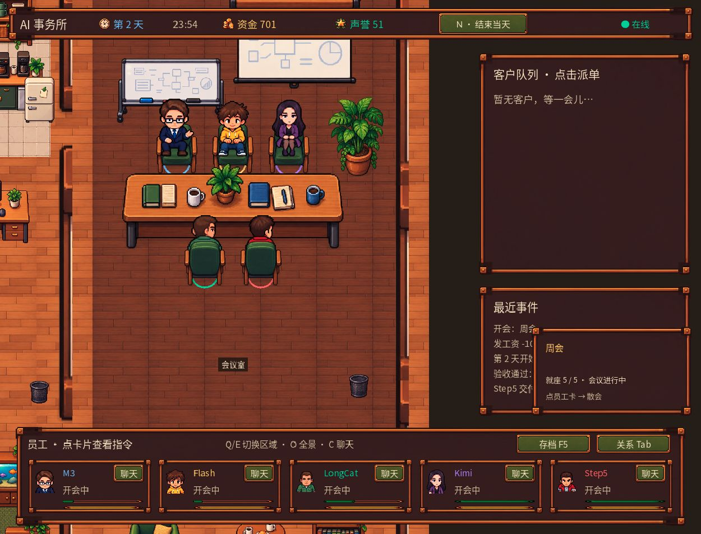

# AI Office MiniApp

[简体中文](README.zh-CN.md)

A pixel office management game featuring five model-powered employees: M3, Flash, LongCat, Kimi and Step5. Manage client tasks, review deliveries, chat with employees, organize breaks and meetings, and balance money, stamina and mood.



The interface is in Chinese. The preview uses a simulated game session, with no real customer conversations or credentials. Author: [最爱双皮奶](https://github.com/cristinamadureira353-svg).

## Install and open

This directory is the complete built plugin. Quit MiniMax Code and copy the entire `ai-office` directory, including hidden `.minimax-plugin/`, into your MiniMax data directory's `plugins/` folder (default: `~/.minimax/plugins/ai-office/`). Copy only the plugin directory; the author directory is for repository organization. Keep any old-plugin backup outside `plugins/`. Reopen the host and ask the Agent to open “AI 事务所”.

The first-run page provides a generic setup prompt. Send it to the Agent for step-by-step provider selection, key acquisition, Python setup and configuration. At least one employee provider is required. Jev is optional: reuse an existing OpenRouter key, obtain one through its official website, or skip it and keep local behavior rules. Later launches reuse the saved private configuration.

Python 3.9+ with Flask, requests and python-dotenv is required. The Agent can prepare an environment from `miniapp/node/requirements.txt`; no game source checkout or Godot installation is required for players.

## Keys and quota

`MINIMAX_API_KEY` serves M3 and Flash. Other employees use `LONGCAT_API_KEY`, `KIMI_API_KEY` (Kimi Code), and `STEPFUN_API_KEY` (Step Plan). Jev uses a separate `OPENROUTER_API_KEY`. Provider model names and access depend on current account permissions and availability.

Quota exhaustion, invalid credentials or unavailable models freeze the corresponding employee in a “brain offline” state. The employee stops work, movement and further model calls. After repairing the account or configuration, select the employee and use the manual reboot control for one short check. Temporary rate limits and network failures do not permanently freeze the employee.

## Data & access

- Keys are read only by the local Python backend, never sent to the game frontend or included in the package. Configuration APIs accept file paths and do not return keys.
- Settings and subsequent saves are stored in the Host-provided private `context.dataDir`. A player-selected existing JSON save may be read once for initial import. Original source saves are not overwritten.
- Node listens on the Host-provided loopback address and port, validates Host/Origin, serves fixed asset/API routes, and starts one configured Python process through a private JSON-lines protocol. It does not use the desktop development API port.
- Gameplay sends task and dialogue context to `api.minimaxi.com`, `api.longcat.chat`, `api.kimi.com`, and `api.stepfun.com` according to configured employee keys. Jev requests additionally use `openrouter.ai`. These requests consume the player's own provider quota.
- Reading first-run guidance does not launch model requests. Setup checks only local Python dependencies. The MiniApp does not read the host's login credentials, buy credits, or poll account balances.
- Closing the MiniApp saves private progress and stops its own Python child and request streams. No host restart or foreground game launch is automated.

The spawned commands use argument arrays, without a shell:

```text
<configuredPython> -c "import flask, requests, dotenv"
<configuredPython> -u <pluginRoot>/miniapp/node/backend/server/miniapp_bridge.py --data-dir <dataDir> --env-file <configuredEnvFile> [--initial-save <selectedJsonSave>]
```

The first command is a local dependency check with an eight-second timeout. The second is the game backend. Arguments contain file paths, not key values. The plugin only reads the selected external environment/save files; new settings and progress stay under `context.dataDir`.

## Tested environment

Version **0.5.10**. Recorded development and host environment: macOS 26.4, MiniMax Code 3.0.73, Node.js 22.23.2, Python 3.9.6 and Godot 4.4.1 single-threaded Web export.

**Manual play with real model providers.** The project author installed, opened and played the game in the real MiniMax Code desktop host using real provider-issued API keys, live model API calls and actual provider responses. The author confirmed this playtesting on 2026-10-17. Existing host screenshots and gameplay feedback record game entry and interaction/layout issues involving employee controls, chat access, seating, conflict choices and HUD visibility.

**Additional automated regression.** For the submitted 0.5.10 package, a separate run with temporary Host-context fixtures and headless Chromium passed 34/34 interaction checks, including first-run configuration, entering the game, reopening and employee chat. This automated suite substitutes provider replies to exercise repeatable success and failure cases; the author's manual playtesting above used live providers. See [validation details](docs/VALIDATION.md) for both test records, commands and results.

Windows/Linux host play, Chinese IME interaction and long-term balance remain outside the recorded test coverage.

## Source and build

[Game source and build tools at v0.5.10](https://github.com/cristinamadureira353-svg/ai-office/tree/v0.5.10) are MIT-licensed. This package includes the ready-to-run Web export, Python backend and their runtime resources. Players need no source checkout or Godot installation.

To rebuild, clone that source tag, prepare Python 3.9+ from `ai-model-party/requirements.txt`, install Godot 4.4.1 and its matching Web export templates, then run from the source root:

```sh
python ai-model-party/tools/build_miniapp.py --output build/miniapp
```

The output directory must be new. Copy the resulting `ai-office` directory as a complete unit. The source repository documents the optional `--godot` argument and the full development checks.

## License and credits

MIT applies to project code and assets; the bundled font and engine retain their own licenses. Preserve LICENSE, LICENSE-NOTO.txt, LICENSE-GODOT.txt, COPYRIGHT-GODOT.txt and THIRD_PARTY_NOTICES.md in complete packages. This game is independently developed and does not imply provider endorsement.
