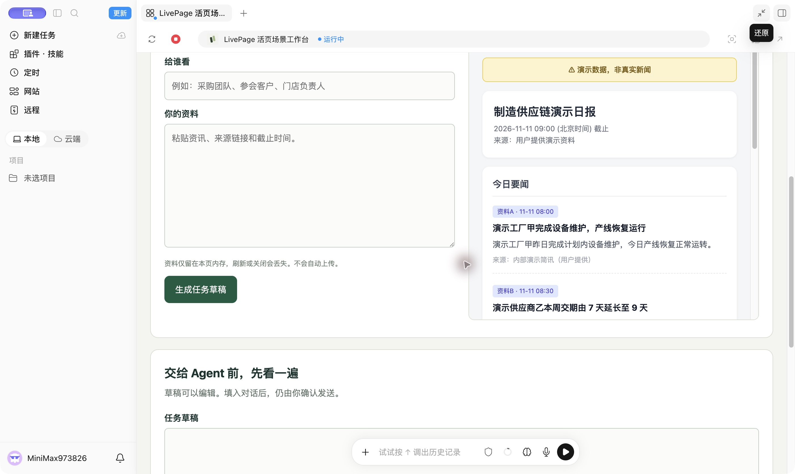
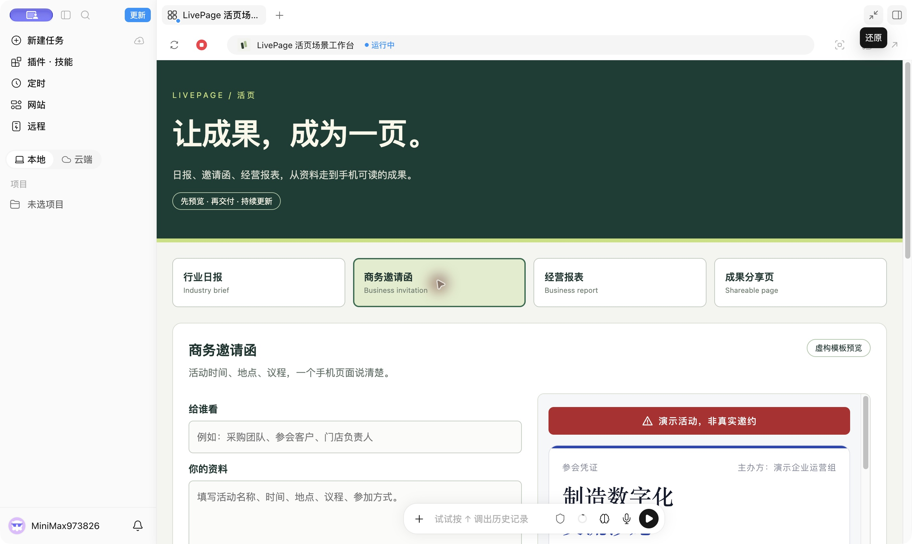
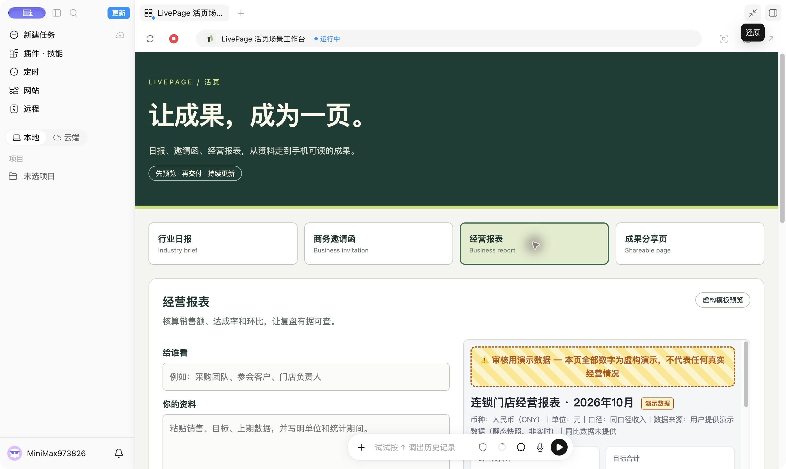

# LivePage Workbench · 1.0.0

[简体中文](README.zh-CN.md)

**Open this MiniApp when you want to preview a daily brief, business invitation, store report, or shareable-page workflow and prepare a task for your Agent.**

Turn finished work into a page people can read on their phone, then keep the same link updated.

## What it does

Choose one of four scenarios, inspect a bundled synthetic template, enter your source material and audience, and generate an editable task brief. The brief asks the Agent to produce a local HTML preview first. Clicking **Add to current chat** requests the Host's confirmation and appends only to the unsent draft. You still review and send it. Copy is available when the Host bridge is unavailable.

The package bundles four focused skills: industry daily brief, business invitation, business report, and general page delivery. Online publication is optional, requires an authorized LivePage Connector, and follows the scope the user requests. The MiniApp itself does not publish, read conversations, run Agent turns, or call tools.

Draft material exists in page memory only and is lost on reload or close. Do not use this as durable storage. A scene change preserves the existing task draft; Generate replaces it explicitly. The shareable-page scene has no separate preview template.

## Scenario previews

Native MiniMax Code screenshots; all data is synthetic.

## Install and open

Copy this **entire** directory (including `.minimax-plugin`) to `<dataDir>/plugins/livepage-workbench/`, following the official MiniMax Code installation guide. The default data directory is `~/.minimax`. Restart MiniMax Code, enable the plugin and ask: **Open LivePage Workbench** / **打开活页场景工作台**. This is a community MiniApp with a distinct ID; it does not overwrite the existing marketplace `livepage-plugin`.

No build step, npm install, remote font, API key, or external runtime dependency is needed. A MiniMax Code version supporting MiniApps is required; the optional Connector connection status is displayed by clients from 3.1.9. The workbench feature-detects `message.append`.

## Tested environment

- Local validation environment: macOS, Node.js 24.14.0.
- Runtime route and disposal checks: `npm test` (recorded results in the contribution validation report).
- Official contract validation targets MiniMax Code 3.1.11 at community commit `36971740ad9ec178c5ec30e721ab23928d22192c`.
- MiniMax Code 3.1.14 (build 3.1.14.218), macOS: local install/open, all four scene switches, all three sandboxed template bodies, source-to-brief generation, and Host confirmation/cancellation were verified in the native client on 2026-11-18. Screenshots use fictional data.
- Successful Host approval and final append-to-draft were not confirmed; cancellation and the confirmation preview were confirmed. The PR remains draft pending this last integration check.
- No Windows or real-device WeChat test is claimed. The existing separate marketplace plugin v1.1.0 was verified visible with one App and four Skills on 2026-11-18.

## Data & access

- **Files read:** only the explicitly allowlisted bundled client files and three templates under `miniapp/client/`, loaded at startup. No user files, Host files, conversation files, environment variables or credentials are read by the runtime.
- **Files written/state:** none. User material and draft text stay in page memory until reload/close. Nothing is saved to `dataDir`, browser storage or logs.
- **Network:** no outbound requests. Only the Host-assigned loopback HTTP listener serves bundled content. External website/privacy links open only when clicked; the MiniApp does not attach task material to them.
- **Processes:** the Host runs the Node entry; no child processes or shell commands are spawned.
- **Agent turns/conversations:** none. The page calls only `message.append` following a click and Host confirmation. It cannot send the draft or read chat history. After the user sends, the ordinary Host Agent executes the selected skill under its own permissions, which can include file or shell tools.
- **Tools/Connector:** no tools are called by this MiniApp and no `toolAccess` or `hostConnectorAccess` is requested. `livepage.app.json` identifies the optional existing LivePage Connector; OAuth sign-in is managed by the Host. Online delivery by the chat Agent uploads only task-selected content under the user's authorization; service endpoints and data retention follow that Connector and [LivePage's privacy policy](https://getlivepage.com/privacy).
- **Devices/Host navigation:** no microphone, camera, notification, or Host navigation access; no telemetry or analytics code.
- **Clipboard:** write only after Copy is clicked; no clipboard reads. If copying fails, the draft is selected for a normal keyboard copy.
- **Templates:** fictional examples; preview frames use an empty sandbox and cannot execute scripts or submit forms. Inputs are inserted as plain text, never as executable HTML.

## License and attribution

New workbench code, instructions and documentation are MIT licensed; see [LICENSE](LICENSE). The runtime lifecycle follows the MIT-licensed [official hello-miniapp example](https://github.com/MiniMax-AI/MiniMax-Code-MiniApps/tree/main/examples/hello-miniapp). Original example copyright: MiniMax. Template source and reuse notes are in each skill's `references/source.md`; no third-party photos, fonts or libraries are bundled. Names/icons identify LivePage and confer no trademark rights or hosted-service license.

Maintained by 广州二四网络科技有限公司 · [getlivepage.com](https://getlivepage.com/) · liz@24haowan.com.
