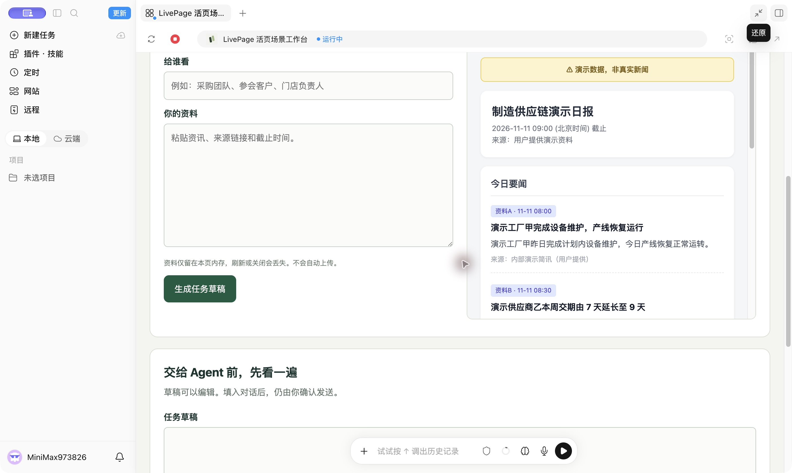
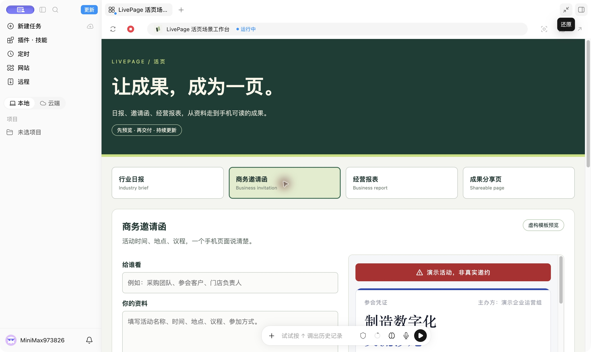
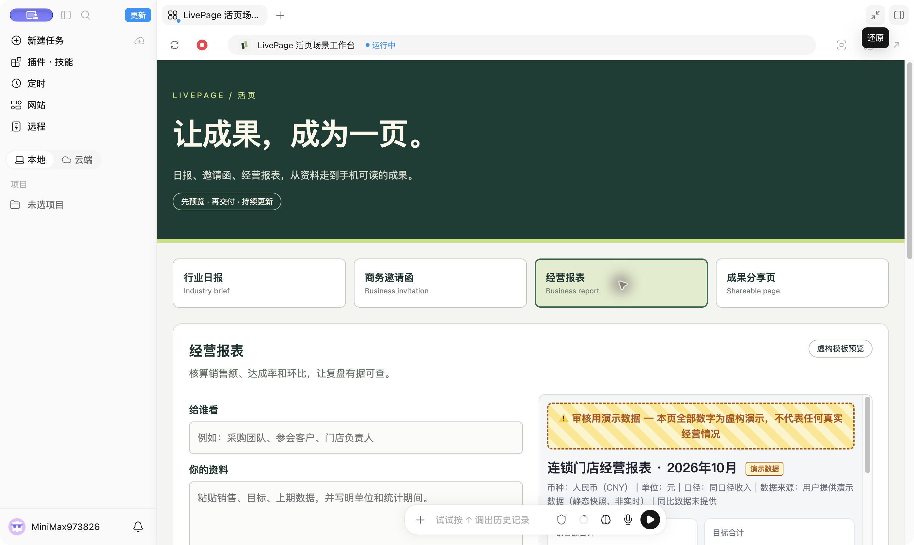

# 活页场景工作台 · 1.0.0

[English](README.md)

**需要预览日报、邀请函、经营报表模板并整理交付任务时，打开活页场景工作台。**

AI 做好的成果，一个链接交付，后续沿用原链接更新。

选择行业日报、商务邀请函、经营报表或成果分享页，查看虚构模板，填写资料与读者，生成可编辑任务草稿。点击“填入当前对话”后由 MiniMax 宿主确认，只会填入未发送的草稿；仍由你检查和发送。没有宿主接口时可复制草稿。

| 场景 | 一句话价值 |
| --- | --- |
| 行业日报 | 把资讯变成有来源、有截止时间的团队日报。 |
| 商务邀请函 | 时间、地点、议程，一个手机页面说清楚。 |
| 经营报表 | 核算销售额、目标达成率和环比，让复盘有据可查。 |
| 成果分享页 | 周报、方案、作品集，一个链接交付并持续更新。 |

## 场景截图

以下为 MiniMax Code 原生预览，全部使用虚构数据。

## 安装与使用

按官方安装说明，将整个目录（包括隐藏的 `.minimax-plugin`）复制到 `<dataDir>/plugins/livepage-workbench/`；默认数据目录是 `~/.minimax`。重启 MiniMax Code，启用后说“打开活页场景工作台”。无需构建或安装依赖。

这是独立社区 MiniApp，不覆盖市场中的 `livepage-plugin`。内含四个技能和可选的 livepage App 引用；客户端 3.1.9 起可显示连接状态。工作台不直接调用连接器；需要在线发布时，另在宿主连接活页账号，由对话 Agent 按用户授权范围执行。离线模板与任务草稿不依赖活页连接。

资料仅在本页内存中，刷新或关闭会丢失。切换场景保留已有草稿，点击“生成任务草稿”才替换。成果分享页场景不另设模板预览。

## 验证范围

本地环境 macOS／Node.js 24.14.0。官方规范按仓库提交 `36971740ad9ec178c5ec30e721ab23928d22192c`（MiniMax Code 3.1.11）检查。MiniMax Code 3.1.14（build 3.1.14.218）macOS 已验收原生安装与打开、四场景切换、三个模板正文、资料生成草稿及宿主确认弹窗与取消路径。批准后最终写入对话草稿尚未核实，PR 先保持草稿状态。未声称 Windows 或真机微信验证。

## 数据与权限

运行时只读取随包的网页与模板；无用户文件／宿主文件读取，无持久化写入，无外网请求、子进程、遥测。页面不读取会话、不自动运行 Agent、不调用 MCP，不申请 `agentAccess`、`toolAccess`、`hostConnectorAccess`、设备或导航权限。复制仅写剪贴板，不读取。官网与隐私链接仅在点击时打开，不携带任务资料。

填入对话要经宿主确认，用户仍需发送；发送后普通 Agent 的文件、shell 和连接器权限由宿主管理。草稿默认要求先交付本地 HTML；在线发布另需授权，不自动上传或把内部资料公开。模板均为虚构演示，在空 sandbox 中预览，无脚本和表单提交。

详细说明见英文 README 的 Data & access 与 [活页隐私政策](https://getlivepage.com/privacy)。新代码与指令采用 [MIT License](LICENSE)，模板来源保存在各技能 `references/source.md`，名称图标不授予商标权，在线服务不包含在开源许可内。

维护：广州二四网络科技有限公司 · liz@24haowan.com · https://getlivepage.com/
