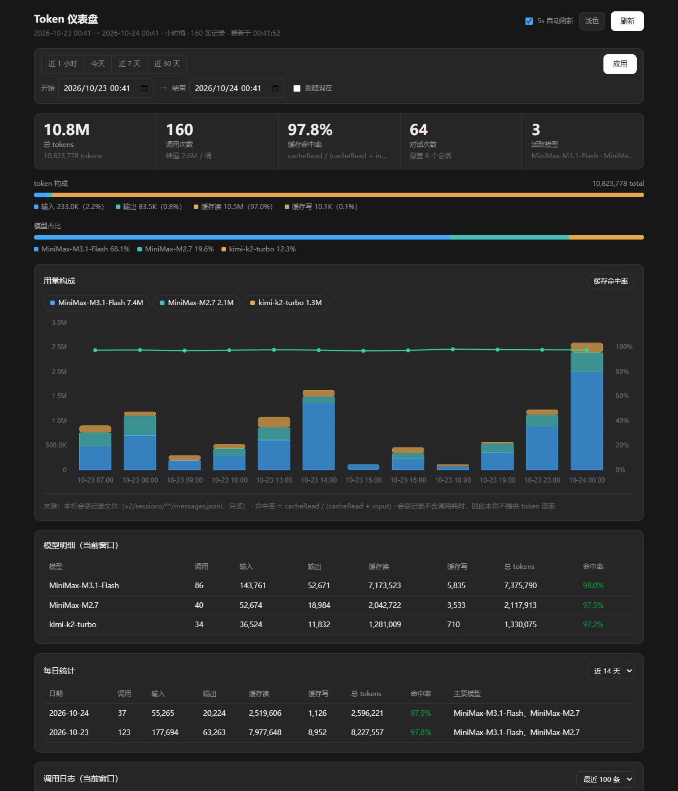

# Token 仪表盘

[English](README.md) | 简体中文

一个跑在你自己机器上的 MiniMax Code token 用量看板。它只读客户端为**你自己的对话**写下的会话记录——和官方画廊里那块 token 用量看板同一个数据源——别的什么都不读：不打开 runtime 的内部数据库、不扫观测日志、不读配置文件。

作者：[HaneWari](https://github.com/HaneWari) · 版本：`2.0.0` · 许可：[Apache-2.0](LICENSE)



*预览图使用合成会话与用量数据。界面目前是中文。*

## 你能看到什么

- **用量趋势** —— 按模型堆叠的柱状图，上面叠一条缓存命中率曲线。窗口拉长时，桶会自动从分钟切成小时、再切成天。
- **五张明细表** —— 模型明细、每日统计、**逐次调用台账**、**对话（turn）明细**、会话用量排行。
- **对话明细** —— 你每问一次就是一行：所属会话、是否收尾、这一轮用了几次模型调用、用了多少 token。还在进行中的对话会标成"进行中"并实时增长——**不需要**先关掉会话。
- **逐次调用台账** —— 每一次模型调用：时间、模型、四类 token、这次调用怎么结束的。
- **时间窗口** —— 近 1 小时 / 今天 / 近 7 天 / 近 30 天，或任意自定义起止时间。时间条排成两行，原生日期选择器不会挡住"应用"按钮；在时间输入框里按回车同样生效。
- **5 秒自动刷新**，另有手动刷新按钮。切换窗口不会让表格空白、也不会干等：旧数据会一直留在屏幕上直到新值到达，迟到的旧窗口响应会被丢弃，不会覆盖更新的结果。

## 它读什么，以及这意味着什么

看板只读一种文件：

```text
<dataDir>/v2/sessions/<YYYY>/<MM>/<DD>/<session>/messages.jsonl
```

transcript 的每一行是一条消息。assistant 消息带着 runtime 为这次调用记下的 token 数：

```json
{ "role": "assistant", "model": "MiniMax-M3.1-Flash", "timestamp": 1792769579471,
  "stopReason": "toolUse",
  "usage": { "input": 1204, "output": 331, "cacheRead": 61044, "cacheWrite": 0, "totalTokens": 62579 } }
```

这就够算出这个看板展示的一切：token 用量、模型分布、按天趋势、逐次调用明细、对话归组与对话状态。

而 transcript **不含**两样东西，所以这个看板也**不展示**两样东西：

- **没有耗时。** transcript 里没有 decode 耗时、也没有请求耗时，因此算不出 token 速率。本版本不再提供输出速率，页面会直接说明，而不是留一列空值。
- **没有路径。** transcript 里没有工作区目录，所以会话排行里没有任何绝对路径。

另外两样即使数据里有、看板也**故意不展示**：

- **不展示消息正文。** 对话明细用所属会话来标识一轮，而不是你的原话。每轮用户消息前 200 字的预览已经移除。
- **不展示模型显示名。** transcript 只记录原始模型 id，所以表里写的是 `MiniMax-M3.1-Flash`，而不是去客户端配置文件里查出来的名字。

## 覆盖率：transcript 并没有留下全部

会话记录不是客户端全部动作的完整账本。长对话被压缩（compaction）时，runtime 会把被压缩的那一段 transcript 换成一段摘要，那一段里的调用就**不在任何** `messages.jsonl` 里了。

在开发用的参考机器上（2026-10-23 实测），看板数到 **151 个会话、8,640 次调用**，覆盖 2026-06-17 至今；而客户端自己的内部账本——也就是这个看板**不去读**的那份——在它自己保留的窗口（2026-09-28 至今）里有 **13,124** 次调用。

把两边限制在**同一个窗口**（2026-09-28 至今）里比：

| | 会话记录 | 内部账本 | 覆盖率 |
| --- | --- | --- | --- |
| 调用次数 | 8,422 | 13,124 | **64.2%** |
| token 总量 | 1,133,235,393 | 2,099,198,213 | **54.0%** |

差的就是被压缩掉的那些调用，不是统计口径错了。反过来也有：账本最早的一行是 2026-09-28，比会话记录晚三个多月——**它自己已经过了保留期**，那段时间的 220 次调用只剩会话记录还留着。

所以：**这些数字是"你的会话记录里还留着多少"，不是账单。** 计费与配额仍以客户端自己的"用量"页面为准，那是服务端算的。

## 为什么是这块看板

- **只读你自己的会话记录。** 不碰内部数据库、不扫观测日志、不读客户端配置。和官方画廊的 `mcode-token-usage-board` 同一个数据源，多两样东西：**逐次调用台账**，以及**带实时状态的对话（turn）表**。
- **增量读取，而不是每次重读。** 参考机器上全部 transcript 约 **344 MiB** JSON。读取器为每个文件记住字节游标，只解析上次之后新追加的内容：一次全量扫描约 **2.0 秒**，而之后的每次刷新只要 **170 毫秒**左右。游标存在插件自己的数据目录里，所以连 Mini App 冷启动都是接着上次继续，而不是从头再读一遍。
- **不需要 Python，不拉子进程，没有额外依赖。** 纯 Node，除了一份内置的 Chart.js 副本外没有第三方运行时代码。上一版为了 `node:sqlite` 准备的子进程回退，随着数据库一起没了。
- **完全本机。** Mini App 在 `127.0.0.1` 上只提供自己那一页和它自己的 API 路由，不访问任何远端主机，除了自己的源之外不发任何请求。

## 安装

把整个目录复制进 MiniMax Code 数据目录。默认 `<dataDir>` 是用户主目录下的 `.minimax`（`~/.minimax`），默认路径是：

```text
<dataDir>/plugins/token-meter-board/
```

| 系统 | 目标路径 |
| --- | --- |
| Windows | `C:\Users\<你>\.minimax\plugins\token-meter-board` |
| macOS | `/Users/<你>/.minimax/plugins/token-meter-board` |
| Linux | `/home/<你>/.minimax/plugins/token-meter-board` |

务必带上隐藏的 `.minimax-plugin` 目录——插件靠它被识别。如果你设过自定义数据目录（`MINIMAX_DATA_DIR`），请放到那个目录下的 `plugins/` 里。

重启 MiniMax Code，确认插件已启用，然后打开 **Token 仪表盘**，或者直接让 Agent 帮你打开。

## 使用

选一个窗口（预设或自定义），然后看趋势、KPI 条和下面五张表。模型筛选条同时作用于图表和表格；会话排行与每日统计各有自己独立的范围选择器，改主窗口不会影响它们。页面每 5 秒刷新一次，刷新按钮可立即重载。

几个示例提问与对应结果：

- **"打开 Token 仪表盘"** → 在当前窗口打开看板。
- **"查看我的模型用量趋势"** → 按模型堆叠的趋势图与缓存命中率曲线。
- **"哪个模型消耗最多？"** → 模型明细表，含每个模型的调用数、token 与缓存命中率。

看板还提供 **让 Agent 分析此窗口**：把当前窗口的总量、调用次数、缓存命中率与对话数追加到聊天输入框，方便你对着刚看到的同一组数字继续追问。

## 数据与访问

**读取的文件（只读，从不修改）：**

| 路径 | 用途 |
| --- | --- |
| `<dataDir>/v2/sessions/**/messages.jsonl` | 每个会话的 transcript：每次模型调用的 token 数、模型 id、时间戳、turn id、结束方式。 |
| `<dataDir>/v2/sessions/**/manifest.json` | 会话目录对应的 session id。 |

**别的什么都不读。** runtime 的内部数据库（`v2/sqlite/runtime-state.sqlite`）、观测日志（`v2/observability/logs/`）、配置文件（`config.yaml`）**都不会被打开**，任何模式都不会。

路径从宿主注入的 `context.dataDir`（当前生效的 MiniMax Code 数据目录）解析，找不到时回落到 `~/.minimax`。**transcript 的目录结构不是公开 API**——它是客户端自己的存储，未来的客户端版本可能改变它。真变了的时候，看板会明确报错，而不是给你一块空白的看板。

**页面上会显示什么。** 看板渲染的是本机真实数据，所以截图里可能出现：

- **会话标题** —— 该会话里你第一条消息的前 80 个字符，注入的 system reminder 会被去掉。这条规则与官方画廊的 token 用量看板一致。消息正文不会被加载，也不展示任何逐轮预览。
- **会话 id 与模型 id。**

数据全部留在本机与页面上。如果打算分享截图，请记得里面会有你自己的第一条提问和模型列表。

**会写入什么。** 只有一个文件：扫描游标 `<插件数据目录>/session-scan-state.json`，在 transcript 发生变化时原子写入（先写临时文件再改名）。里面是文件路径、会话 id、会话标题与逐次调用的计数，好让下次启动接着走而不是从头再读一遍。它只是缓存：删掉它最多多花一次全量扫描。页面在你的浏览器 `localStorage` 里只存一样东西：主题选择，键名 `tmb-theme`。

**网络：** 无。Mini App 只在 `127.0.0.1` 上提供自己那一页和自己的 API 路由，不访问任何远端主机，除了自己的源之外不发任何请求。它接受的查询参数是逐端点显式白名单——其他任何东西（包括任何看起来像数据目录覆盖的参数）在进入查询层之前就被丢弃。`Host` 头不指向回环地址、或 `Origin` 头不指向本监听端口的请求，一律以 403 拒绝。

**子进程：** 无。不派生任何进程，也不使用 shell。

**Node.js：** 任何自带 `node:fs/promises` 与 `node:http` 的 Node.js 即可——不需要实验特性开关，也不需要原生模块。测试时使用的内置运行时是 Node.js v24.18.0。

## 指标口径

| 指标 | 定义 |
| --- | --- |
| 总 tokens | `输入 + 输出 + 缓存读 + 缓存写`——transcript 记录的四类。transcript 里没有"推理"这一类，因此不在求和内。 |
| 缓存命中率 | `缓存读 / (缓存读 + 输入)`——提示词里命中缓存的比例。缓存写不进分母。 |
| 对话（turn） | 一条用户消息，加上 Agent 在回答它之前所做的若干次模型调用。 |
| 对话状态 | 取该轮最后一次模型调用的结束方式：`stop` → 已完成，`toolUse` → 未收尾，`aborted` → 已中止，还没有模型调用 → 进行中。 |
| 调用次数 | 带 usage 块的 assistant 消息条数。已被压缩出 transcript 的调用看不到。 |

会话被重建时，同一条消息可能出现在多个 transcript 里，所以调用按 message id 全局去重。

客户端界面显示的是它自己当前会话的数字。看板用的是你所选窗口内的 transcript 记录，两者可能不一致：界面统计的是 runtime 记下的全部调用，看板统计的是 transcript 里仍然留着的那些。

## 测试环境

- MiniMax Code Desktop **3.1.4**（build 186）、Windows 11（10.0.22631，x64）
- 内置 Node.js **v24.18.0**
- 已在桌面客户端中验证：插件安装、窗口切换、自定义起止窗口、逐次调用台账、对话实时增长、自动刷新、明暗主题，以及找不到会话记录时的报错路径。
- macOS 与 Linux **未**验证。代码中没有平台相关逻辑——数据路径由 `context.dataDir` 解析——但仍请把其他平台当作未测。

本版本的完整验证记录——包校验器结果、与内部账本的覆盖率测量、同机性能测量——见 [`docs/validation.md`](docs/validation.md)。

## 局限

- 这是**本机观察工具**，不是账单。计费与配额以产品自己的"用量"页面为准，那是服务端计算的，可能滞后。
- 数字只覆盖你的会话记录里仍然留存的内容。被压缩掉的调用、以及别的机器上的用量，在这里都看不到。
- transcript 格式是客户端内部实现，可能随时改变。结构一变，看板会如实报告，而不是显示一堆 0。
- 没有 token 速率，也没有工作区路径，原因如上。

## 第三方组件

- [Chart.js](https://www.chartjs.org/) v4.4.3 —— 以离线副本形式内置于 `miniapp/client/vendor/chart.umd.min.js`。MIT 许可，© Chart.js Contributors。完整许可文本随包提供，见 `miniapp/client/vendor/LICENSE-chartjs.txt`。

## 源码结构

```text
miniapp/
  client/index.html              整个页面：结构、样式与前端脚本
  client/vendor/                 内置的 Chart.js（MIT），供离线使用
  client/vendor/LICENSE-chartjs.txt  内置 Chart.js 副本的完整 MIT 许可文本
  node/server.mjs                HTTP 服务、路由、回环地址校验
  node/lib/sessions.mjs          transcript 读取器：增量解析、去重、聚合
  node/lib/queries.mjs           窗口、趋势、总览、会话、每日、调用与对话查询
```

不需要任何构建步骤：页面与 Node 服务直接使用。

## 许可

[Apache-2.0](LICENSE)——完整文本见该文件。内置的 Chart.js 副本保留其自己的 MIT 许可，文本见 `miniapp/client/vendor/LICENSE-chartjs.txt`。
