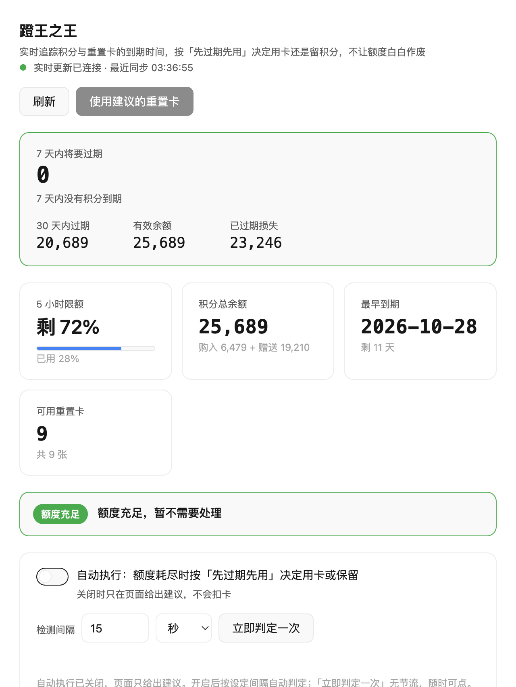
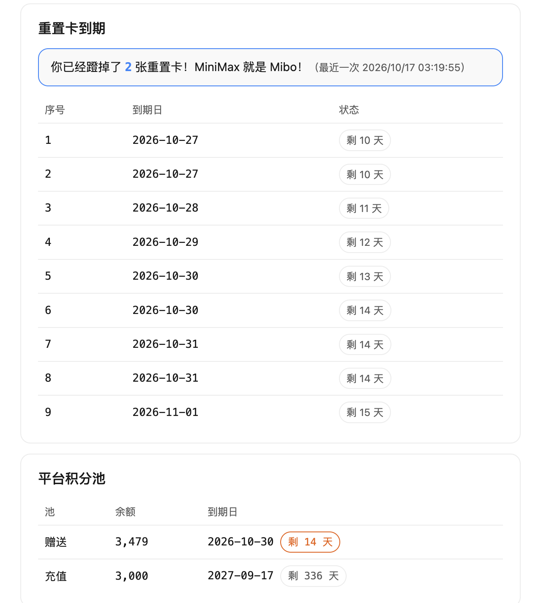

<div align="center">


# 蹬王之王 · Expiry Sentinel

**Track what expires first, then spend exactly that.**

English | [简体中文](README.zh-CN.md)

[](LICENSE)

</div>

---

MiniMax Code credits and reset cards both expire on a timer. Left alone, the
shortest-dated balance quietly evaporates while you keep using the one that
lasts longest. **蹬王之王** shows every balance with its expiry date, then spends
whichever runs out first — so nothing is wasted and nothing expires unused.

## Screenshot

<div align="center">

</div>

The header answers the only question that matters: *how much is about to expire?*
Below it, the 5-hour quota, total credit balance, the next expiry, and how many
reset cards are left.

<div align="center">

</div>

Credit detail, reset cards by expiry, and platform credit pools each get their own
table, sorted by the date they lapse.

> **Note on the screenshots.** They were captured from a real account, so the
> balances, dates, and totals in them are genuine numbers rather than samples.
> No card IDs are shown anywhere in the UI.

## How the decision works

When the 5-hour or weekly quota runs out, requests start spending credits. That is
the moment to act, and the app compares two dates:

| Situation | Decision | Why |
| --- | --- | --- |
| Reset card expires **before** the oldest credit | **Spend the card** | Restores the quota, so the longer-lived credit is preserved |
| Credit expires **before** the card | **Keep the card** | Let the credit lapse first; the card still has value later |
| Quota not exhausted | **Do nothing** | No credits are being burned yet |

Both the Node service and the background daemon implement this rule, and a
parity test compares them character by character so the two cannot drift apart.

## Install

Copy this entire directory — including the hidden `.minimax-plugin` directory —
into your MiniMax Code data directory. By default that is `.minimax` in your home
folder, so the default path is:

```text
<dataDir>/plugins/expiry-sentinel/
```

If you configured a different data directory, use that instead. Restart MiniMax
Code, confirm the plugin is recognized and enabled, then open **蹬王之王**, or ask
the Agent to open it.

## Use it

**Watch only (default).** Open the board and read it. Nothing is spent.

**Auto-spend inside the page.** Turn on 自动执行 and pick an interval (seconds or
minutes). The page decides and spends on that interval while it stays open.
「立即判定一次」 always triggers one check immediately, with no throttle.

**Auto-spend around the clock.** Turn on 后台服务. This installs a launchd agent
that keeps running with the page closed, and starts at login on macOS. The page
shows its PID and lets you stop it.

Both paths share one decision rule, and the server deduplicates by idempotency
key, so a card is never spent twice even if both are active.

## Background daemon (optional)

The `daemon/` directory contains a Rust rewrite of the same decision logic,
built for low overhead while it runs unattended:

```bash
cd daemon
cargo build --release
```

It needs a token. It obtains one through the desktop app's OAuth lease socket
(`~/.minimax/run/mcode-auth-lease-v1.sock`), so it must run while MiniMax Code is
running. Set `MCODE_TOKEN` to use a fixed token instead.

Typical resident memory is under 1 MB, and it polls one endpoint per cycle and
caches the rest by how often each changes.

## Tested environment

- MiniMax Code desktop app on macOS (Apple Silicon)
- Verified against a live account: quota polling, credit detail, card listing,
  card spending, and the auto-spend path that fired on quota exhaustion
- Cross-platform behaviour and other client versions are **unconfirmed** — the
  daemon path uses launchd and has only been exercised on macOS
- The endpoints are private APIs. They may change without notice, and the app
  will report a parse or read error rather than invent data when they do

## Data & access

**Files read.** The desktop app's OAuth lease capability file
(`~/.minimax/run/mcode-auth-lease-v1.cap`) and the lease socket beside it, to
obtain the same session the desktop app uses. These paths are an internal
implementation detail of the client, not a documented interface; the background
daemon will stop working if they change.

**Files written.**

- `~/.config/mcode-reset-card/token` — only when you provide `MCODE_TOKEN`
- `~/.config/mcode-reset-card/bg-state.json` — the daemon's record of which cards
  it already attempted, so a restart cannot spend the same card twice
- `~/Library/LaunchAgents/com.local.mcode-reset-card.plist` — written only when you
  enable 后台服务

**Network hosts.** Two, both MiniMax:

- `https://www.minimaxi.com` — quota, platform credit pools, reset cards
- `https://agent.minimaxi.com` — MiniMax Code credit detail, membership summary

**Processes spawned.** `launchctl load` / `unload` for the background service,
and `launchctl list` to read its status. Nothing else.

**Agent turns.** None. The app never invokes the Agent.

**Secrets.** The session token lives only in the Node process and the daemon.
It is never placed in HTML, client JavaScript, logs, or API responses.

**Spending is a real write.** Enabling auto-spend spends real reset cards on your
account. Start with the dashboard in watch-only mode.

## License

MIT — see [LICENSE](LICENSE).
