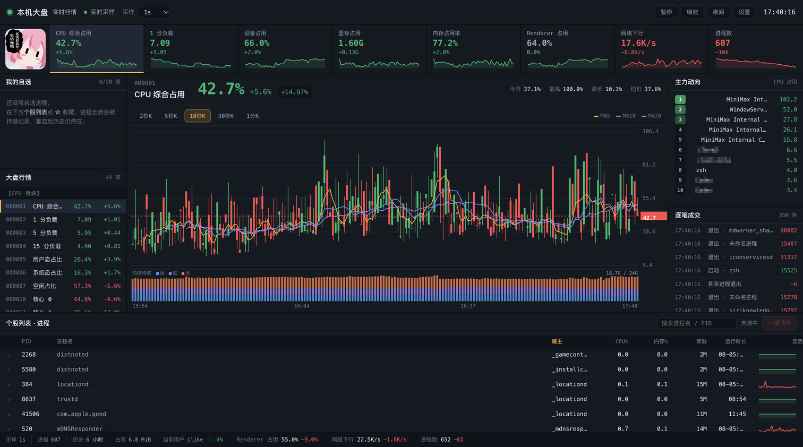
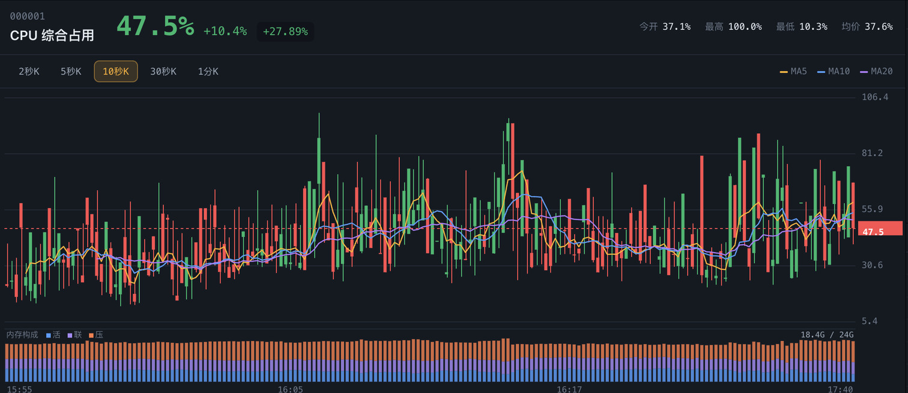
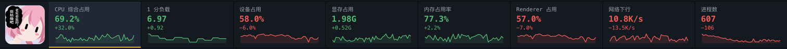
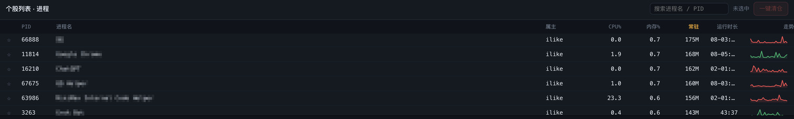

# 本机大盘 · Local Market Board

A system monitor that renders your machine in the visual language of a Chinese A-share
trading terminal. CPU, GPU, temperature, memory, disk, network and every running process
become listed stocks, each with live candlesticks, moving averages, an index strip, a
watchlist, a leaderboard and a trade tape.

[简体中文](README.zh-CN.md)

## Screenshots

Application names in the leaderboard and the process table are mosaicked. Everything else is
live output from the machine described under **Tested environment**.

## Platform support

| Platform | Collection | Fixed metrics | Status |
| --- | --- | --- | --- |
| macOS | `vm_stat` / `ioreg` / `netstat` / `ps` | 34 + per-core CPU | Verified on real hardware |
| Windows | Long-lived PowerShell + performance counters | 34 + per-core CPU | See the note below |

**Windows verification scope.** The process-collection path was executed on macOS under
PowerShell 7.6.9 through the cross-platform .NET implementation. Memory, GPU, disk,
network and thermal readings depend on Windows-only `PerformanceCounter`,
`Get-CimInstance` and `nvidia-smi`; they were tested end to end against samples in the
real output format and have yet to run on a physical Windows machine.

GPU temperature, GPU power draw and the ACPI thermal-zone temperature are Windows-only.
On macOS the three codes in the 温度 board stay empty.

## Install

Requires the MiniMax Code desktop app, 3.1.2 or later, because the package declares
`surface.window`.

1. Copy this whole directory to `~/.minimax/plugins/kurumi-monitor/`, including the
   hidden `.minimax-plugin/` directory.
2. Restart MiniMax Code and confirm the plugin is recognised and enabled.
3. Say `打开本机大盘` in a conversation, or start it from the plugin list.

The window opens at 1480x940 and asks for at least 1280x720. Below that width the page
shows a hint to pop the panel out into its own window.

## Using it

- **Click a code in 大盘行情** to switch the main chart. Candles aggregate at
  2s / 5s / 10s / 30s / 1min.
- **Click a row in the process table** to chart that process; its CPU share is the price.
- **Click ☆** to add a process to 我的自选. Its history keeps accumulating and survives
  a restart.
- **The search box** filters by process name or PID.
- **一键清仓** terminates the selected process after a confirmation dialog.

Red means up and green means down, following the A-share convention; the title bar
switches to international colours. Every change carries an explicit `+` or `−` sign, so
direction never depends on colour alone.

## Data & access

This Mini App runs locally under your own account. It declares no `agentAccess`,
`toolAccess` or `deviceAccess`, and requests no browser permission.

**Processes it spawns**

| Platform | Command | Purpose |
| --- | --- | --- |
| macOS | `vm_stat`, `ioreg`, `netstat`, `ps`, `sysctl` | memory pages, GPU counters, sockets, process table, core count |
| Windows | one long-lived `powershell.exe` running the bundled `collector.ps1` | performance counters, CIM classes, process table |
| Windows | `nvidia-smi` when present | GPU utilisation, VRAM, temperature, power draw |

Every child is spawned with `execFile` and an argument array. On Windows the collector
is started once and reused; its output is newline-delimited JSON.

**Files it reads**

- The process table and system counters listed above, through the commands above.
- `settings.json` in its own state directory, to restore the selected code, watchlist,
  period, theme and colour scheme.

**Files it writes**

- Samples and events under the system temporary directory:
  `$TMPDIR/kurumi-monitor/` on macOS, `%TEMP%\kurumi-monitor\` on Windows. Ticks are
  sharded into `ticks/YYYYMMDD-HH.jsonl`; events append to `events.jsonl`. The operating
  system reclaims these on its own schedule, and everything in them is derived data that
  the app rebuilds by sampling again.
- `settings.json` in its own state directory, holding the selected code, watchlist,
  candle period, theme and colour scheme.

Measured on the machine in **Tested environment**: about 88 KB per minute of samples, so
roughly 253 MB across 48 hours of continuous running.

**Processes it can terminate.** 一键清仓 sends `SIGTERM` to the selected process, or
`SIGKILL` when 强制清仓 is ticked. The button is enabled only for processes the current
user can signal, checked with `process.kill(pid, 0)`. The app's own process and the host
process are permanently protected.

**Network.** No outbound request of any kind. No remote fonts, no CDN, no telemetry. All
collection and rendering happen on the machine.

**Agent turns, conversations, tools, microphone.** None. The app never calls
`window.mcode.agent`, never reads a conversation, never invokes a tool and never opens
the microphone.

## Tested environment

| Item | Version |
| --- | --- |
| MiniMax Code | 3.1.10-preview.5019 |
| macOS | 26.5.2 (Darwin 25.5.0, arm64) |
| Node.js | 22.22.2 |
| PowerShell | 7.6.9, used to exercise the Windows branch |

Verified on macOS: all 44 codes render with live values, the six macOS probes complete a
round in 44–58 ms, a watchlist of 20 entries survives a restart of the runtime, and the
console reports no error. The Windows branch was exercised with a stub `powershell.exe`
feeding recorded frames, covering 29 assertions across memory, GPU, disk, network,
process and thermal parsing.

## Credits

The interface language and interaction spec were inspired by
[PerfTicker](https://github.com/QiuSui1145/PerfTicker) by **QiuSui** (QiuSui_Studio), a
single-file C# program that turns the Windows Task Manager into a stock terminal, released
under GPL-3.0.

This project is an independent implementation in JavaScript and Node, running inside the
MiniMax Code Mini App host. The two projects share no source code. GPL-3.0 is kept as a
tribute to the original author.

## Source

https://github.com/jzlikewei/Kurumi-monitor

## License

[GPL-3.0](LICENSE) © 2026 李白
