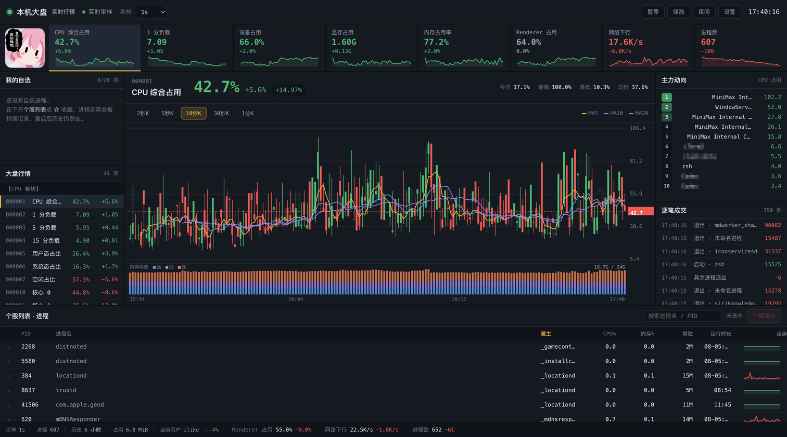
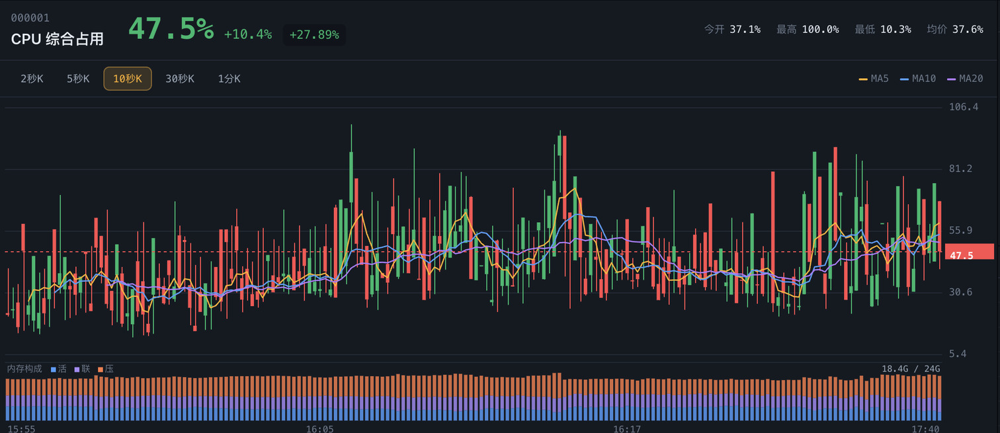
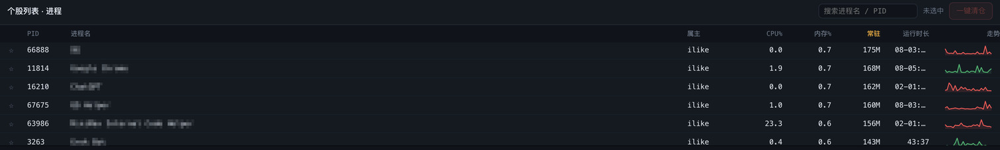

# 本机大盘

把系统指标搬进 A 股行情终端的界面语言。CPU、GPU、温度、内存、磁盘、网络与每一个
运行中的进程都成为一只「个股」，实时 K 线、均线、指数条、自选行情、主力动向与
逐笔成交一应俱全。

[English](README.md)

## 截图

主力动向与进程表里的应用名做了马赛克处理，其余内容是下方「测试环境」那台机器的实时输出。

## 平台支持

| 平台 | 采集方式 | 固定指标 | 验证状态 |
| --- | --- | --- | --- |
| macOS | `vm_stat` / `ioreg` / `netstat` / `ps` | 34 项 + 逐核 CPU | 真机实测 |
| Windows | 常驻 PowerShell + 性能计数器 | 34 项 + 逐核 CPU | 见下方说明 |

**Windows 验证范围**：进程采集链路在 macOS 上用 PowerShell 7.6.9 实跑验证过，走的是
.NET 跨平台实现。内存、GPU、磁盘、网络与温度几项依赖 Windows 专有的
`PerformanceCounter`、`Get-CimInstance` 与 `nvidia-smi`，用真实输出格式的样本做了
端到端测试，尚未在 Windows 真机上跑过。

GPU 温度、GPU 功耗与 ACPI 热区温度只在 Windows 上有值。macOS 上温度板块的三项留空。

## 安装

需要 MiniMax Code 桌面端 3.1.2 或更高版本，本包声明了 `surface.window`。

1. 把本目录整个复制到 `~/.minimax/plugins/kurumi-monitor/`，包含隐藏的
   `.minimax-plugin/` 目录。
2. 重启 MiniMax Code，确认插件已识别并启用。
3. 在对话里说「打开本机大盘」，或从插件列表里启动。

窗口默认 1480x940，最小 1280x720。视口窄于 1280 时页面会提示把面板弹出为独立窗口。

## 用法

- **点大盘行情里的品种**切换主图，K 线按 2 秒 / 5 秒 / 10 秒 / 30 秒 / 1 分聚合。
- **点进程表里的行**把主图切到那个进程，它的 CPU 占用就是这只「个股」的行情。
- **点 ☆ 加自选**，进程走势会被持续记录，重启后历史仍然在。
- **搜索框**按进程名或 PID 过滤。
- **一键清仓**终止选中进程，操作前有二次确认。

红涨绿跌遵循 A 股习惯，标题栏可切换为国际配色。涨跌始终带 `+` / `−` 符号，
方向不依赖颜色传达。

## 数据访问范围

这个 Mini App 以你的身份在本机运行，没有声明 `agentAccess`、`toolAccess` 与
`deviceAccess`，也不申请任何浏览器权限。

**会启动的进程**

| 平台 | 命令 | 用途 |
| --- | --- | --- |
| macOS | `vm_stat`、`ioreg`、`netstat`、`ps`、`sysctl` | 内存分页、GPU 计数器、套接字、进程表、核心数 |
| Windows | 一个常驻 `powershell.exe`，运行包内 `collector.ps1` | 性能计数器、CIM 类、进程表 |
| Windows | 存在时调用 `nvidia-smi` | GPU 占用、显存、温度、功耗 |

所有子进程都用 `execFile` 加参数数组启动。Windows 上采集器只启动一次并常驻，
输出为按行分隔的 JSON。

**会读取的文件**

- 上述命令返回的进程表与系统计数器。
- 自身状态目录里的 `settings.json`，用于恢复选中品种、自选、周期、主题与配色。

**会写入的文件**

- 系统临时目录下的采样与事件：macOS 为 `$TMPDIR/kurumi-monitor/`，Windows 为
  `%TEMP%\kurumi-monitor\`。采样按 `ticks/YYYYMMDD-HH.jsonl` 小时分片，事件追加到
  `events.jsonl`。这些由操作系统按自己的策略回收，内容全部是重新采样即可重建的
  派生数据。
- 自身状态目录里的 `settings.json`，保存选中品种、自选列表、K 线周期、主题与配色。

在下方「测试环境」那台机器上实测：采样落盘约 88 KB/分钟，连续运行 48 小时约 253 MB。

**可以终止的进程**：一键清仓向选中进程发送 `SIGTERM`，勾选强制清仓则发送
`SIGKILL`。按钮只对当前用户有权发信号的进程可用，判定方式是
`process.kill(pid, 0)`。保护名单包含本进程、它的全部祖先及这些祖先的全部后代
（覆盖宿主程序的其余进程、其他插件的运行时与 Agent 起的进程），另加一份按平台的
会话关键进程名单（macOS 的 `loginwindow`、`WindowServer`，Windows 的 `explorer`、
`winlogon`）。确认框会带上目标进程的启动时刻，原进程已退出、PID 被复用时清仓被拒绝。

**网络**：没有任何对外请求，无远程字体、无 CDN、无遥测。采集与渲染全部在本机完成。

**Agent 任务、会话、工具、麦克风**：全部不使用。不调用 `window.mcode.agent`，
不读取会话，不调用工具，不打开麦克风。

## 测试环境

| 项目 | 版本 |
| --- | --- |
| MiniMax Code | 3.1.10-preview.5019 |
| macOS | 26.5.2（Darwin 25.5.0，arm64） |
| Node.js | 22.22.2 |
| PowerShell | 7.6.9，用于验证 Windows 分支 |

macOS 上已验证：44 项指标全部有值并实时刷新，六个 macOS 采集源单轮 44–58 毫秒，
20 项自选跨运行时重启完整恢复，控制台无报错。Windows 分支用桩 `powershell.exe`
喂入录制帧验证，覆盖内存、GPU、磁盘、网络、进程与温度解析共 29 项断言。

## 致谢

界面语言与交互规格的灵感来自 [PerfTicker](https://github.com/QiuSui1145/PerfTicker)，
作者 **QiuSui**（QiuSui_Studio），一个把 Windows 任务管理器做成炒股软件行情终端的
C# 单文件程序，采用 GPL-3.0 协议。

本项目是独立实现：技术栈为 JavaScript / Node，运行在 MiniMax Code 的 Mini App 宿主里，
两边没有共享任何源码。沿用 GPL-3.0 是出于对原作者的尊重。

## 源码

https://github.com/jzlikewei/Kurumi-monitor

## 许可证

[GPL-3.0](LICENSE) © 2026 李白
