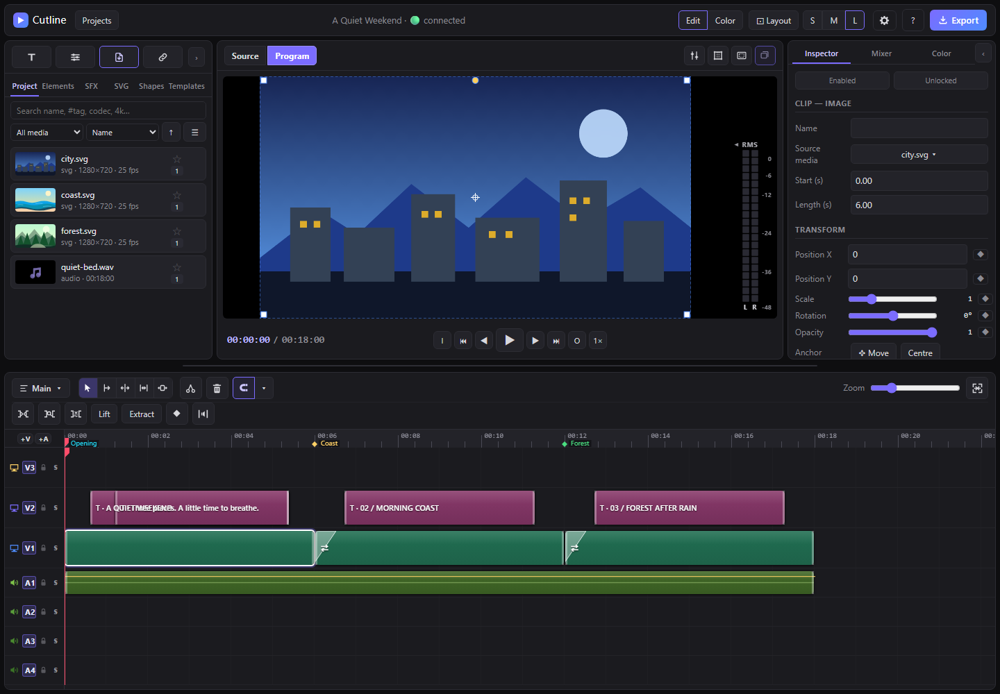
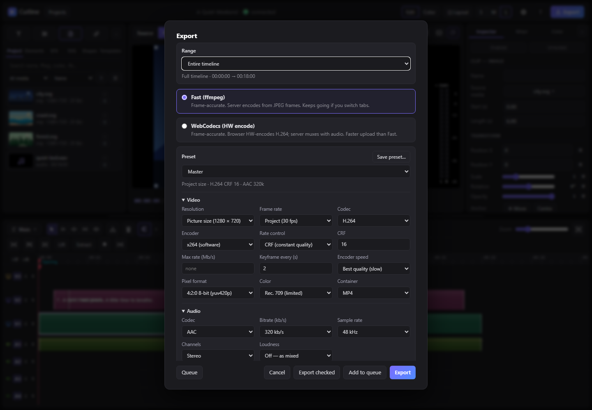

# Cutline for MiniMax Code

[简体中文](README.zh-CN.md)

Edit video inside MiniMax Code, or hand the cut to the Agent in your chat.

Cutline brings the media bin, timeline, captions, motion graphics, colour, audio and export into one Mini App. Work directly in the editor, ask the Agent to change the timeline for you, and take over whenever you like.

Cutline is a community-maintained adaptation of [FableCut](https://github.com/ronak-create/FableCut), not an official FableCut release or an upstream-endorsed project.

## Install and open

1. Install the complete `cutline` directory as a local Plugin in MiniMax Code, keeping its hidden `.minimax-plugin` folder.
2. Open Cutline from the Mini App launcher, or ask the Agent to open it. The Host manages the service.
3. Install `ffmpeg` and `ffprobe` separately for media analysis, audio processing and video encoding, add them to the system PATH, then restart the app.

The interface is available in English and Simplified Chinese under **Settings → Appearance → Language**. The choice affects only the current browser's interface.

## From footage to finished video

1. **Import media.** Add video, audio or images; the originals stay untouched.
2. **Build the timeline.** Arrange, split and trim clips, then layer titles, images, shapes and audio.
3. **Refine the result.** Add captions, transitions and motion graphics, then adjust picture and sound.
4. **Review and export.** Play the cut, choose a preset or custom settings, and render.

You can also ask in chat:

- “Cut this video down to 30 seconds, remove the pauses and add Chinese captions.”
- “Give the three guests simple lower thirds.”
- “Lower the music and export both a vertical version and a high-quality master.”

Manual and Agent-driven edits operate on the same project, so you can take over at any point.

### Point the Agent at a spot

Right-click a clip, an empty spot on a track, the ruler, a marker or a file in the Project bin and choose **Send to chat**. MiniMax Code asks you to confirm, then adds a short reference to the chat input: clip and media ids, tracks, timeline seconds and frame, the open sequence and composition, and the project revision. Type what you want changed after it and press Send. A clip reference also carries the moment you right-clicked, so "split here" or "the caption at this point" lands where you meant. The text stays in the draft until you send it, and you can edit it first.

## Choose an export method

| Method | Best for | What to know |
| --- | --- | --- |
| **Export in the editor** | Watching progress or creating several versions | Keep the Mini App open during the render |
| **Agent standalone export** | Rendering after closing the panel or delivering from a fixed snapshot | The Agent manages the background task; one file per job |

Standalone export needs a local Chrome or Edge installation and uses the project snapshot captured when the job is prepared. Use a new job for later edits. The finished file passes a full decode check; after reviewing it, clean up the job folder to reclaim disk space.

## Limits

- Generate images, video, speech and music with other tools, then import the files into Cutline.
- Captions can come from a script, subtitle file or transcript; use a dedicated transcription tool when starting from audio.
- The project service is shared across conversations, so confirm the active project before coordinating edits. The plugin does not read conversation content or other sessions.
- For long or high-resolution renders, test a short section first.

## Tested environment

- Target: MiniMax Code 3.1.2 or later. Installation, media import, timeline editing and standalone export were exercised on Windows 11 with Google Chrome, including a 180-second render.
- **Send to chat** was checked on MiniMax Code 3.1.9 for Windows: all five right-click entries appear, the Host shows its confirmation, and the confirmed reference lands in the chat draft with correct ids, times and frames at 24 fps. A Chromium browser test with the Host bridge stubbed covers the text for each menu, a cancelled confirmation, both interface languages and a client without the API.
- macOS, every effect combination and sustained long-form or high-resolution workloads remain on the validation roadmap. Current records cover the tested scenarios.

Run `npm test --prefix plugins/klarkxy/cutline` from the repository root for plugin tests, and `npm run check` for repository validation.

## Data & access

- **State:** projects, media copies, versions, caches and exports live in the Host-provided private data directory; export-job copies remain until you clean them up.
- **Files:** local paths use the MiniMax Code process's file permissions and can point outside the private data directory. `fablecut_frame` reads a supplied absolute path, `/media/…` or `/library/…` source in place. `fablecut_import_media` and `fablecut_analyze_reference` copy accepted media from supplied paths into managed storage; originals stay unchanged. `fablecut_import_project` reads `project.json` and the referenced media in the folder the user supplies, then copies those assets into this installation. Projects and exports are written to the private data directory.
- **Network:** the editor and MCP endpoint use the Host-assigned local address. HTTPS imports contact the supplied URL; optional font loading contacts `fonts.googleapis.com` and `fonts.gstatic.com`, and optional background removal contacts `cdn.jsdelivr.net`. Standalone export is isolated from the external network.
- **Processes:** media operations invoke `ffmpeg` and `ffprobe`; the Agent starts and manages Node plus Chrome or Edge for standalone export.
- **Agent turns and conversations:** Agent turns start from your chat. The plugin exposes MCP tools, leaves `agentAccess` undeclared and does not read conversation content or other sessions. All conversations use the same open project.
- **Chat input:** **Send to chat** calls the page API `message.append`, which needs no declaration. Each use shows the Host's confirmation with the exact text; after you confirm, the text joins the unsent draft of the conversation the Mini App is open in. The reference holds ids, times, track names, media file names, clip names, the first line of a title, marker labels and the project name. The page sends nothing on its own and reads no chat history. On a client without the API the menu items stay visible and disabled.
- **Host data and devices:** Host configuration, credentials, private logs, session databases and the microphone sit outside the plugin's access.

## Upstream and maintenance

The original copyright and MIT terms are retained in [LICENSE](LICENSE). See [upstream.json](upstream.json) for provenance, [PATCHES.md](PATCHES.md) for the maintenance process, and the [Skill](skills/cutline/SKILL.md) with its references for Agent workflows.
