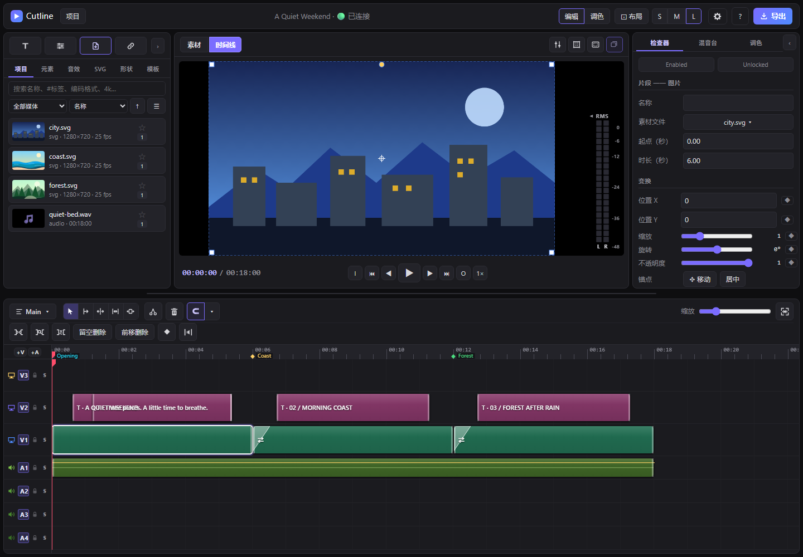
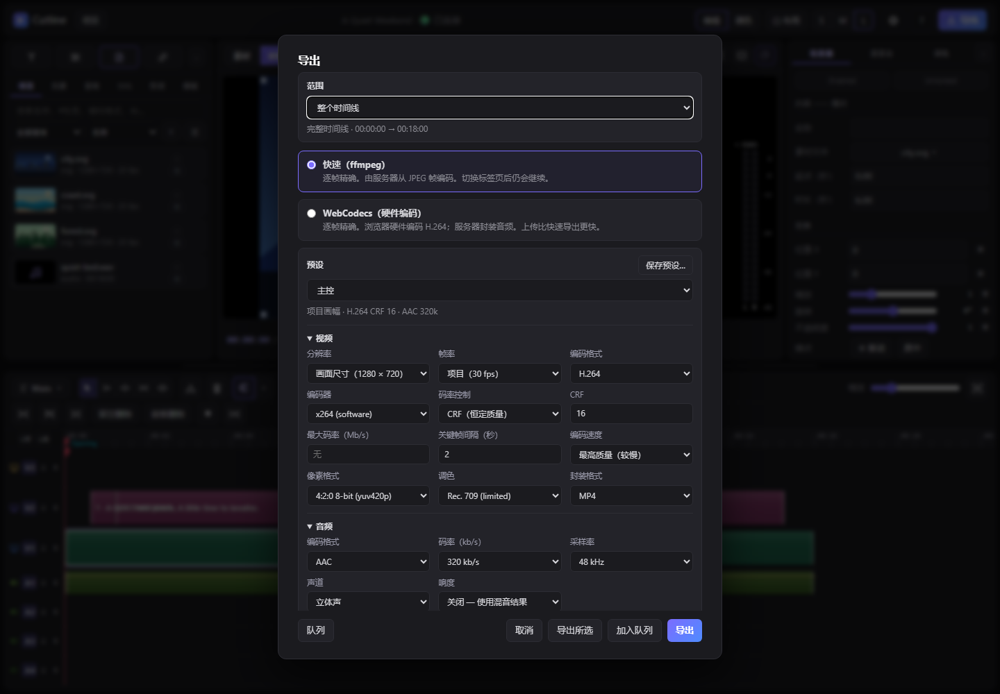

# Cutline for MiniMax Code

[English](README.md)

在 MiniMax Code 里剪视频，也可以把剪辑交给聊天中的 Agent。

Cutline 把素材库、时间线、字幕、动效、调色、音频和导出放进同一个 Mini App。你可以自己动手，也可以让 Agent 按你的要求修改时间线，并随时接管继续编辑。

Cutline 是基于 [FableCut](https://github.com/ronak-create/FableCut) 的社区改编版，由社区独立维护；它不是 FableCut 官方发行版，也未获上游背书。

## 安装与打开

1. 将完整的 `cutline` 目录作为本地 Plugin 安装到 MiniMax Code，保留隐藏的 `.minimax-plugin` 目录。
2. 从 Mini App 入口打开 Cutline，或让 Agent 打开。Host 会管理服务。
3. 媒体分析、音频处理和视频编码需要单独安装 `ffmpeg`、`ffprobe`，加入系统 PATH 后重启应用。

界面支持英文和简体中文，可在 **设置 → 外观 → 语言** 中切换。语言选择仅影响当前浏览器界面。

## 从素材到成片

1. **导入素材。** 添加视频、音频或图片，原件保持原样。
2. **组织时间线。** 拖放、剪切、修整片段，叠加标题、图片、形状和音频。
3. **完善效果。** 添加字幕、转场和动效，调整颜色与声音。
4. **检查并导出。** 播放预览，选择预设或自定义设置，渲染成片。

也可以直接对 Agent 说：

- “把这段视频剪成 30 秒，去掉停顿，加上中文字幕。”
- “给三位嘉宾加上简洁的姓名条。”
- “把音乐压低一点，导出竖屏版和高清母版。”

手动编辑和 Agent 编辑使用同一个工程，你可以随时接管。

### 给 Agent 指一个位置

在片段、轨道空白处、时间标尺、标记或项目素材上点右键，选 **发送到对话**。MiniMax Code 弹出确认后，会在对话输入框里加一段简短引用：片段与素材 id、轨道、时间线秒数和帧号、当前序列与合成、工程修订号。接着写上要改什么，再按发送即可。片段引用还带着你右键的那个时间点，所以“从这里切开”“这个时间点的字幕”都能落在你指的位置。引用文字先进入草稿，发送前可以随意修改。

## 选择导出方式

| 方式 | 适合场景 | 使用要点 |
| --- | --- | --- |
| **编辑器内导出** | 查看进度、批量输出 | 渲染期间保持 Mini App 打开 |
| **Agent 独立导出** | 关闭面板后渲染、固定快照交付 | Agent 管理后台任务，每个任务产出一个文件 |

独立导出需要本机 Chrome 或 Edge，并使用任务创建时的工程快照。后续修改请通过新任务渲染。成片通过完整解码检查后交付；确认结果即可清理任务目录释放空间。

## 使用边界

- 图片、视频、语音和音乐可先用其他工具生成，再导入 Cutline。
- 字幕可来自文稿、字幕文件或转写结果；语音转写请先使用专门工具完成。
- 工程服务由多个会话共享，协作编辑前先确认当前工程；插件不会读取聊天内容或其他会话。
- 长片和高分辨率渲染建议先分段试导出。

## Tested environment

- 目标客户端：MiniMax Code 3.1.2 或更高版本。已在 Windows 11 与 Google Chrome 环境中验证安装、素材导入、时间线编辑和独立导出，包括一次 180 秒渲染。
- **发送到对话** 已在 Windows 版 MiniMax Code 3.1.9 上实测：五个右键入口都会出现，Host 会弹出确认框，确认后引用写入对话草稿，24 fps 下的 id、时间和帧号均正确。另有 Chromium 浏览器测试（Host 桥接为测试替身），覆盖各菜单生成的文字、取消确认、中英两种界面语言，以及不支持该 API 的客户端。
- macOS、全部效果组合及长片／高分辨率负载仍待完整验证。当前记录代表已实测场景。

在仓库根目录运行 `npm test --prefix plugins/klarkxy/cutline` 执行插件测试，运行 `npm run check` 执行仓库校验。

## Data & access

- **状态：** 工程、媒体副本、版本、缓存和导出文件保存在 Host 提供的私有数据目录；导出任务副本保留至手动清理。
- **文件：** 本地路径按 MiniMax Code 进程的文件权限访问，可以指向私有数据目录之外。`fablecut_frame` 会就地读取提供的绝对路径、`/media/…` 或 `/library/…` 来源；`fablecut_import_media` 和 `fablecut_analyze_reference` 会将提供路径中的支持素材复制到受管目录，原件保持原样。`fablecut_import_project` 会读取用户提供文件夹中的 `project.json` 与引用素材，并将资源复制到本安装的数据区。工程与导出结果写入私有数据目录。
- **网络：** 编辑器和 MCP 使用 Host 分配的本机地址。HTTPS 导入访问你提供的 URL；可选字体功能访问 `fonts.googleapis.com`、`fonts.gstatic.com`，可选背景移除访问 `cdn.jsdelivr.net`。独立导出与外部网络隔离。
- **进程：** 媒体处理调用 `ffmpeg`、`ffprobe`；独立导出由 Agent 启动并管理 Node、Chrome 或 Edge 后台任务。
- **Agent 与会话：** Agent 回合由你在聊天中发起。插件提供 MCP 工具，未声明 `agentAccess`，不会读取聊天内容或其他会话；所有会话共用当前打开的工程。
- **对话输入框：** **发送到对话** 调用页面 API `message.append`，该 API 无需声明。每次使用都会弹出 Host 自己的确认框并显示完整文字；确认后文字追加到 Mini App 所在对话的未发送草稿。引用内容包括 id、时间、轨道名、素材文件名、片段名、字幕首行、标记名和工程名。页面不会自行发送消息，也不读取聊天记录。客户端不支持该 API 时，菜单项保持可见并置灰。
- **Host 数据与设备：** Host 配置、凭据、私有日志、会话数据库和麦克风均位于访问范围之外。

## 上游与维护

原始版权和 MIT 许可保留在 [LICENSE](LICENSE)。[upstream.json](upstream.json) 记录来源与版本，[PATCHES.md](PATCHES.md) 说明维护流程，[Skill](skills/cutline/SKILL.md) 及参考文档说明 Agent 工作方式。
