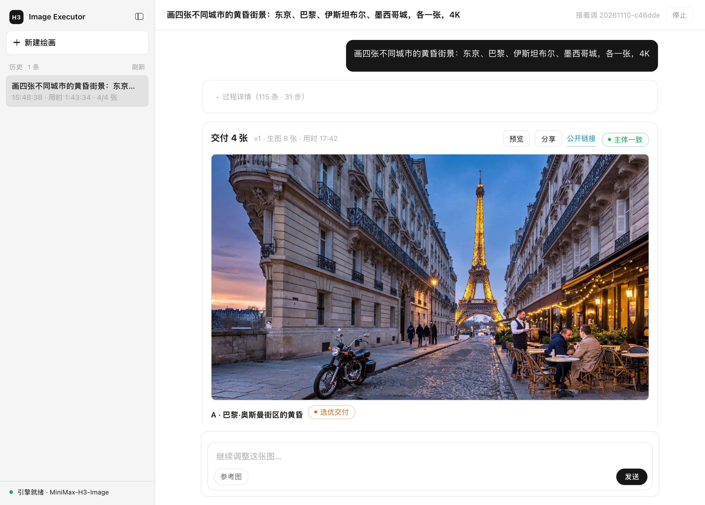

# H3-Image-Executor (`h3-image-executor`)

[简体中文](README.zh-CN.md)

A Mini App that turns one sentence into verified 4K images. You describe the picture; the app
searches for reference images, plans the shot list, generates, reviews each image by looking at
it, corrects colour cast, runs a bounded fix loop, picks the best candidate, and delivers the
result together with an acceptance report.

The interface is in Chinese.



It is built around the **H3-Image** generation API. That API is not part of the public MiniMax
Open Platform image endpoint, so you need an H3-Image endpoint address and key of your own
before the app can generate anything. See [Configure the endpoint](#configure-the-endpoint).

## What it does

- **Plans before it draws.** A planner turns the sentence into a shot list: one spec per image,
  each with its own aspect ratio, hard constraints and soft preferences.
- **Finds reference images by itself.** When a named subject has to look a specific way, it
  searches for a reference, downloads it, and judges whether the candidate is usable.
- **Locks character appearance across a set.** For multi-image requests, it first generates a
  character sheet and binds it to every image as a reference, so the same subject does not turn
  into two different creatures halfway through the set.
- **Reviews by looking.** Each candidate is checked against its constraints by a vision model that
  never sees the prompt that produced it, so the review cannot be talked into agreeing.
- **Measures colour.** Red cast is detected programmatically rather than by eye, and a cast image
  is redrawn instead of shipped.
- **Fixes in a bounded loop.** At most 5 rounds; two rounds without improvement switches approach;
  three ends early. Content-safety rejections stop immediately instead of retrying.
- **Compares across images.** After every image is done, it builds one side-by-side sheet and asks
  whether the same subject is still the same subject. It reports; it does not redraw.
- **Ships an acceptance report.** Every delivery carries a `report.json` with per-image verdicts,
  the `request_id` of each generation call, cost, and anything it could not verify.

## Requirements

- MiniMax Code 3.1.6 or later (the app declares `toolAccess` and `agentAccess`).
- An H3-Image endpoint address and API key.

## Install

1. Copy this whole directory, including the hidden `.minimax-plugin` directory, into the MiniMax
   Code plugins directory as `h3-image-executor/` (`~/.minimax/plugins/h3-image-executor/` by
   default), so the manifest ends up at
   `~/.minimax/plugins/h3-image-executor/.minimax-plugin/plugin.json`.
2. Restart MiniMax Code and confirm the plugin is enabled.
3. Say "打开 H3-Image-Executor" to the Agent, or open it from the plugin list.

## Configure the endpoint

The app ships **no default endpoint address**. Until you configure one, the engine line at the
bottom of the sidebar reads 未配置生图接口.

Click that line to open the settings dialog and fill in:

| Field | Meaning |
| --- | --- |
| API Key | Your H3-Image key. Sent only to the endpoint you configure. |
| 接口地址 | Base URL of the H3-Image endpoint, must start with `https://`. |

The key is written to `settings.json` inside the private `dataDir` the Host creates for this
plugin, with mode `0600`. It is never written into the package and never printed to a log. The
stored key is never returned to the page: the page only receives its first 6 characters and its
length.

Alternatively, export the values in your shell and restart MiniMax Code:

```sh
export MINIMAX_API_KEY="..."
export MINIMAX_BASE_URL="https://..."
```

`MCODE_API_KEY` is accepted as another name for the key; in the process environment
`MINIMAX_API_KEY` wins when both are set. `H3_IMAGE_MODEL` overrides the model name, which defaults
to `MiniMax-H3-Image`.

Resolution order is: what you saved in the page, then the process environment, then
`~/.zshrc` / `~/.zprofile` / `~/.bash_profile` / `~/.profile`. **The page wins**, so a value you
typed deliberately is not overridden by an environment variable left over from something else.

## Usage

Type what you want into the composer and press Enter. The app runs the whole pipeline and
delivers images plus a report. Useful things to know:

- **Default output is 4K.** Aspect ratio comes from the plan unless you state one.
- **Each generation shows its `request_id`** in the timeline as a `req …` chip. Click it to copy
  the full value; quote it when reporting a problem.
- **A failed image says why.** Interface errors, including content-safety rejections, appear in
  the delivery area with the raw message, not as a silent "0 images".
- **Follow up in the same session.** Sending another message edits the delivered images rather
  than starting over.
- **History is in the sidebar.** Each row can be rerun or deleted; deleting moves the session to
  `sessions/.trash/` inside `dataDir` instead of erasing it. The app never empties that folder;
  delete its contents yourself to free disk space.
- **Stopping a run.** The **停止** button aborts the session's Agent turns and ends the run at the
  next step. A generation request already sent to the endpoint still finishes, but nothing new
  starts after it.
- **You can just ask in chat.** With the plugin enabled, "draw …" in a conversation hands the request
  to this app instead of generating a picture in the chat, unless you name another tool or say you
  do not want the panel. The bundled `h3-image-executor` Skill tells the Agent to open the app with
  `?prompt=…&auto=1`, and the page fills the composer and submits it.

### Launch parameters

The dashboard reads these from its own query string. This is how the Agent hands work over, and you
can use them yourself to deep-link into a painting:

| Parameter | Meaning |
| --- | --- |
| `prompt` (or `q`) | The request text, used verbatim. |
| `auto` | `1` (default) fills the composer and submits; `0` fills it and waits for you to press Send. |
| `session` | A session id such as `20261109-877482`. Present means "keep editing that one"; absent starts a new painting. |
| `len` | Optional. The number of characters in `prompt` as the sender counted them. When it does not match what arrived, the page warns that the request may have been damaged in transit; it still submits. |

The page strips those parameters from the address bar as soon as it has read them, so reloading does
not submit the same request twice. If no endpoint is configured yet, the request is filled in but not
submitted, and the composer says so.

## Tested environment

- MiniMax Code 3.1.12-preview.5165 on macOS 15.0.1 (Apple Silicon)

Verified in that environment with this build (1.8.1): publishing a public link, including the
`website_deploy` approval in the page, and a drawing request in chat being handed to the panel.
Verified there with earlier builds: single-image and multi-image runs end to end, reference search
and download, character-sheet generation and cross-image comparison, the bounded fix loop, colour
measurement, session restore after a runtime restart, deletion and rerun, share page generation,
and failure reporting.

Checked only with automated tests against a simulated Host (the Node service and the page in
headless Chrome), not in MiniMax Code: end-to-end runs with this build, the 2048 px copies in the
share page, the **停止** button, the messages after switching `session.run` or `tool:call` off,
questionnaires, and view restore after the Host reloads the page. Not verified: Windows, MiniMax
Code releases other than the one above, and any H3-Image endpoint other than the one used during
development.

## Data & access

**Files read outside the package**

- `~/.zshrc`, `~/.zprofile`, `~/.bash_profile`, `~/.profile` — read as plain text, never executed,
  only to find `MINIMAX_API_KEY`, `MCODE_API_KEY` and `MINIMAX_BASE_URL` when you have not
  configured them in the page. This relies on shell configuration layout that is not part of any
  published contract.
- Images you pick as references through the file picker.

**Files written**

- Everything the app keeps is written under the Host-provided `dataDir`: `settings.json` (mode
  `0600`), `sessions/<id>/` (plans, images, previews, references, review sheets, deliveries,
  reports, the share page `share/index.html` with the larger copies it embeds in `share/large/`,
  `session.json`), `refcache/` (downloaded reference images, plus a one-day record of downloads
  that failed), and `sessions/.trash/` (deleted sessions).
- The two JSON state files — `settings.json` and `sessions/<id>/session.json` — are written
  atomically: a temporary file in the same directory, then `rename`. Image and HTML files are
  written directly.
- Outside `dataDir`, only two things write files:
  - The publish turn (see **Tools called**) copies the share page to `h3-share-publish/index.html`
    in this Mini App's own Agent working directory, because `website_deploy` only accepts paths
    inside that directory. Each publish overwrites it.
  - The `h3-review` command-line tool bundled for the `h3-image-review` Skill writes PNG review
    sheets when an Agent runs it: next to the input image for `sheet`, in the current working
    directory for `refs` and `grid`, or wherever `-o` points. The app itself never runs it.
- The page keeps view state in its own browser storage: whether the sidebar is collapsed, and,
  saved each time the page is hidden, the open session ID, the unsent text in the composer (up to
  4,000 characters) and how many unsent reference images you had picked, so a reload by the Host
  restores them.

**Network**

- The H3-Image endpoint you configure. It receives your key as a bearer token, your prompts, and
  any reference images you supply. There is no default: it is whatever you typed.
- Image URLs returned by that endpoint, which the app downloads from.
- Image URLs found by the reference-image search (see **Tools called**) or written into the plan
  by the planning turn: any third-party site, over `https` or `http`. The app only downloads these
  images; the search queries themselves go through the tool, not from this app.

The app refuses to download images from `169.254.0.0/16` — the link-local range where cloud
instance metadata services live — and from wildcard addresses such as `0.0.0.0`, and it checks
every redirect again before following it. For image URLs that come from the search tool it also
refuses localhost and private ranges (`10.*`, `172.16-31.*`, `192.168.*`, `100.64-127.*`,
`fc00::/7`), including host names that resolve to them, because a third-party search result should
never make the app read from your own network. Private ranges and localhost stay allowed for your
endpoint's image URLs and for image URLs written into the plan from your request, because your
endpoint may itself sit on an internal network. Each download is capped: 25 MB for a reference
image, 100 MB for a generated image.

**Processes spawned**

Clipboard commands only, and nothing else. Each one uses a fixed argument list, no shell, a 2 s
timeout and an output cap.

- **Reading** — MiniMax Code denies clipboard reads to Mini App pages, so the **clipboard** button
  in the settings panel asks the Node service to run your platform's paste command once: `pbpaste`
  on macOS, `powershell.exe -NoProfile -NonInteractive -Command Get-Clipboard` on Windows,
  `wl-paste` or `xclip` on Linux, capped at 8 KB. What is read only fills the input field: it is
  never logged and never written to disk, and it is handed back to the page only when it looks
  like a key or an `https://` endpoint address.
- **Writing** — the page copies with the browser clipboard first (`navigator.clipboard.writeText`,
  then `document.execCommand('copy')`). Both need the panel to have focus, which it often does not,
  so the Node service can also run your platform's copy command: `pbcopy` on macOS,
  `powershell.exe -NoProfile -NonInteractive -Command Set-Clipboard -Value ([Console]::In.ReadToEnd())`
  on Windows, `wl-copy` or `xclip` on Linux, capped at 2 KB. It does so in two cases: once,
  automatically, when a publish you started finishes, to put the new public link on your
  clipboard; and when you click **Share** for a session that already has a public link and the
  page could not copy it. The Node service rejects anything that is not a single-line
  `https://<name>.space.mcode.cn` address, so this cannot be turned into a general "write anything
  to your clipboard" endpoint.

Nothing is spawned at load, on a timer, or on save, and no other child process is ever started.

**Agent turns**

The app declares `agentAccess: ["session.run"]` and runs Agent turns to plan, review and correct.
Those turns run on the model service your MiniMax Code session is configured to use, so your
prompt text, your reference images and the generated images themselves are sent there for
planning, review, correction and selection. Those turns can read and write files, run shell
commands and call MCP tools, subject to your permission rules. Every tool-permission request is
shown in the page for you to answer, including the `website_deploy` request of the publish turn
described under **Tools called**; the app never allows one on your behalf. It only denies, on its
own, the other tool requests of the publish turn. If you switch the Agent permission
(`session.run`) off in the plugin details, the run stops and the page says where to switch it back
on. It does not declare `session.read` and cannot read your other conversations.

**Tools called**

The app declares `toolAccess: ["call"]` and calls one tool: the first installed tool whose name
contains `search_images`. On the tested setup that is `connector__matrix__search_images`, the
`search_images` tool of the `matrix` Connector. It receives the subject names from the plan with a
short note on what kind of picture to find, and returns image URLs. Each call goes through your
permission rules. When your rules say "ask", the app shows the Host's prompt to always allow this
one tool before the first search. If you switch tool calls (`tool:call`) off in the plugin details,
the run continues without searched references and the page says why.

The **publish public link** button is separate and worth reading twice: it starts one Agent turn
whose only job is to call the Host's `website_deploy` tool, which publishes the self-contained
share page to a public `https://<name>.space.mcode.cn` URL that **anyone with the link can open**.
The page contains your request and follow-ups, the reference images you attached or the app found
online, thumbnails of the other search results, the plan, downscaled copies of every candidate and
delivered image, a larger copy (long edge 2048 px) of each delivered image that opens when you
click it, the review sheets, the full prompts the app sent to the model and the model's replies,
and the run log with `request_id`s and costs. The larger copies are capped at 4 MB in total;
delivered images past that cap open at preview size. Nothing is published until you press that button and then
click **允许一次** (allow once) on the `website_deploy` request that appears in the page. A
permanent line under the button says that anyone with the link can open the page and what it
contains. Before the page is written, local paths are replaced with placeholders: the session
folder and the plugin's `dataDir` keep the relative part after them, and any other path in your
home folder, or under `/Users/` or `X:\Users\`, is replaced as a whole. Every other tool request
from the publish turn is denied, and a questionnaire request aborts the turn.

**Bundled Skills**

- `h3-image-executor` tells the chat Agent to hand drawing requests to this app instead of other
  image tools, unless you name another tool or say you do not want the panel. When you ask about a
  finished run, it tells the Agent to read `sessions/<id>/session.json` in this plugin's data
  directory. The Skill does not know where MiniMax Code keeps that directory, so finding it relies
  on unspecified layout.
- `h3-image-review` tells the Agent how to run the bundled `h3-review` tool (see **Files written**)
  when you ask it to look at generated images itself.

**Device use**

No microphone, camera or system notifications. The app declares no `deviceAccess`.
It does not read the MiniMax Code page you are currently viewing, nor your browser history. The
page writes to the clipboard only when you click a copy control (a `req …` chip, or **Share** for
an existing link) and once after a publish you started finishes; the clipboard commands described
above run in the Node service. The app only ever sees its own panel.

## Known limitations

- A character sheet improves consistency but does not guarantee it. Large pose or aspect-ratio
  differences between the sheet and a story image still drift.
- Content-safety rejections are deterministic, so the app stops at the first one instead of
  retrying. Change the request itself and send it again.
- The reference-image search depends on the search tool and inherits its availability. When the
  tool rejects or fails a query, that subject gets no searched reference; attach one yourself.

## License

MIT. See [LICENSE](LICENSE).
