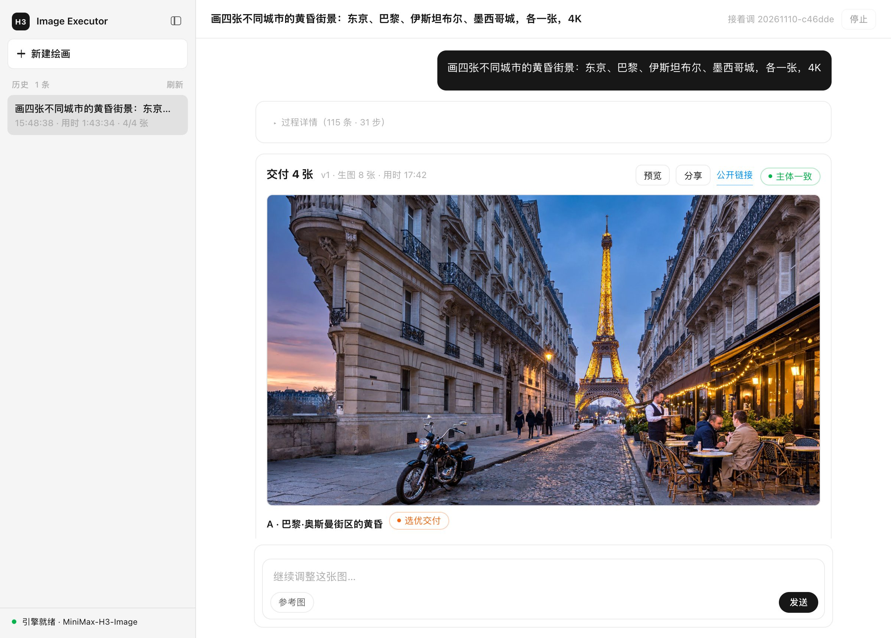

# H3-Image-Executor (`h3-image-executor`)

[简体中文](README.zh-CN.md)

A Mini App that turns one sentence into verified 4K images. You describe the picture; the app
searches for reference images, plans the shot list, generates, reviews each image by looking at
it, corrects colour cast, runs a bounded fix loop, picks the best candidate, and delivers the
result together with an acceptance report.

The interface is in Chinese.



It is built around the **H3-Image** generation API. That API is not part of the public MiniMax
Open Platform image endpoint, so you need an H3-Image endpoint address and key of your own
before the app can generate anything. See [Configure the endpoint](#configure-the-endpoint).

## What it does

- **Plans before it draws.** A planner turns the sentence into a shot list: one spec per image,
  each with its own aspect ratio, hard constraints and soft preferences.
- **Finds reference images by itself.** Whether to search, how many items and how much effort to
  spend is up to the planner for each request; it does not search every time. When the request
  contains a proper noun or a specific name (a person, a character, a brand or product, a logo, a
  car model, a landmark, a named work, or an unfamiliar term for something whose look is uncertain),
  the planner searches first. For generic things and common styles or page types it searches only
  when a real example would clearly make the picture more accurate. The planner also sets a search
  budget: one search-tool call and one batch judged each count as one, up to 16; without a budget
  it gets two per item and at least eight. The budget is spent in the order the items are listed,
  and every item searched keeps one judging step in reserve that other items' re-searches and extra
  batches cannot use; a batch where no candidate downloaded makes no judging call and costs nothing.
  When the budget runs out the search
  stops, and items that were not searched or not fully judged are reported in the delivery notes as
  over budget, not as not found. Each reference records what it is for (the subject's look, a
  detail, the style, the layout or the setting) and what to take from it, and the generation
  request says so for each image, so the model does not copy one of them as the base picture. A
  layout reference is full of text, so it is not sent when the base picture has to stay blank for
  typeset text or a chart. The judge first checks that a candidate shows the named thing itself; for
  a character or mascot, official illustrations and photos of statues or figures all count; a
  style, layout or setting reference only has to be a real example of its kind. When a whole batch
  is rejected, it searches again under another name (for example the subject's name in its original
  language) instead of paging through the same results. When the first search errors at the search
  service or returns nothing, the planner's other wording is tried once as well (not when the tool
  is denied). When the request is themed on a real film,
  series, animation or game, it searches for the official poster or stills and uses them for the
  lead's signature costume, props, palette and title lettering; faces are drawn as original
  characters unless you name the actor to resemble.
- **Locks character appearance across a set.** For multi-image requests, it first generates a
  character sheet and binds it to every image as a reference, so the same subject does not turn
  into two different creatures halfway through the set.
- **Reviews by looking.** Each candidate is checked against its constraints by a vision model that
  never sees the prompt that produced it, so the review cannot be talked into agreeing.
- **Gives each step as many tool calls as the task needs.** The number of tool calls the planning,
  review, correction, selection and follow-up edit steps may make is no longer fixed. Before each
  call it is worked out from what that step has to open (each candidate's review sheet, the
  reference sheet and so on) plus one spare call, plus a margin for the image's difficulty: the
  planner rates each image easy, normal or hard, adding one, two or four calls; an image it did not
  rate is rated from its spec, so eight or more pieces of text, two or more references to match or
  an animation of eight frames or more count as hard. A step that already ran out of calls on an
  image gets two more the next time, and each step has a ceiling. The limit written in the prompt
  is the one enforced at run time, and the step's details in the timeline show how it was reached.
- **Measures colour.** Red cast is detected programmatically rather than by eye, and a cast image
  is redrawn instead of shipped. When the red is in the subject itself (an orange cat, a red scarf,
  a warm-lit product) and the near-neutral parts of the picture are balanced, the image is not
  counted as cast. When the request itself asks for yellow, red or orange as the main colour (a
  bright yellow poster) and the picture has almost no neutral areas, white balance cannot be
  measured, so the image is not counted as cast and the review judges it; the prompt for such an
  image no longer asks the model to avoid warm or yellow tones. When the request says white paper
  or a white background, the white areas are measured on their own: if red, green and blue differ
  by 4 levels or more (purplish, pinkish, yellowish or bluish white), the image fails and is
  redrawn. The average over the whole picture does not show this kind of cast.
- **Does not drift over repeated edits.** Each image keeps the first candidate whose colour passed
  as its colour reference. Every later edit of another candidate, in a correction round or a
  follow-up, sends it along as the second image, described as a colour reference only (tone, white
  balance, how white the paper is). A follow-up that asks for different colours or lighting is sent
  without it, and a new reference is picked afterwards.
- **Puts in QR codes that scan.** Image models cannot draw a working QR code; they draw black and
  white squares that only look like one. When your request asks for a code, the planner copies
  what goes in it word for word from your request, and after each candidate is generated the app
  finds the code the model drew, replaces it with a real one that follows the original perspective
  and shading, and scans the final file. A code that does not scan fails the image like any other
  hard constraint and sends it back for redrawing. Ask for a code without saying what goes in it
  and you get a decorative one, marked as such in the delivery; add the content in the same session
  and the app swaps a real code into the delivered image without generating it again.
- **Typesets long text itself.** Image models cannot write a long passage, vertical text or brush
  calligraphy reliably: in a real run asking for the full 324-character *Lantingji Xu* as a
  handscroll, the first round's candidates had invented characters, the delivered image left out 36
  characters including a whole sentence, and four more rounds after a follow-up still failed the
  checks; the review could not proofread that much text. For text like that the app asks the model
  for the picture with the writing surface left blank (the paper, the signboard, the poster panel),
  then sets the text onto it with a font, character for character, following the light and texture
  of the surface. A passage of 24 or more characters (or 40 in total), 10 or more characters set
  vertically and 12 or more in brush lettering go this way from the first round; a short title is
  drawn by the model first and switches over when the review finds the lettering wrong on every
  candidate, if the plan says where the title sits. If the area is not actually blank, the image is
  redrawn. Changing the text afterwards (the words, font, size, colour or punctuation) is set again
  on the saved blank image in seconds, with no generation call. Pages laid out like a textbook or a
  book follow typesetting conventions: text with the same role (several body paragraphs, several
  labels) gets one size, and footnotes and page numbers are never larger than the body; body
  paragraphs start with a two-character indent and are justified; footnote marks (①②…) in the body
  and titles are set as small superscripts, while the numbers that start each footnote stay full
  size; a short rule is drawn above the footnotes. Up to 16 pieces of text are set per image, and
  any beyond that are listed in the delivery notes. Each piece looks for blank space only around its
  own planned position: when a line or block the model drew covers that position, the piece moves
  up or down to the nearest blank spot (at most two box heights). Other pieces' planned positions
  and text already set count as taken, so two pieces never land on each other, and a final check
  over every character keeps an image with overlapping text from being delivered. With many pieces,
  the blank-space request to the model describes whole areas instead of listing coordinates (listed
  percentages got drawn as a page of numbers). When the review finds text in the wrong place
  (over a line, off the surface, outside the box it belongs in) and the picture itself is fine,
  the text is set again on the same blank image at the corrected positions, with no generation
  call and without using up a redraw round, at most twice per image. When one character needs two
  colours (a literacy chart with the 氵 of 清 in orange and the 青 in dark grey), it is still set as
  one whole character: the app finds the cut with the least ink between the radical and the rest of
  the glyph and colours the radical's side, which can be left, right, top or bottom. If the font
  joins the parts so the cut is not clean (brush fonts often do), that piece switches to the Song or
  Hei font; if no font splits it, the character keeps one colour and the delivery notes say so.
  Short text such as titles, labels and example words stays on one line unless one line would make
  it much smaller. After planning, the app reads the pieces in layout order, top to bottom and left
  to right, and compares them with the quoted text in your request; when a quote cannot be read
  (for example 清 split into 氵 and 青), the planner gets the exact problem back and revises once,
  and if it still does not match, the review checks those places on the image and the delivery
  notes mention them. The planning prompt states which font each style really uses on this
  machine: where no Kai font is installed (the macOS default), Kai uses the brush font.
- **Makes animated GIFs from one reference image.** Image models produce one still at a time, so an
  animation is planned as 4 to 16 keyframes, as many as the motion needs: four to six for a blink
  or raised eyebrows, ten to sixteen for turning the head away or hands coming into the frame, so
  that neighbouring frames differ by one small step. The first frame is made from the reference;
  each later frame is made from the frame before it, one small step on, with the reference sent
  alongside to hold the identity, clothing, background and colours. Made from the reference one by
  one, the frames came out inconsistent: the model drew the same "hands up to the chest" at a
  different height each time. The app then assembles them into a looping GIF. The model redraws the fine texture of the whole picture on every edit and
  can shift it by a pixel or two, so before assembling, the app aligns each frame to the reference,
  matches its tone, keeps only the parts that really move and takes everything else from the
  reference, which keeps the background still. Two fade frames are added between neighbouring
  frames by default, and a last frame that is the same image as the first is merged into it, so the
  loop does not stall at the seam. If you attach a picture, the frames are made from it directly. If
  not, the reference is drawn first and delivered for you to confirm or change, and the frames come
  only after you press 生成 GIF, or after a minute with no reply, which counts as confirming. One review turn looks at all the frames next to the reference, and
  only the frames it rejects are redrawn, once. Frames that return to an earlier pose reuse that
  frame's image. After the frames are drawn, the app locks each one to the reference and measures
  how much changes between neighbours; where one step changes more than 9% of the picture, it adds
  one in-between frame, made from the frame before with the frame after also sent, asking for the
  state halfway between; it is reviewed like the rest and dropped if it fails, and a back-and-forth
  motion draws it once. Every frame is shown for the same time, and the whole loop lasts as long as
  the planned keyframes, so added frames do not make the pace uneven. A frame that still fails the
  review after its redraw is left out of the GIF (the delivery notes say so) so the motion does not
  jerk backwards; the gap it leaves gets an in-between frame from its neighbours however small the
  measured change, with its original plan in the prompt, and one that succeeds takes its place.
  When that fails too, its share of time goes to the frame before, so the motion keeps the planned
  speed instead of moving one step in one frame and three in the next. The review also checks that
  text, symbols and props from the reference are in every frame. Fades are added only between
  frames that differ little: blending two very different frames gives two half-transparent figures,
  which reads as flicker rather than motion. The GIF is read back from the written file to check
  the frame count, size, timing and looping.
- **Turns a grid of panels into a GIF.** A picture laid out in panels (six expressions, a four-panel
  comic, a nine-grid) is drawn by the model in one go, so every panel has the same character and
  style, far more consistent than frames drawn one by one. After it is delivered, say "把这组图变成
  GIF": the program finds the lines or gutters between the panels, cuts each panel out without the
  separators, makes them one size, aligns them by their content (the model places the subject a
  little differently in each panel, which makes it jump when played as is), and joins them top to
  bottom, left to right into a looping GIF. The grid itself is not redrawn. Between neighbouring panels
  it adds one in-between panel each, so the motion moves step by step instead of switching at once.
  The in-betweens are generated together: an Agent turn looks at the grid and writes what each panel
  should become (where the hands are, how far the mouth opens), the grid is edited once into a grid
  of in-betweens, two candidates at a time, and for each step the program first drops candidates that
  copy a neighbour, then a review picks one from the rest; steps with no pick get a second round (two
  at most). Asked only to "draw the state halfway between", the model copies the next panel almost
  every time. Each in-between is aligned to the figure in its own panel (shift and scale) and locked to
  that panel's background, keeping only the parts that move, so the background does not flicker. It
  costs one generation call, about a minute, plus two Agent turns. By default each panel shows for
  0.7 s, the first for 1.05 s, the last for 1.4 s, and each in-between for 0.18 s (taken from the panel
  before it). Panels that change scene (a four-panel story comic) get no in-betweens, nor do grids
  where you say not to add frames. Every frame shares one palette, and the GIF is read back from the
  written file to check it. When the request asks for a grid and a GIF from the start, the plan sets
  that up and both are delivered, in-betweens included, once the grid passes review.
- **Spins things that turn around a centre in the program.** Loading rings, spinning icons, gears,
  windmills and records cannot be drawn reliably frame by frame: in a twelve-dot loading ring, half
  of the twelve frames put the highlight on the wrong dot. For these the plan has the model draw one
  picture, and once it passes review the program turns the disc around the centre to make the
  frames: a ring of evenly spaced dots turns one step per frame, so the dim dots land back on
  themselves and look still while only the highlight moves, with one blended frame between steps;
  a continuous spin turns a little per frame. The centre starts from the plan and is refined to the
  position where the picture best matches itself after one step; nothing outside the disc moves. One
  more step after the last frame gives the first, so the loop closes by construction. It takes one
  generation call, and the GIF is built in under 2 s.
- **Draws data charts from the data.** Image models draw bar, line and pie charts that only look like
  charts: bar heights do not match the values, axis ticks are wrong and numbers are miswritten. When a
  picture needs a data chart, the app has the model draw the picture with a blank panel at that spot
  (a whiteboard, a card, a screen, a page), and the program draws the axes, ticks, grid, bars, lines,
  wedges, value labels and legend from the data. It then measures them back from the final file: it
  locates the tick marks to fit value-to-pixel, then checks every bar end, every data point and every
  wedge boundary, and does not deliver the image if anything is off by more than about 1.5 px. Bar
  axes always start at 0, ticks use round steps, pie percentages are allocated by largest remainder so
  they add up to exactly 100%, and value labels only ever gain trailing zeros, never get rounded. The
  plan copies only the numbers you gave; ratios and totals are computed by the program, and any number
  that cannot be found in your words is listed in the delivery for you to check. Panels the model draws
  are often off the planned spot or lit with a gradient, so the chart follows the whole panel; a panel
  with something drawn on it is sent back for a redraw. Changing numbers, adding or removing
  categories, switching the chart type or the colours later redraws the chart on the saved base in a
  second or two, without calling the generation endpoint.
- **Fixes in a bounded loop.** At most 5 rounds; two rounds without improvement switches approach;
  three ends early. Content-safety rejections stop immediately instead of retrying.
- **Rides out short outages.** Gateway errors (HTTP 429 and 5xx) and dropped connections on
  generation, upload and download are retried twice with a growing wait, and a review turn that
  fails is retried on the same images instead of throwing them away. If a failure persists, or a
  configuration error such as HTTP 401 appears mid-run, the run stops and delivers the best image
  it already has, saying under the image that it stopped early.
- **Compares across images.** After every image is done, it builds one side-by-side sheet and asks
  whether the same subject is still the same subject. It reports; it does not redraw.
- **Ships an acceptance report.** Every delivery carries a `report.json` with per-image verdicts,
  the `request_id` of each generation call, cost, and anything it could not verify.

## Requirements

- MiniMax Code 3.1.6 or later (the app declares `toolAccess` and `agentAccess`).
- An H3-Image endpoint address and API key.

## Install

1. Copy this whole directory, including the hidden `.minimax-plugin` directory, into the MiniMax
   Code plugins directory as `h3-image-executor/` (`~/.minimax/plugins/h3-image-executor/` by
   default), so the manifest ends up at
   `~/.minimax/plugins/h3-image-executor/.minimax-plugin/plugin.json`.
2. Restart MiniMax Code and confirm the plugin is enabled.
3. Say "打开 H3-Image-Executor" to the Agent, or open it from the plugin list.

## Configure the endpoint

The app ships **no default endpoint address**. Until you configure one, the engine line at the
bottom of the sidebar reads 未配置生图接口.

Click that line to open the settings dialog and fill in:

| Field | Meaning |
| --- | --- |
| API Key | Your H3-Image key. Sent only to the endpoint you configure. |
| 接口地址 | Base URL of the H3-Image endpoint, must start with `https://`. |

The key is written to `settings.json` inside the private `dataDir` the Host creates for this
plugin, with mode `0600`. It is never written into the package and never printed to a log. The
stored key is never returned to the page: the page only receives its first 6 characters and its
length.

Alternatively, export the values in your shell and restart MiniMax Code:

```sh
export MINIMAX_API_KEY="..."
export MINIMAX_BASE_URL="https://..."
```

`MCODE_API_KEY` is accepted as another name for the key; in the process environment
`MINIMAX_API_KEY` wins when both are set. `H3_IMAGE_MODEL` overrides the model name, which defaults
to `MiniMax-H3-Image`.

Resolution order is: what you saved in the page, then the process environment, then
`~/.zshrc` / `~/.zprofile` / `~/.bash_profile` / `~/.profile`. **The page wins**, so a value you
typed deliberately is not overridden by an environment variable left over from something else.

## Usage

Type what you want into the composer and press Enter. The app runs the whole pipeline and
delivers images plus a report. Useful things to know:

- **Default output is 4K.** Aspect ratio comes from the plan unless you state one.
- **Each generation shows its `request_id`** in the timeline as a `req …` chip. Click it to copy
  the full value; quote it when reporting a problem.
- **A failed image says why.** Interface errors, including content-safety rejections, appear in
  the delivery area with the raw message, not as a silent "0 images".
- **Follow up in the same session.** Sending another message edits the delivered images rather
  than starting over.
- **Say when a reference is wrong.** A follow-up such as "参考图找的不对，重新找" runs a new search
  for the subjects that had no reference, or that you say are wrong, and redraws with what it
  finds. If the new search finds nothing, the panel says so and does not redraw. If you have the
  right picture yourself, attaching it is still the most reliable way.
- **QR codes.** Say what the code should contain, for example "二维码链接至 https://www.minimax.cn/".
  The content has to appear in your own words: if the plan's content cannot be found there letter
  for letter, the app does not put a code in and asks you instead. Each delivered image is marked
  二维码可扫 (replaced and scanned), 装饰码 (no content given) or 二维码没换成 (with the reason).
  A follow-up that only gives or changes the content, such as "二维码换成 https://…", is applied to
  the delivered image in a few seconds, with no generation call and no new review.
- **Typeset text.** An image whose text the app set is marked 文字由程序排入, with the font and the
  layout under it; 文字没排上 means the area left for the text was not blank, and says why. Ask for
  changes in the same session, such as "字换成宋体", "字大一点" or "加上标点". Calligraphy (classical
  prose, poems, couplets, handscrolls) is set without punctuation by default, the way it was
  written; say you want punctuation and it is set small beside the characters. The text is a font,
  not handwriting: a character looks the same every time it appears, on an even grid. In a session
  from an earlier version, asking to fix a long passage the model wrote has the model erase its
  writing first, then the text is set.
- **GIFs.** Ask for a GIF, a 动图 or an animated sticker, and attach a picture if you have one. A
  reference the app drew first is marked GIF 参考图 · 待确认, with the planned frames under it; press
  **生成 GIF** to make the frames, or say what to change and the reference is redrawn first. The card
  counts down: with no reply of any kind for a minute, the reference counts as confirmed and the frames
  start by themselves, and that turn is labelled 按默认确认自动开始 in the conversation; press **先别生成**
  to stop the countdown. If the app restarts while waiting, the minute starts over; a session reopened
  long after its countdown ran out does not start on its own. The
  delivered GIF is marked GIF · N 帧, with a numbered strip of the frames under it; both the GIF and
  the reference can be downloaded. Follow-ups such as "慢一点", "第 3 帧重画", "去掉最后一帧",
  "在第 2 帧后面加一帧眨眼", "只播一遍" or "别要渐变" work in the same session: changing the speed,
  order, size, looping or whether frames fade or cut, or removing a frame, rebuilds the GIF in
  seconds with no generation call, and redrawing or adding a frame generates only that frame. Asking
  to change the subject itself (a colour, the clothes) redraws the reference and waits for you to
  confirm again. The GIF is 768 px on its long edge by default (up to 1024), with one 255-colour
  palette shared by every frame.
- **Spinning GIFs.** Ask for a loading ring or a spinning icon, for example "做一个十二个点的加载圈 GIF，
  512×512". The card shows the GIF, marked GIF · N 帧, with the frames of one turn under it; both the
  GIF and the picture can be downloaded. Follow-ups such as "转快一点", "反过来转", "一圈 8 格" or "连续转"
  rebuild it in seconds with no generation call; changing the look (colours, dot shapes) edits the
  picture as usual and spins the new one. "让它转起来" works on a picture already delivered.
- **Grid GIFs.** On a delivered grid, follow up with "把这组图变成 GIF". A minute or two later the card
  shows the GIF, marked GIF · N 格, with a strip of the panels numbered top to bottom, left to right
  (in-betweens marked with the panel number and a plus); both the GIF and the grid can be downloaded.
  To skip the wait and the in-betweens, say "直接拼，不要补帧". Follow-ups such as "每格停久一点",
  "最后一格多停一会儿", "来回播", "去掉第 3 格", "换个顺序", "加渐变" or "切换时弹一下" rebuild it in seconds with
  no generation call (a step that appears after removing a panel gets its own in-between); when some
  steps got no in-between the card says so, and "更顺一点" tries again; "第 3 格改成生气" edits the grid as
  usual, then redoes the in-betweens and rebuilds the GIF from the new grid. A picture with no
  panels is reported as such and not redrawn; for a sheet with nothing between the panels (stickers
  on white), say "按 2 行 3 列切" and it is cut into equal panels.
- **Data charts.** When you want a bar, horizontal bar, line, area, pie or donut chart in the picture,
  put the numbers in the request ("revenue for 2021 to 2025 was 86, 120, 158, 203 and 245 万元"); if
  the chart is the point of the picture and you gave no numbers, the app asks for them first. The
  delivered image is marked 图表核对通过, or 图表 · 请核对数据 when some number cannot be found in your
  words; the delivery details list all the data the chart uses. Follow-ups such as "2024 年改成 280",
  "换成折线图", "加一年 2026 年 300", "颜色换成蓝色" or "去掉图表" work in the same session, and changing only the
  chart never regenerates the picture. One picture holds up to 3 charts, each with up to 24
  categories and 6 series.
- **History is in the sidebar.** Each row can be rerun or deleted. A rerun opens a new session with
  only the original request and the images you uploaded; searched references, the character sheets
  and GIF reference the app drew, and the previous results are left out. Deleting moves the session to
  `sessions/.trash/` inside `dataDir` instead of erasing it. The app never empties that folder;
  delete its contents yourself to free disk space.
- **Stopping a run.** The **停止** button aborts the session's Agent turns and ends the run at the
  next step. A generation request already sent to the endpoint still finishes, but nothing new
  starts after it.
- **You can just ask in chat.** With the plugin enabled, "draw …" in a conversation hands the request
  to this app instead of generating a picture in the chat, unless you name another tool or say you
  do not want the panel. The bundled `h3-image-executor` Skill tells the Agent to open the app with
  `?prompt=…&auto=1`, and the page fills the composer and submits it.

### Launch parameters

The dashboard reads these from its own query string. This is how the Agent hands work over, and you
can use them yourself to deep-link into a painting:

| Parameter | Meaning |
| --- | --- |
| `prompt` (or `q`) | The request text, used verbatim. |
| `auto` | `1` (default) fills the composer and submits; `0` fills it and waits for you to press Send. |
| `session` | A session id such as `20261109-877482`. Present means "keep editing that one"; absent starts a new painting. |
| `len` | Optional. The number of characters in `prompt` as the sender counted them. When it does not match what arrived, the page warns that the request may have been damaged in transit; it still submits. |

The page strips those parameters from the address bar as soon as it has read them, so reloading does
not submit the same request twice. If no endpoint is configured yet, the request is filled in but not
submitted, and the composer says so.

## Tested environment

- MiniMax Code 3.1.12-preview.5165 on macOS 15.0.1 (Apple Silicon), with 1.8.1 and earlier builds
- MiniMax Code 3.1.16 preview builds (earlier previews for the first runs) on macOS 15.0.1 (Apple
  Silicon), with development builds of 1.9.0

Verified on 3.1.12-preview.5165 with 1.8.1: publishing a public link, including the `website_deploy`
approval in the page, and a drawing request in chat being handed to the panel. Verified there with
earlier builds: single-image and multi-image runs end to end, reference search and download,
character-sheet generation and cross-image comparison, the bounded fix loop, colour measurement,
session restore after a runtime restart, deletion and rerun, share page generation, and failure
reporting.

Development builds of 1.9.0 were run in MiniMax Code, with the real planning and review turns,
from 11 to 20 November 2026: typeset text on textbook pages, literacy charts, a film poster and an
anatomy diagram; keyframe GIFs (a rain story, a running cat, a meme face, a pixel-art loop, a
loading ring); a grid of panels turned into a GIF; a QR-code business card; and two data charts.
The paragraphs below say what those runs showed and what was changed because of them. Program
spins, in-between panels and the `h3-gif` tool have not been run in MiniMax Code.

1.9.0 adds the QR-code work. Its one run in MiniMax Code, a business card, replaced the drawn code
with a real one that scanned on three of four candidates (on the fourth the pasted code did not
scan, so the code was left as drawn), but delivered nothing: a review turn failed and a reference
upload then got HTTP 502, which led to the change to temporary failures below. Otherwise it was
checked only with automated tests: the QR encoder against the jsQR decoder (every mask, versions 1 to 40,
capacity limits), the code replacement on the two candidates of a real run whose codes did not
scan, and on synthetic codes with rotation, perspective, uneven shading, low contrast, no white
border and a tiny size; and, against a simulated Host and a simulated H3-Image endpoint, a run that
replaces the code, a decorative code followed by a follow-up that adds the content, changing the
content after a runtime restart, content the planner changed, and a code the model never drew.
**Scanning with a phone camera has not been verified**: the app's check is a software decoder.

1.9.0 also changes the reference-image search, again checked only with automated tests. The JPEG
decoder now reads progressive files: its output matches the baseline originals byte for byte for
15 lossless `jpegtran` conversions (progressive, successive approximation, restart markers,
non-interleaved scans, all common chroma subsamplings), matches `djpeg` at 53 dB PSNR or better
on 26 test files with 4:2:0, 4:2:2, 4:4:4, 4:4:0 and grayscale subsampling, and decodes the seven
progressive candidates a real run had silently skipped. 4:1:1 files decode but differ from
`djpeg` more (34 dB, as before 1.9.0). Against a simulated search tool, Host and endpoint:
candidate numbering when a candidate cannot be decoded, the second search under another name,
addresses the model invented, a follow-up that searches again (including replacing a reference
and finding nothing), and session restore of the new fields.

1.9.0 also changes how temporary failures are handled, checked only with automated tests against
a simulated endpoint (HTTP 502 on generation and upload, HTTP 401, a refused connection) and
simulated Agent turns that fail: the retry counts and waits, delivery of the images already made,
and the notice under the delivered image, which was also looked at in headless Chrome.

1.9.0 also adds typesetting. It was first tried against the real H3-Image endpoint, with the
planning and review turns replaced by fixed answers: the request of a real run (the full
*Lantingji Xu* as a handscroll) gave two blank-paper images in one round, and all 324 characters
were set on both in vertical columns. A copy of that run's saved session was then asked, against
the same endpoint, for the 36 missing characters: the model erased its own writing, the blank check
rejected three of the four erased images (faint ghosts of the old strokes remained), and all 324
characters were set on the fourth, about a minute in all. The blank check rejects all twelve images
of the earlier run, which the model had written on, and accepts every blank image that endpoint
returned. Automated tests against a simulated Host and endpoint cover starting with typesetting,
redrawing when the area is not blank, blank banners down to 5% of the image height, going back to
drawn text when the fonts lack a character, switching after the review finds the lettering wrong, a
plan that leaves out the layout, changing the font and the punctuation after a runtime restart
without a generation call, and a follow-up on a session saved by an earlier version. The marks on
the delivered image were looked at only in headless Chrome. **Not verified:** whether the real
planning turn writes the layout as asked, how the real review judges typeset images, and the
Windows fonts.

1.9.0 also adds GIFs. They were first tested against the real H3-Image endpoint, with the
planning and review turns replaced by fixed answers: a shiba mascot was drawn first as the reference
(two candidates in 16 s), and after the confirmation eight frames were made from it (four generated
in parallel in about 17 s; two frames were the reference itself and two returned to an earlier
pose), giving a 768 × 768 GIF of 392 KB, about 40 s in all. The shiba, and an orange cat from an
earlier probe, are flat illustrations, and their frames lined up with the reference pixel for pixel
(the cat's backgrounds differed from it by 1 to 3 levels out of 255 on average). A watercolour rain
scene (6 frames) was then run in MiniMax Code, with the real planning and review turns, and behaved
differently: the model redrew the fine texture of the whole picture on every edit, so even the frame
that only turned the cat's head had 16% of its pixels off by more than 14 levels, and the two
umbrella frames were shifted by 1 to 3 pixels and enlarged by about 0.5%. The delivered GIF's
background flickered on every frame and the loop stalled for 1.2 s at the seam; the plan wrote only
each frame's new motion, so the umbrella and the cat snapped back in later frames; and the second
review ran out of tool calls before it saw any image and rejected the redrawn frame. Rebuilt from
those frames the current way, the share of pixels changing between neighbouring frames drops from
32–61% to 3–33% (only the parts that move), and the GIF shrinks from 1654 KB to 659 KB without
fades, or 1234 KB with them; the shiba set with fades is 418 KB. These GIFs decode the same in
Pillow as in the app's own decoder. Automated tests against a simulated Host and endpoint cover
frames from an uploaded reference, a reference drawn first and confirmed (also after a runtime
restart), the reference starting by itself after a minute with no reply (cancelled by a follow-up,
stopped by 先别生成 also across a restart, restarted in full after a restart mid-countdown, and not
started for a session reopened long after its countdown ran out), the review rejecting a frame, a review that saw no image, a frame that came back
unchanged, speed, order, frame removal and switching to cuts with no generation call, a first and
last frame that are the same image, redrawing and adding single frames, and changing the subject
after the GIF was made. The GIF card, the confirmation button and the countdown were looked at only in headless
Chrome. **Not verified:** whether the real planning turn, with the revised prompt, now carries
earlier changes into every later frame, and whether the real review then catches frames that snap
back.

The colour check change in 1.9.0 was checked on images from real runs: the eight warm-lit product
photos of one run that were all judged red before now pass, as does the orange-cat reference above,
and the same reference with a red cast added (red raised by 6 to 25 percent) is still judged red.

The data charts in 1.9.0 were first tried against the real H3-Image endpoint, with the planning and
review turns replaced by fixed answers: a coffee-shop revenue poster was drawn (a barista on the left, a whiteboard on the right with a five-year bar chart). In the first
round both candidates' whiteboards were off the planned spot and were sent back; in the second round
both left the board blank, the program drew the bar chart and measured 11 points back from the final
file with a largest error of 0.08 px, about 30 s and 4 generated images in all. The follow-up "2025
年改成 260，换成折线图" made no generation call and gave v2 in about a second, 12 points measured, largest
error 0.08 px. Following the panel was added afterwards: of the two first-round images that were sent
back, the narrower whiteboard is now drawn on directly (0.13 px), and the one with a clear window
reflection is still sent back. Automated tests against a simulated Host and endpoint cover bar,
grouped, stacked and negative bar charts, horizontal bars, two-series lines, area, a line starting
above 0, pie, donut, a dark panel, lit and shifted whiteboards, a panel with lines on it (redrawn), a
panel too small, numbers not given by the user (flagged in the delivery), changing only numbers,
switching the type, removing the chart and redrawing the chart during a text-only change (all with no
generation call), adding a chart to a picture that had none (with the model clearing a panel first
when the spot was not blank), and further changes after two runtime restarts. Two runs in MiniMax
Code followed. A line chart of five yearly growth rates given in the request was measured back at 11
points with a largest error of 0.06 px, and the follow-up 变成柱状图 redrew it as bars on the same
base with no generation call (0.1 px). A bar chart asked for with an uploaded picture was measured
at 12 points (0.12 px); its numbers were not in the request, and the delivery flagged them for
checking. **Not verified** beyond those two runs: whether the real planning turn copies only your
numbers and places the panel well, and how the real review judges a program-drawn chart.

A later round of 1.9.0 changes (typesetting layout, colour, reference search, tool-call limits, GIF
smoothness, rerun) came from the typesetting and GIF runs above. The runs in MiniMax Code on 19
November used builds that included it, but its parts were not checked there one by one. Checked on
images from real runs: a
textbook page, re-set on that run's blank base by the new rules, has both body paragraphs at one
size, two-character indents, superscript footnote marks, a rule above the footnotes and the page
number; the twelve bases of a linear-algebra page run, re-set from the original plan, now take the
text on five instead of two, none with overlapping text; 清, 情 and 请 are set whole with their
radicals coloured on that literacy chart run's base; 21 left-right and top-bottom characters split
at the right place in the Hei and Song fonts; the white-paper check rejects only the delivered image
with the purplish paper among that textbook run's four candidates; the four candidates of the
bright-yellow poster run are no longer judged red; and the tool-call records of 24 real sessions set
the limits for each step. Against a simulated Host, endpoint and search tool: one size per role,
indents, superscripts and rules, no overlapping text and moving to nearby blank space, re-setting
text only, two colours in a character and switching fonts, the check and revision after planning;
the white-paper check, warm main colours and the colour reference (also after a restart); the search
budget (no search, too small, three or more items, both finishing orders, a second wording, batches
with no judging call not counted) and reference roles; the tool-call limits of each step; GIF
frames made from the previous one, in-between frames, even timing, and frames that failed review
left out; and a rerun carrying only the request and uploaded images. **Not verified:** whether the
real planning turn writes roles, `part`, difficulty and the search budget, whether the real review
uses re-setting text only, whether a second wording finds images on the real search service, and
whether a GIF made over a dozen chained steps keeps the figure and gets accurate in-between frames.

Grid GIFs have been run once in MiniMax Code, on a six-panel grid of a girl in a red dress: for the
follow-up "变成GIF" the edit turn wrote `from_panels` with 3 columns and 2 rows, no generation call
was made, and building the GIF took about 2 s. After alignment the head and the background did not
move by a single pixel between panels; but the default at the time added one frame 3% larger at
each switch, which pushed the whole picture outward and the head up by 9 px before snapping back
0.08 s later, so every switch looked like a jump. That bounce is now off unless asked for (the same
grid is 909 KB without it and 2119 KB with it). After that change, "重新变成gif" in the same session
had the edit turn copy every current setting back, the bounce included, which rebuilt the jumping
version again: the bounce is now added only when your words that turn mention 弹, settings copied
back unchanged do not count as changes, and settings saved by the first version have the bounce
turned off when restored. Replaying that sentence on a snapshot of the session against a simulated
Host gives a 6-frame GIF with no bounce. That grid in fact had no separator lines, its panels
drawn edge to edge, and the program had put the cuts on the screen frames and chart axes inside panels
2 and 3, 70 to 120 px off; it now cuts at the equal positions, which keeps 10% more of each panel.
With alignment now matching the upper middle of each panel and refined to a fraction of a pixel, the
head in that grid does not move between panels, and in panel 4 of the second version of another run's
six-panel grid (both hands on the head), where the head used to sit 12 px lower than in the other
panels, it is now within 1 px. The `h3-gif` tool has not been run in MiniMax Code.

In-between panels were tested against the real H3-Image endpoint with fixed answers for the planning
and review turns (those only run in MiniMax Code). Three ways of asking were tried first: only "make
each panel the state halfway to the next", the same plus a grid with every panel replaced by the next
one, and a written description of each in-between. The first two copied the next panel in 4–6 and 1–3
cells; with descriptions both candidates drew all 6 cells as in-betweens, so that is what is used, with
only the original grid sent. Replaying "重新变成gif" on a snapshot of the red-dress session: one
generation (2K, two candidates, 35–40 s, once 193 s while the service queued), 6 steps picked, a GIF of
12 frames and 1.7 MB, down from 2.4 MB once the in-betweens were locked to their panel's background,
which also stopped the background flickering. Another run's chibi six-panel grid got all 6 steps too,
at 831 KB. Against a simulated Host and endpoint: copied candidates rejected by the program, the review
picking letters, program picks when the review saw nothing, a second round that edits only the panel
without a pick, the card note after two failed rounds, "更顺一点" retrying, "不要补帧", speed changes with
no generation, only the new step after removing a panel, redoing in-betweens after a grid edit, no
in-betweens for a grid that changes scene, a failed planning turn, and in-betweens kept across a
restart. **Not verified:** how well the real planning turn writes the in-betweens and how well the real
review picks them.

Program spins and the handling of dropped keyframes were tested against the real H3-Image endpoint
with fixed answers for the planning and review turns (those only run in MiniMax Code): a twelve-dot
loading ring drawn from the new planning rules (one generation, 18 s) was spun into a 24-frame,
154 KB GIF with one turn in 0.96 s, and with its twelve steps stacked the dim dots stay put while the
highlight moves one dot per step; a gradient arc spinner turns continuously over 30 frames. The
reference from the real run that dropped six of twelve frames, spun directly, keeps its dim dots
still too. For keyframes, after the "paw above the head" frame of a shiba wave was failed, an
in-between was drawn from its neighbours and its original plan, giving a 6-frame GIF at 220 ms per
frame; the same run showed the model drawing "waving outward above the head" as a paw stretched
downward, which only the real frame review can catch.

Checked on an image from another real run: a six-panel expression grid (5472 × 3072, thin grey
lines, panels not exactly equal) is cut into 3 columns and 2 rows with no separator left in any
panel, aligned, and joined into a 768 × 650 GIF of 6 frames and 388 KB that passes the read-back
check, about 2 s from reading the image to writing the file (1.2 s of it decoding the 4K image). On
synthetic grids: thin lines, white gutters with an outer margin, framed panels, stickers on white
(with rows and columns given), a title bar on top, two panels over three, an ordinary picture (not
cut), a vertical strip, an empty last panel, and panels with large blank areas. Against a simulated
Host and endpoint: making the GIF in a follow-up with no generation call, the same when the edit turn
writes the older `start` or copies the current settings back, changing the speed and playing back and forth, dropping a panel, no rebuild
when nothing changed, rebuilding from the new grid after one panel is edited, the report when the
picture has no panels, a grid and a GIF planned from the start, further changes after a restart, and
asking for the bounce and then removing it. All six `h3-gif` commands and their exit codes on errors
were tested too. **Not verified:** whether the real planning turn writes `panel_gif` when a grid
fits, and how well grids drawn in other ways (comic layouts, irregular panels) are cut.

Checked with 1.8.1 only with automated tests against a simulated Host (the Node service and the
page in headless Chrome), not in MiniMax Code: end-to-end runs, the 2048 px copies in the share
page, the **停止** button, the messages after switching `session.run` or `tool:call` off,
questionnaires, and view restore after the Host reloads the page. The QR marks on delivered images
and the in-between and spin notes on the GIF card were looked at only in headless Chrome against a
simulated Host and endpoint. Not verified: Windows, MiniMax Code releases other than those above,
and any H3-Image endpoint other than the one used during development.

## Data & access

**Files read outside the package**

- `~/.zshrc`, `~/.zprofile`, `~/.bash_profile`, `~/.profile` — read as plain text, never executed,
  only to find `MINIMAX_API_KEY`, `MCODE_API_KEY` and `MINIMAX_BASE_URL` when you have not
  configured them in the page. This relies on shell configuration layout that is not part of any
  published contract.
- Images you pick as references through the file picker.
- Images and GIFs an Agent passes to the bundled `h3-review`, `h3-qr` and `h3-gif` command-line
  tools, and, for `h3-qr fix --content-file`, the text file holding the code's content.
- Font files, when text is typeset or a chart is drawn: read in place, never copied, changed or uploaded. On macOS
  `/System/Library/Fonts/STHeiti Medium.ttc`, `/System/Library/Fonts/STHeiti Light.ttc` and
  `/System/Library/Fonts/Supplemental/Songti.ttc`; on Windows `simkai.ttf`, `simsun.ttc`,
  `msyh.ttc` and `simhei.ttf` in `%WINDIR%\Fonts`. The heiti and songti files are read whenever
  text is typeset, brush lettering included, to fill in characters the chosen font lacks. A file
  that is not there is skipped.

**Files written**

- Everything the app keeps is written under the Host-provided `dataDir`: `settings.json` (mode
  `0600`), `sessions/<id>/` (plans, images, previews, references, review sheets, deliveries,
  reports, the share page `share/index.html` with the larger copies it embeds in `share/large/`,
  `session.json`), `refcache/` (downloaded reference images, plus a one-day record of downloads
  that failed), and `sessions/.trash/` (deleted sessions). When a QR code is replaced, the repaired
  copy is written next to the generated image as `sessions/<id>/images/<candidate>-qr.jpg` (`.png`
  when the endpoint returned PNG); the generated image itself is kept unchanged. Typeset text works
  the same way: the image with the text is `sessions/<id>/images/<candidate>-text.jpg`, and the blank
  image the model generated stays next to it, because later text changes start from it. Program-drawn
  charts likewise: the image with the chart is `sessions/<id>/images/<candidate>-chart.jpg`, and the
  base with the blank panel stays next to it for later changes. GIF frames
  are written as `sessions/<id>/images/<image>F<n>-r<round>-g0.jpg` with 512 px previews in
  `previews/`, a reference the app drew first is copied into `sessions/<id>/refs/` under the next
  `R` number, and each delivery folder gets the GIF (`<name>.gif`), the reference as the still
  (`<name>.jpg`) and the frame strip (`<name>-frames.png`). A grid GIF is written as
  `sessions/<id>/images/<candidate>-panels.gif`, with its strip `<candidate>-panels-strip.png` next to
  it; the delivery folder gets the GIF, the grid itself and the strip. Candidate grids of in-betweens
  are written as `sessions/<id>/images/<image>T-r<n>-g<k>.jpg`, and the sheets for the planning and
  review turns in `sheets/`. A spun GIF is written as
  `sessions/<id>/images/<candidate>-spin.gif` with its strip `<candidate>-spin-strip.png`; the
  delivery folder gets the GIF, the picture and the strip.
- The two JSON state files — `settings.json` and `sessions/<id>/session.json` — are written
  atomically: a temporary file in the same directory, then `rename`. Image and HTML files are
  written directly.
- Outside `dataDir`, only four things write files:
  - The publish turn (see **Tools called**) copies the share page to `h3-share-publish/index.html`
    in this Mini App's own Agent working directory, because `website_deploy` only accepts paths
    inside that directory. Each publish overwrites it.
  - The `h3-review` command-line tool bundled for the `h3-image-review` Skill writes PNG review
    sheets when an Agent runs it: next to the input image for `sheet`, in the current working
    directory for `refs` and `grid`, or wherever `-o` points. The app itself never runs it.
  - The `h3-qr` command-line tool bundled for the `h3-image-qrcode` Skill writes, when an Agent
    runs it: for `fix`, the repaired image next to the input as `<name>-qr.<ext>` (with `-2`, `-3`…
    rather than overwriting an existing file) or wherever `-o` points, and never over the input
    image itself; for `make`, a PNG named `qr.png` (same numbering) in the current working
    directory, or wherever `-o` points. `scan` and `locate` write nothing. When `fix` cannot make
    the code scan, it writes no file at all. The app itself never runs it.
  - The `h3-gif` command-line tool bundled for the `h3-image-gif` Skill writes, when an Agent runs
    it: for `grid`, the GIF next to the grid as `<name>.gif`; for `slides`, next to the first image as
    `<name>-slides.gif`; for `spin`, next to the image as `<name>-spin.gif`; for `frames`, next to the
    frame folder as `<folder>.gif` (with `-2`, `-3`…
    rather than overwriting), or wherever `-o` points; next to the GIF a contact sheet
    `<gif name>-frames.png` (or wherever `--sheet` points). `split` writes the panels as
    `<name>-panels/01.png`… (choosing another folder if that one exists), and `check` writes a sheet
    only when given `--sheet`. It never overwrites an input file, and writes nothing when the GIF
    fails its read-back check. The app itself never runs it.
- The page keeps view state in its own browser storage: whether the sidebar is collapsed, and,
  saved each time the page is hidden, the open session ID, the unsent text in the composer (up to
  4,000 characters) and how many unsent reference images you had picked, so a reload by the Host
  restores them.

**Network**

- The H3-Image endpoint you configure. It receives your key as a bearer token, your prompts, the
  reference images you supply or the search found, and generated images sent back for edits: the
  image being changed, the one used as the colour reference, a GIF's previous frame, the two
  neighbouring frames when an in-between frame is added, and the whole grid when in-between panels
  are made. There is no default: it is whatever you
  typed.
- Image URLs returned by that endpoint, which the app downloads from.
- Image URLs found by the reference-image search (see **Tools called**), and image URLs you give in
  your request or a follow-up: any third-party site, over `https` or `http`. The app downloads
  these images itself and uploads them to your endpoint; it never asks the endpoint to fetch an
  address. An address that the planning or follow-up turn writes but that does not appear in your
  own words is ignored. The search queries themselves go through the tool, not from this app.

The app refuses to download images from `169.254.0.0/16` — the link-local range where cloud
instance metadata services live — and from wildcard addresses such as `0.0.0.0`, and it checks
every redirect again before following it. For image URLs that come from the search tool it also
refuses localhost and private ranges (`10.*`, `172.16-31.*`, `192.168.*`, `100.64-127.*`,
`fc00::/7`), including host names that resolve to them, because a third-party search result should
never make the app read from your own network. Private ranges and localhost stay allowed for your
endpoint's image URLs and for image URLs you give yourself, because your endpoint may itself sit on
an internal network. Each download is capped: 25 MB for a reference
image, 100 MB for a generated image.

**Processes spawned**

Clipboard commands only, and nothing else. Each one uses a fixed argument list, no shell, a 2 s
timeout and an output cap.

- **Reading** — MiniMax Code denies clipboard reads to Mini App pages, so the **clipboard** button
  in the settings panel asks the Node service to run your platform's paste command once: `pbpaste`
  on macOS, `powershell.exe -NoProfile -NonInteractive -Command Get-Clipboard` on Windows,
  `wl-paste` or `xclip` on Linux, capped at 8 KB. What is read only fills the input field: it is
  never logged and never written to disk, and it is handed back to the page only when it looks
  like a key or an `https://` endpoint address.
- **Writing** — the page copies with the browser clipboard first (`navigator.clipboard.writeText`,
  then `document.execCommand('copy')`). Both need the panel to have focus, which it often does not,
  so the Node service can also run your platform's copy command: `pbcopy` on macOS,
  `powershell.exe -NoProfile -NonInteractive -Command Set-Clipboard -Value ([Console]::In.ReadToEnd())`
  on Windows, `wl-copy` or `xclip` on Linux, capped at 2 KB. It does so in two cases: once,
  automatically, when a publish you started finishes, to put the new public link on your
  clipboard; and when you click **Share** for a session that already has a public link and the
  page could not copy it. The Node service rejects anything that is not a single-line
  `https://<name>.space.mcode.cn` address, so this cannot be turned into a general "write anything
  to your clipboard" endpoint.

Nothing is spawned at load, on a timer, or on save, and no other child process is ever started.

**Agent turns**

The app declares `agentAccess: ["session.run"]` and runs Agent turns to plan, review and correct.
Those turns run on the model service your MiniMax Code session is configured to use, so your
prompt text, your reference images and the generated images themselves are sent there for
planning, review, correction and selection; when screening reference candidates, so are the
titles and site names the search tool returned for them; the planning and follow-up turns also see
the names of the fonts used for typesetting on this machine (such as 宋体-简 or Ma Shan Zheng). Those
turns can read and write files, run shell
commands and call MCP tools, subject to your permission rules. Every tool-permission request is
shown in the page for you to answer, including the `website_deploy` request of the publish turn
described under **Tools called**; the app never allows one on your behalf. It only denies, on its
own, the other tool requests of the publish turn. If you switch the Agent permission
(`session.run`) off in the plugin details, the run stops and the page says where to switch it back
on. It does not declare `session.read` and cannot read your other conversations.

**Tools called**

The app declares `toolAccess: ["call"]` and calls one tool: the first installed tool whose name
contains `search_images`. On the tested setup that is `connector__matrix__search_images`, the
`search_images` tool of the `matrix` Connector. It receives the search terms the plan wrote (subject
names, or a style or page type; when one finds nothing, the plan's other wording) with a short note
on what kind of picture to find, and returns image URLs. How many searches one plan or follow-up
makes is bounded by its search budget (at most 16, searches and candidate judging combined;
automatic retries after a service error are not counted). Each call goes through your
permission rules. When your rules say "ask", the app shows the Host's prompt to always allow this
one tool before the first search. If you switch tool calls (`tool:call`) off in the plugin details,
the run continues without searched references and the page says why.

The **publish public link** button is separate and worth reading twice: it starts one Agent turn
whose only job is to call the Host's `website_deploy` tool, which publishes the self-contained
share page to a public `https://<name>.space.mcode.cn` URL that **anyone with the link can open**.
The page contains your request and follow-ups, the reference images you attached or the app found
online, thumbnails of the other search results, the plan, downscaled copies of every candidate and
delivered image, a larger copy (long edge 2048 px) of each delivered image that opens when you
click it, the review sheets, the full prompts the app sent to the model and the model's replies,
and the run log with `request_id`s and costs, and each delivered GIF as it is. The larger copies are
capped at 4 MB in total, and the GIFs at 3 MB; delivered images past that cap open at preview size,
and a GIF past it is shown as its reference. Nothing is published until you press that button and then
click **允许一次** (allow once) on the `website_deploy` request that appears in the page. A
permanent line under the button says that anyone with the link can open the page and what it
contains. Before the page is written, local paths are replaced with placeholders: the session
folder and the plugin's `dataDir` keep the relative part after them, and any other path in your
home folder, or under `/Users/` or `X:\Users\`, is replaced as a whole. Every other tool request
from the publish turn is denied, and a questionnaire request aborts the turn.

**Bundled Skills**

- `h3-image-executor` tells the chat Agent to hand drawing requests to this app instead of other
  image tools, unless you name another tool or say you do not want the panel. When you ask about a
  finished run, it tells the Agent to read `sessions/<id>/session.json` in this plugin's data
  directory. The Skill does not know where MiniMax Code keeps that directory, so finding it relies
  on unspecified layout.
- `h3-image-review` tells the Agent how to run the bundled `h3-review` tool (see **Files written**)
  when you ask it to look at generated images itself.
- `h3-image-qrcode` tells the Agent how to run the bundled `h3-qr` tool (see **Files written**)
  when you ask it to make the QR code in an image scan, to check whether a code scans, or to make
  a standalone code: copy the content from your words, ask when you have not said it, and report a
  code as working only when the tool's own scan says so. It points requests about images made in
  this panel back to the panel session instead.
- `h3-image-gif` tells the Agent how to run the bundled `h3-gif` tool (see **Files written**) when
  you ask it to make a GIF from a grid of panels, from several separate images or from frames it
  draws with its own code, or to check a GIF: a GIF counts as done only when the tool's read-back
  check passes. It points grids made in this panel back to the panel session instead.

QR codes are made and checked entirely inside the app's Node process and those tools: no network
request, no process, no Agent turn and no tool call is involved. What goes into a code is part of
the plan, so the planning turn sees it like the rest of your request. Typesetting is the same: the
fonts are read and the text is drawn inside the Node process, and the review turn sees the typeset
image like any other candidate. Cutting grids and making GIFs also happen entirely in the Node process
and `h3-gif`, with no network request and no generation call.

**Device use**

No microphone, camera or system notifications. The app declares no `deviceAccess`.
It does not read the MiniMax Code page you are currently viewing, nor your browser history. The
page writes to the clipboard only when you click a copy control (a `req …` chip, or **Share** for
an existing link) and once after a publish you started finishes; the clipboard commands described
above run in the Node service. The app only ever sees its own panel.

## Known limitations

- A character sheet improves consistency but does not guarantee it. Large pose or aspect-ratio
  differences between the sheet and a story image still drift.
- Content-safety rejections are deterministic, so the app stops at the first one instead of
  retrying. Change the request itself and send it again.
- The reference-image search depends on the search tool and inherits its availability. When the
  tool rejects or fails a query, that subject gets no searched reference; attach one yourself. When
  the search budget runs out, later items are not searched or not fully judged, and the delivery
  notes say so.
- Reference candidates in WebP, or in arithmetic-coded, lossless or CMYK JPEG, cannot be decoded.
  They are skipped, and the timeline says why instead of counting them as rejected.
- QR codes: the app finds a code by its three corner finder squares, so a code the model drew
  obscured, strongly tilted, stylised or without finder squares is not found. The image is then
  redrawn with a stricter instruction, at most twice without review; after that it goes through
  the normal review and fix loop, and if no candidate's code could be replaced, the best image is
  delivered marked 二维码没换成 with the reason. Only dark-on-light codes are made and checked;
  most phone cameras cannot read inverted ones. Each image holds at most three codes. When a code
  is replaced, the whole image is re-encoded once as a quality-93 JPEG (PNG stays PNG). The check
  is a software decoder (jsQR) reading the final file from several crops and at about 2 pixels per
  module; it is a strong signal, not a guarantee that every phone reads the printed result.
- Typeset text: the blank check looks for an evenly coloured area, so a strongly textured surface
  (wood grain, brick, patterned cloth) can be judged not blank; after two redraws without review the
  image goes through the normal review and fix loop and is delivered marked 文字没排上. When the
  model erases its own writing, it often leaves ghosts of the old strokes, so expect extra generation
  calls before one comes back clean. Text is set flat and upright inside a rectangle, so on a tilted
  or curved sign it looks pasted on. The two brush
  fonts are bundled; 宋体 and 黑体 come from the system on macOS and Windows, 楷体 from the system on
  Windows only (the macOS 楷体 is a download on demand, so the bundled brush font is used instead),
  and on Linux every style falls back to the bundled brush font. Fonts with CFF outlines (most
  `.otf` files) cannot be read. When no available font has a character, the app goes back to letting
  the model draw the text. The image is re-encoded once as a quality-93 JPEG (PNG stays PNG).
  Two colours in one character need one cut on the left, right, top or bottom: characters whose
  radical wraps around the rest (这, 国, 同) cannot be split and keep one colour. The check after
  planning compares only the text inside quotation marks in your request.
- GIFs are keyframe animations, not video. Each frame is made from the one before it, so frames are
  drawn one at a time, about two minutes for eight; over a dozen steps the figure can slowly drift,
  held back by sending the reference every time and locking the background and tone when
  assembling, and small details in the moving parts (the folds of a scarf, fur texture, the face)
  still change a little from frame to frame. After one frame in the middle is redrawn on its own,
  the frames after it still continue from the old one, and the join relies on the in-between frame
  the app adds when it measures a big step. Fades are added only between frames that differ little;
  bigger changes cut directly. Camera moves or a changing background are out of reach: a frame that changes everywhere is not
  locked to the reference. A WebP reference cannot be used, because the app cannot decode it. GIF
  has at most 256 colours: photographic frames with soft gradients show some banding (they get an
  ordered dither; flat illustrations do not).
- A program spin only turns in the picture plane: a coin flipping or a globe turning on its axis is
  out of reach. The whole disc around the centre turns, background included, so the background there
  must be plain or a gradient out from the centre (the plan asks for that); a pattern inside the disc
  shows as turning. A stepped spin needs evenly spaced dots or spokes: drawn unevenly, the dim dots
  wobble by a pixel or two each frame. A continuous spin does not refine the centre and uses the plan's.
- A grid GIF switches from panel to panel; it is not smooth motion. For a blink or a wave, use the
  GIF made from a reference above. Panels are found by their lines or gutters, so a sheet with
  nothing between the panels (stickers on white) or with slanted or overlapping panels (comic layouts
  that break the frame) needs you to say how many rows and columns, and is then cut into equal parts;
  panels drawn edge to edge with no separator are cut into equal parts too, so an unequal layout with
  no separators is not cut correctly. Panels are aligned by their upper middle (the subject's head
  and face) and only shifted, by up to 4% of their size, so a subject drawn at different sizes or
  with its head elsewhere stays misaligned, and the background, drawn anew in each panel, can still
  be off by a pixel or two. In-between panels are drawn by the model and can be wrong (hands in the
  wrong place, a copy of a neighbour); when the program and the review find nothing usable for a step,
  that step cuts straight through. The drawing never matches the panels exactly, and an in-between
  keeps its own panel's background, so the background (a chart on a screen, say) still switches at once
  at the next panel. With all in-betweens the GIF has twice the frames and roughly twice the size.
  Without them the expression and the hands switch at once; with fades, two very different panels
  blend into two half-transparent pairs of hands. The bounce on
  each switch is added only when you ask for it: it costs one full frame per panel, roughly doubles
  the file, and makes the whole picture grow and settle back at every switch.
- Data charts are flat charts drawn by the program: the lines and text are clean print-style, not hand
  drawn, and they do not follow the panel's perspective, so the panel has to face the camera (the plan
  asks for that). Bar, horizontal bar, line, area, pie, donut and stacked bar charts are supported;
  scatter, radar, map and table charts are not. Value labels in one chart all keep the same number of
  decimals (2185.8 next to 3191.43 is written 2185.80). A number that cannot be found in your words is
  still drawn and only flagged in the delivery; when the data came from a table in an image, the
  program cannot check it against the source.

## Third-party code

`miniapp/node/vendor/jsqr/jsQR.cjs` is the `dist/jsQR.js` file of [jsQR](https://github.com/cozmo/jsQR)
1.4.0 by Cosmo Wolfe and Jefff Nelson, copied unchanged except for the `.cjs` extension, under the
Apache License 2.0; the full licence text is in `miniapp/node/vendor/jsqr/LICENSE`. The QR encoder
(`miniapp/node/lib/qrcode.mjs`) is written for this package.

`miniapp/node/vendor/fonts/MaShanZheng-Regular.ttf` (Ma Shan Zheng, copyright 2018 The Ma Shan Zheng
Project Authors) and `miniapp/node/vendor/fonts/ZhiMangXing-Regular.ttf` (Zhi Mang Xing, copyright
2018 The Zhi Mang Xing Project Authors) are the Google Fonts files, unchanged, under the SIL Open
Font License 1.1; the licence texts are `OFL-MaShanZheng.txt` and `OFL-ZhiMangXing.txt` next to
them. Together they add about 9.9 MB to the package. The font reader (`miniapp/node/lib/font.mjs`)
and the typesetter (`textlayout.mjs`, `textoverlay.mjs`) are written for this package, as are the GIF
encoder and decoder (`miniapp/node/lib/gif.mjs`), the grid cutter (`panels.mjs`), the spinner
(`motion.mjs`) and the GIF builder (`gifbuild.mjs`).

## License

MIT. See [LICENSE](LICENSE). The bundled jsQR is Apache-2.0 and the bundled fonts are OFL-1.1; see
**Third-party code**.
