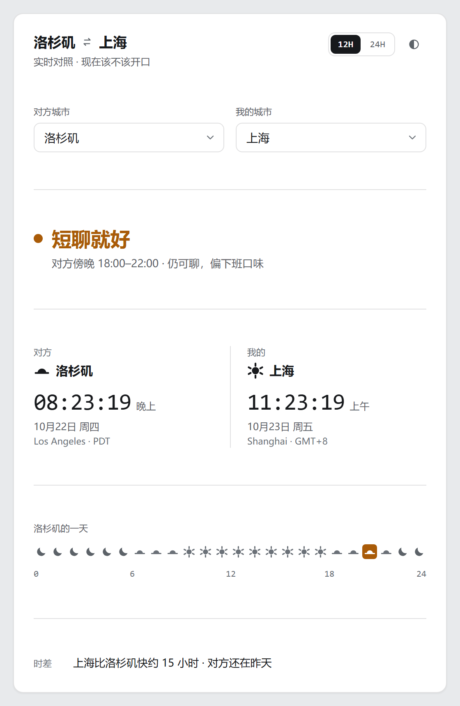
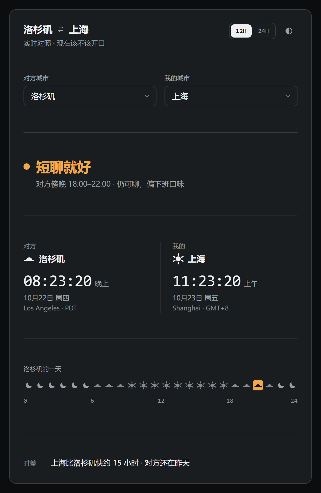

# A/时差保安

[English](README.md) | 简体中文

发消息之前先看一眼对方那边几点。一个只有结论、没有废话的时差仪表：**该正常聊、该短聊、还是该先睡**，一律按对方城市的当地时间判定。

> **界面只有中文。** 插件名、判定文案、城市名、时段、日期格式都是中文，没有语言切换；本仓库提供中英两份 README，页面本身只有一种语言。

作者：[FineCat](https://github.com/LiuChen19960902) · 版本：`1.0.2`



*浅色主题。截图拍摄时洛杉矶是 20:23，落在傍晚档；深色主题见下图。*



## 它回答什么

**此刻该不该开口跟对方说话。**

判定只看**对方城市的当地时间** —— 不方便的是对方，不是你；自己的城市只作对照。所以人在上海盯洛杉矶，和人在伦敦盯上海，是同一套标准。

| 对方当地时间 | 档位 | 结论 |
| --- | --- | --- |
| 09:00–18:00 | 白天（绿） | 现在可以聊 |
| 18:00–22:00 | 傍晚（黄） | 短聊就好 |
| 06:00–09:00 | 清晨（黄） | 先别展开 |
| 22:00–06:00 | 深夜（红） | 先睡，别发 |

阈值对所有城市完全一致，不因东西半球或作息文化而变。

## 页面里有什么

- **一个判定** —— 24 px 状态色大字，页面的唯一主角。颜色之外始终有文字和形状，不靠颜色单独传意。
- **两个时钟** —— 对方城市在上，自己的在下，各带日期和时区短名（PDT、GMT+8 这类）。12H / 24H 可切换。
- **一条 24 格图标带** —— 对方城市一天里的每一小时占一格，画成太阳、贴地平线的半日或月亮；当前那一格铺上判定色。四个阈值正好落在格子边界上。
- **一句话提醒** —— 判定下方一行写明「对方档位 + 时间段 + 一句话建议」，再往下是可选的时差提醒（只有你这边更晚时才出现）。不生成话术、不提供一键复制、不往聊天框里塞东西。
- **所有时区都能选** —— 运行时认识的 418 个时区全部覆盖，在随包的这套表里每个都有中文名（数量随运行时 tzdata 版本增减；若运行时新增了表里还没有的时区，该条目会退回英文名）。另按国家给出「中国（默认）」这类国家级条目。两侧的城市都能单独切换，标题中间那个 ⇄ 还能一键对调。

时间与偏移全部由浏览器的 `Intl` 和运行时自带的时区数据库算出，夏令时自动处理。**不联网、无账号、无推送、不做日历。**

## 安装与使用

把整个目录（**含隐藏的 `.minimax-plugin` 目录**）复制到用户主目录下的 `.minimax/plugins/`：

| 系统 | 目标路径 |
| --- | --- |
| Windows | `C:\Users\<用户名>\.minimax\plugins\timezone-guard` |
| macOS | `/Users/<用户名>/.minimax/plugins/timezone-guard` |
| Linux | `/home/<用户名>/.minimax/plugins/timezone-guard` |

`.minimax` 是隐藏目录：Windows 上需在文件资源管理器开启「显示隐藏的项目」，macOS 上按 `Cmd + Shift + .`。只要用过 MiniMax Code，这个目录通常已经存在。如果客户端使用了自定义数据目录，请放到那个目录下的 `plugins/` 里。

然后重启 MiniMax Code，确认插件已被识别并启用，让 Agent 帮你打开「A/时差保安」，或直接说「打开A/时差保安，看看洛杉矶现在该不该开口」。

更新时先关闭应用并退出 MiniMax Code，再整体替换插件目录。卸载同理，删除该目录即可。

## 已验证环境

MiniMax Code 桌面版 **3.1.4**，Windows 11 家庭版（10.0.26300，x64）。本插件在 3.1.4 上开发并测试。

需要 MiniMax Code **3.1.2** 或更高版本：包里声明了 `surface.window`（弹出独立窗口的尺寸），更早的版本装不上这个包。

在客户端里验证过：安装与打开；判定在白天 / 清晨 / 傍晚 / 深夜四个时段档各自正确切换；两个城市分别可切换，标题里的 ⇄ 点击后可一键对调（鼠标点击与键盘 Enter / Space 都试过，对调后两个时钟、时差、图标带、判定与两个城市输入框全部跟着翻转并持久化）；城市库覆盖运行时全部时区（实测运行时为 418 个）、每个都有中文名、无失效条目；12H / 24H 切换并持久化；浅色与深色两套主题；面板默认宽度下渲染正常。

布局另在本包的 client 文件上用 Chromium 155 直接测过 400 / 460 / 560 / 680 / 1100 / 1440 px 六档宽度：无横向溢出、无双滚动条、卡片底部无多余留白。

**未验证：** macOS 与 Linux；把面板弹成独立窗口（`surface.window`）这条路径没有实测过 —— 页面本身仍是一列响应式布局。

## 数据与访问范围

- **读取的文件** —— 只有它自己包目录下的五个静态文件：`miniapp/client/index.html`、`styles.css`、`cities.js`、`time.js`、`app.js`。不读包目录以外的任何文件，也不扫描磁盘。
- **写入的文件** —— 无。不写 `context.dataDir`，不写任何地方。
- **浏览器存储** —— 只存界面偏好，键名 `timezone-guard.prefs.v1`：选中的两个城市、主题、12H/24H 制式。不存会话、不存任何内容数据。
- **网络** —— 无。页面只从插件自己的回环服务加载静态资源，没有遥测，没有远程字体、图标或脚本。
- **子进程** —— 无。
- **Agent 轮次** —— 无。包没有声明 `agentAccess`，运行期不发起任何 Agent 调用。
- **凭据** —— 不需要 API key、不需要账号、不需要任何配置。

## 源码与验证情况

页面是 `miniapp/client/index.html`（无框架、无 CDN、无构建步骤，离线可用），视觉层在 `styles.css`，判定与交互在 `app.js`，城市库与全时区中文名在 `cities.js`，纯时间计算在 `time.js`；Node 入口是 `miniapp/node/server.mjs`，它只负责把 `/dashboard` 和这五个静态文件挂到宿主分配的端口上；供编辑器类型检查用的 Host API 类型定义在 `miniapp/node/miniapp-api.ts`。**没有任何第三方运行时依赖** —— Node 侧只用内置模块，浏览器侧只用原生 API。

### 跑测试

`miniapp/client/time.js` 装着全部时间计算，浏览器和 Node 跑的是**同一个文件**，不存在第二份要同步的副本。单测随包分发：

```sh
npm test
```

在包目录下执行。覆盖四个阈值正好落在整点（06:00 / 09:00 / 18:00 / 22:00）、偏移解析（含 `GMT+05:45` 这类非整小时时区）、时差文案，以及「对方还在昨天」用的日历日差。

## 许可

[MIT](LICENSE)。
