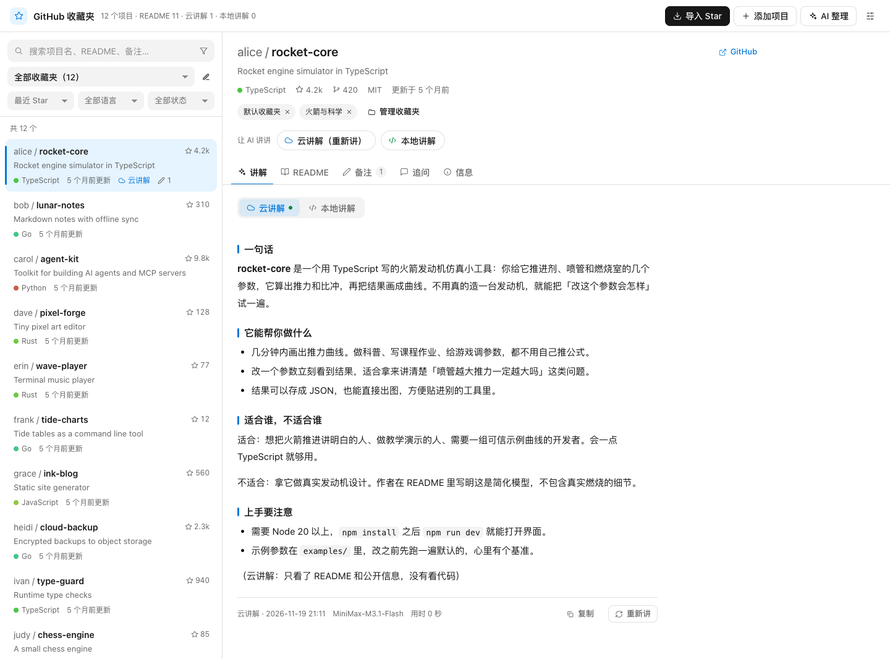

# GitHub Star Shelf

English | [简体中文](README.zh-CN.md)

Turn your GitHub stars into a shelf you can actually use. **GitHub Star Shelf** is a [MiniMax Code](https://code.minimax.cn) Mini App: import your stars, sort them into collections, search names, READMEs and your own notes, and ask the AI to explain any project in plain language, either from its README alone or after it has read the real code.

Plugin ID `github-star-shelf` · MIT licensed · the interface is in Chinese.



*Screenshots use sample data. The light and dark themes both follow MiniMax Code; [a dark screenshot](docs/preview-dark.png) is included.*

## What it does

- **Import** your stars with the GitHub CLI (`gh`), or the public stars of any user by name. READMEs are fetched in the background, so search can look inside them.
- **Collections and notes.** Sort projects into collections, keep your own notes, and let the AI add notes too.
- **Search** names, descriptions, topics, README text and notes (several words must all match). Filter by language or by explained / noted; sort by star date, stars, last push or name.
- **Cloud explanation.** The AI reads the project's metadata and README and explains it in plain language. No code is downloaded.
- **Local explanation.** A shallow clone goes into the AI's own workspace and the AI reads the real code. It never runs, installs or builds anything from the repository.
- **One session per project.** Follow-up questions stay with that project; start a fresh session whenever you like. Every permission request from the AI is shown in the page and waits for your answer.
- **MCP tools.** Twelve tools let the Agent list and search projects, manage collections, write notes and import stars.
- **Tools & locations.** The settings page shows which `gh` and `git` it found and where, lets you re-detect after installing one, or point it at your own.

## Requirements

- **MiniMax Code 3.1.6 or later** on macOS or Windows. Earlier versions cannot tell a Mini App where the AI session works, which the AI features need.
- **`git`**, for local explanations.
- **`gh`** (the GitHub CLI), logged in with `gh auth login`: optional but recommended. Without it the app reads public data anonymously, and GitHub allows only 60 such requests per hour per network.
- Node.js 22 or later is needed only to run the tests. The Mini App itself runs on MiniMax Code's own Node runtime.

## Install

**From Git** (MiniMax Code 3.1.11 or later): in the plugin marketplace click **Create**, choose **Import from Git repository** under **Mini App**, paste `https://github.com/start3208/github-star-shelf`, click **Preview**, check the permissions, then **Import**. Open it from plugin management, or ask the Agent to open GitHub Star Shelf.

**By hand:** `git clone https://github.com/start3208/github-star-shelf`, then copy the folder **without `.git`** (but with the hidden `.minimax-plugin/`) to `<dataDir>/plugins/github-star-shelf/` (by default `~/.minimax/plugins/`) and restart MiniMax Code. You can also hand the folder to the Agent and ask it to publish it as a Mini App.

## Use it

1. Open the Mini App and click **Import**. If `gh` isn't logged in, type your GitHub username first.
2. Pick a project and choose **Cloud explanation** (README only) or **Local explanation** (reads the code too).
3. Ask follow-ups on the **Chat** tab, add notes, file projects into collections, or open the **AI tidy-up** panel and describe how you want the collections arranged.

## How it finds your tools and folders

Nothing about your machine is hard-coded. Instead:

| What | How it is found |
| --- | --- |
| `gh`, `git` | 1) The path you set in **Settings → Tools & locations**. 2) Your `PATH`. 3) The usual install folders for your system: macOS `/opt/homebrew/bin`, `/usr/local/bin`, MacPorts; Linux `/usr/bin`, Linuxbrew, snap, Nix, `~/.local/bin`; Windows Program Files, `%LOCALAPPDATA%\Programs`, Scoop, Chocolatey. 4) Only if it is still missing: the `PATH` of your login shell. Each candidate is run with `--version` and must identify itself as `gh` or `git`, so a broken or look-alike program is skipped. |
| macOS `git` | `/usr/bin/git` is skipped when the Command Line Tools are not installed: it is only a placeholder that would pop up Apple's installer. |
| Windows | Only `.exe` / `.com` programs are used, and clones get `core.longpaths=true`. |
| AI workspace folder | Asked from MiniMax Code for each session (`workspaceDir`), because it differs per computer and per Agent. It is asked again after every start (when the page first asks for its state) and whenever the remembered folder is gone, so data moved to another computer follows. The settings page only displays the last one. |
| Data folder | Handed over by MiniMax Code (`dataDir`). |
| Clone cache | `cache/repos/<owner>__<repo>/` inside the AI workspace folder. Before cloning, the app checks that it is writable and has room (twice the repository size, at least 200 MB). |

The offline tests fake other people's machines to cover this: a short `PATH`, tools in non-standard places, a broken or look-alike `gh`, the macOS placeholder `git`, folders whose names contain spaces, Chinese characters and quotes, unwritable or full disks, and a moved data folder.

## Tested environment

- **MiniMax Code 3.1.16 on macOS (Apple silicon)**, with `gh` 2.96 logged in and Apple's `git`. Version 1.1.0 was used through this window: imported stars, cloud and local explanations, notes, follow-ups and the settings page.
- **MiniMax Code on Windows 11:** this public package at commit `3e508ea` (version 1.2.0) was imported with *Import from Git repository* and used against a real GitHub account: 50 stars imported (the README cache was still filling, 33 to 50, while the recording ran), search, the collections dropdown, a cloud explanation on MiniMax-M3.1-Flash with stop and re-run, a follow-up that ran two tools, the README tab, and the Agent calling the MCP tools (`list_collections`, `list_projects`, `get_project`) and reading back the right shelf. Local explanations, the settings page, notes and collection editing were used there too. The recording does not show the client build; the import dialog reported this package's minimum as `>=3.1.6`.
- **Install from Git** was used on both systems: the marketplace's *Import from Git repository* preview showed this package with its name, version, commit, declared permission (`agentAccess: session.run`) and the minimum version below, and the imported copy was used locally.
- **Offline tests** (`npm test`, about 130 tests, under 30 s): Node 22, 24 and 26 on macOS (Apple silicon). CI runs Node 22 and 24 on Ubuntu and macOS. On Windows 11 the Windows-related subset was run by hand: 11 passed, 2 skipped, 0 failed.
- **The page** (1.2.0): rendered in headless Chrome against an isolated copy of the app with a fake `gh`, `git` and AI, in light and dark themes, at widths from 360 to 1400 px: no console errors and no horizontal scrolling. Those screenshots are the ones above. This is not a real-browser test suite: it lives outside this repository and does not run in CI.
- **Not verified:** on Windows the rest of the suite — importing, explanation sessions, cloning, cancellation and rate limits, 99 tests — does not run at all, because it fakes `gh` and `git` through a POSIX `sh`; that half is covered on macOS, Ubuntu and in CI only. Linux only runs in CI. The AI's permission confirmation card has only been exercised with a simulated Agent, because the real one never asked for a permission here. Whether "open session in sidebar" actually opens the sidebar cannot be seen from inside the page. GitHub Enterprise is not supported (`GH_HOST` is pinned to `github.com`).

## Data & access

**Files**

- In the folder MiniMax Code gives the app (`dataDir`): `state.json` (collections, projects, notes, explanations, settings; written atomically, and a damaged file is set aside as `state.json.corrupt-<time>` rather than overwritten) and `readmes/` (cached README text). Nothing else is stored there.
- In the AI session's workspace folder (asked from MiniMax Code, never guessed): `prompts/` (copies of the five fixed prompt files shipped in this package), `projects/<owner>__<repo>/` (`meta.json` and `README.md`, the material the AI reads) and, for local explanations only, `cache/repos/<owner>__<repo>/` (shallow clones). It deletes only those exact folders, only when you delete a project or clear the cache, and first checks that each path really is one of them. Before writing there it creates and removes a tiny test file to confirm the folder is writable.
- It never touches MiniMax Code's configuration or any other folder.
- The page keeps view preferences (selected collection, sort, filters, last tab) in the browser's `localStorage`.

**Network** (read-only; no telemetry, no accounts, no other hosts)

- `api.github.com`: through `gh` when it is installed and logged in (your login, your rate limit). Otherwise anonymous GET requests with `User-Agent: github-star-shelf/1.0` for a named user's public stars and for repository details. When GitHub's anonymous limit is hit the app says so and stops. It does not retry, and it does not scrape web pages.
- `raw.githubusercontent.com`: README text, only when `gh` is not available.
- `github.com`: `git clone` of public repositories for local explanations, run by your own `git`.
- `https://cli.github.com` is only shown as an install hint. The app never contacts it.
- In the page, README images load from GitHub's own hosts (`github.com`, `*.github.com`, `*.githubusercontent.com`, `github.githubassets.com`). Other hosts load only if you choose "load all" in settings, or click "load external images" for one README, which warns that it reveals your IP address. Links open in your browser.
- The app never reads, stores or sends your GitHub token. `gh` keeps it.

**Processes it starts** (arguments are passed as arrays, never through a shell; `GH_HOST=github.com`; interactive prompts disabled; all of them are stopped when the Mini App stops)

- `gh --version`, `gh api user --jq .login`, `gh api graphql` (one read-only query: your own star count) and `gh api` with read-only GET paths for stars, repository details and READMEs.
- `git --version`; `git clone --depth 1 --single-branch --no-tags` into the cache folder; `git fetch --depth 1` and `git reset --hard FETCH_HEAD` inside that same cache folder to refresh it.
- macOS only: `xcode-select -p`, so that it never runs Apple's placeholder `/usr/bin/git`.
- Your login shell, only when `gh` or `git` was not found anywhere else, or when you click **Re-detect**: `$SHELL -ilc` with a fixed script that only prints `$PATH` (6 second limit; only bash, zsh, fish, sh, dash or ksh). Like any terminal, that makes your shell read its startup files.

**Agent turns** (`agentAccess: ["session.run"]`)

It asks the Agent to explain a project, to answer your follow-up questions, to write notes through this app's own MCP tools, and to rearrange collections when you ask it to. The Agent keeps its usual abilities (files, shell, MCP), so every permission request is shown in the page and waits for your answer: it is never allowed automatically, and it is denied automatically after 30 minutes. The fixed prompt files tell the AI to treat text from repositories as data, never as instructions, and never to run, install or build anything from a repository.

**Not used:** your other conversations (`session.read`), the tool API, microphone, camera, notifications, and Host navigation.

**MCP:** twelve tools at `/mcp/github-star-shelf` for collections, projects, notes and star import. They touch only this app's own data. `servers.mcp.json` holds a placeholder address that MiniMax Code replaces with the real one.

## Files

```text
.minimax-plugin/plugin.json   Plugin manifest
package.json                  Mini App declaration
miniapp/miniapp.json          Payload roots, Node entry, page route, permissions
miniapp/client/               The page: plain JavaScript, no build step
miniapp/node/server.mjs       Node entry: start(context) → { dispose }
miniapp/node/lib/env.mjs      Where are gh, git and the folders? (injectable, so tests can fake any machine)
miniapp/node/lib/github.mjs   gh / public API / git access and the wording of errors
miniapp/node/lib/service.mjs  Collections, projects, notes, import, settings
miniapp/node/lib/agent.mjs    AI sessions, explanations, permissions, cache
miniapp/node/lib/mcp.mjs      The twelve MCP tools
miniapp/node/lib/search.mjs   Search over names, READMEs and notes
miniapp/node/lib/store.mjs    State on disk, written atomically
miniapp/node/prompts/         The five fixed prompt files given to the AI
servers.mcp.json              MCP server declaration
test/                         Offline tests and their fakes (gh, git, AI)
```

## Development

```sh
npm test                # about 130 offline tests, under 30 s, Node 22+; never touches GitHub
SHELF_LIVE=1 npm test   # also two smoke tests against your real gh / git (1-2 GitHub requests)
```

The tests start the real Mini App server with a fake `gh`, `git` and AI, in sandbox folders whose names contain spaces, Chinese characters and quotes. A network guard fails any test that tries to reach the internet.

`test/client.test.mjs` checks the page scripts statically (syntax, that every import resolves, no import cycles, nothing the page's strict content-security policy would block), because the page has no browser test of its own.

`test/hygiene.test.mjs` keeps the repository clean for other people's machines: no personal paths, account names, e-mail addresses or tokens; every address the code contacts and every process it starts must match the **Data & access** section above.

CI also runs the community repository's package validator ([MiniMax-AI/MiniMax-Code-MiniApps](https://github.com/MiniMax-AI/MiniMax-Code-MiniApps), pinned to a commit). To run it yourself, clone that repository and run `node scripts/validate.mjs <this folder>`. The folder containing this one must have a lowercase name.

## Credits

`icon.png` is the stock Mini App icon: it is byte-identical to `examples/hello-miniapp/icon.png` in the community repository [MiniMax-AI/MiniMax-Code-MiniApps](https://github.com/MiniMax-AI/MiniMax-Code-MiniApps) (MIT, Copyright (c) 2026 MiniMax) and to the icon many packages there use. If you fork this, you can replace it with your own.

## License

[MIT](./LICENSE) for everything in this repository except `icon.png`, which is covered by the credit above.
