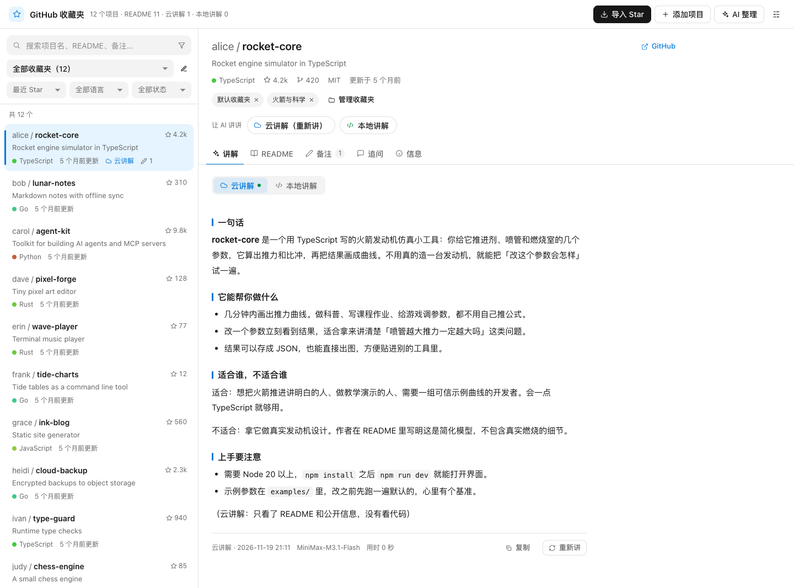

# GitHub 收藏夹（GitHub Star Shelf）

[English](README.md) | 简体中文

把你在 GitHub 上点过的 Star 变成真正用得上的收藏夹。**GitHub 收藏夹** 是一个 [MiniMax Code](https://code.minimax.cn) 的 Mini App：导入你的 Star，分到不同的收藏夹，按名称、README 和你自己的备注搜索，还能让 AI 用大白话讲清每个项目是干什么的：只看 README 讲，或者把代码拉下来读完再讲。

插件 ID `github-star-shelf` · MIT 许可证 · 界面是中文。



*截图用的是示例数据。明暗主题都跟随 MiniMax Code；另附[暗色截图](docs/preview-dark.png)。*

## 能做什么

- **导入**：用 GitHub 命令行工具（`gh`）导入你的 Star，也可以填用户名导入对方公开的 Star。README 会在后台预取，所以搜索能搜进 README 里面。
- **收藏夹和备注**：把项目分进收藏夹，写自己的备注，AI 也能帮你记备注。
- **搜索**：名称、简介、话题、README 正文、备注（多个词要同时命中）。可以按语言、按「已讲解 / 有备注」筛选，按 Star 时间、星数、最近更新、名称排序。
- **云讲解**：AI 读项目信息和 README，用大白话讲。不下载代码。
- **本地讲解**：把代码浅克隆到 AI 自己的工作文件夹里，让 AI 读真实的代码再讲。不会运行、安装或构建仓库里的任何东西。
- **一个项目一个会话**：追问都留在这个项目的会话里，随时可以新开一个。AI 每次要权限，都会在页面上等你回答。
- **MCP 工具**：12 个工具，让 Agent 能列出和搜索项目、整理收藏夹、记备注、导入 Star。
- **工具和位置**：设置页会告诉你找到了哪个 `gh`、哪个 `git`、在哪里；装好之后可以重新检测，也可以手动指定。

## 需要什么

- **MiniMax Code 3.1.6 或更新**（macOS 或 Windows）。更早的版本没法告诉 Mini App「AI 会话在哪个文件夹干活」，AI 功能要用到这个。
- **`git`**：本地讲解需要。
- **`gh`**（GitHub 命令行工具），并用 `gh auth login` 登录：可选，但推荐。没有它也能用，只是改用匿名的公开接口，GitHub 对匿名访问限制为每个网络每小时 60 次。
- 只有跑测试才需要 Node.js 22 或更新。Mini App 本身运行在 MiniMax Code 自带的 Node 上。

## 安装

**从 Git 仓库导入**（MiniMax Code 3.1.11 或更新）：在插件市场点「创建」，在「Mini App」分类下选「从 Git 仓库导入」，粘贴 `https://github.com/start3208/github-star-shelf`，点「预览」，核对权限后点「导入」。之后从插件管理里打开，或者让 Agent「打开 GitHub 收藏夹」。

**手动安装**：`git clone https://github.com/start3208/github-star-shelf`，然后把文件夹**去掉 `.git`**（保留隐藏的 `.minimax-plugin/`）复制到 `<dataDir>/plugins/github-star-shelf/`（默认是 `~/.minimax/plugins/`），重启 MiniMax Code。也可以把这个文件夹交给 Agent，让它按 Mini App 发布。

## 怎么用

1. 打开 Mini App，点「导入」。`gh` 没登录的话，先填你的 GitHub 用户名。
2. 选一个项目，点「云讲解」（只看 README）或「本地讲解」（连代码一起读）。
3. 在「追问」里接着问，写备注，把项目放进收藏夹；也可以打开「AI 整理」，用一句话说想怎么整理。

## 它怎么找到你电脑上的工具和文件夹

你机器上的任何东西都不是写死的，而是这样找的：

| 找什么 | 怎么找 |
| --- | --- |
| `gh`、`git` | 1）你在「设置 → 工具和位置」里手动指定的路径。2）`PATH`。3）各系统常见的安装位置：macOS 的 `/opt/homebrew/bin`、`/usr/local/bin`、MacPorts；Linux 的 `/usr/bin`、Linuxbrew、snap、Nix、`~/.local/bin`；Windows 的 Program Files、`%LOCALAPPDATA%\Programs`、Scoop、Chocolatey。4）都找不到，才去问你登录 shell 的 `PATH`。每个候选都会用 `--version` 实际运行一次，输出必须表明自己是 `gh` 或 `git`，所以坏的、同名冒牌的程序会被跳过。 |
| macOS 的 `git` | 没装「命令行开发工具」时跳过 `/usr/bin/git`：它只是个占位程序，一运行就会弹出苹果的安装窗口。 |
| Windows | 只用 `.exe` / `.com`；克隆时加 `core.longpaths=true`。 |
| AI 的工作文件夹 | 每个会话都问 MiniMax Code（`workspaceDir`），因为它每台电脑、每个 Agent 都不一样。每次启动之后（页面第一次来取状态时）、以及记着的文件夹不见了的时候，都会重新问一次，所以数据搬到另一台电脑也能跟过去。设置页只显示最近一次用的位置。 |
| 数据文件夹 | 由 MiniMax Code 交给 Mini App（`dataDir`）。 |
| 克隆缓存 | AI 工作文件夹里的 `cache/repos/<owner>__<repo>/`。克隆前会检查能不能写、剩余空间够不够（仓库大小的两倍，至少 200 MB）。 |

离线测试会模拟别人的电脑来覆盖这些情况：很短的 `PATH`、装在非常规位置的工具、坏的或冒牌的 `gh`、macOS 的占位 `git`、名字里带空格、中文和引号的文件夹、不可写或写满的磁盘、搬了家的数据文件夹。

## 已测试环境

- **MiniMax Code 3.1.16，macOS（Apple 芯片）**，`gh` 2.96 已登录，`git` 是苹果自带的。1.1.0 在这个窗口里实际用过：导入 Star、云讲解和本地讲解、备注、追问、设置页。
- **MiniMax Code，Windows 11**：用「从 Git 仓库导入」装的就是这份公开包 `3e508ea`（版本 1.2.0），配真实 GitHub 账号走了一遍：导入 50 个 Star（录屏期间 README 缓存还在从 33 涨到 50）、搜索、收藏夹下拉、云讲解（MiniMax-M3.1-Flash，能停能重讲）、追问（实际调了 2 次工具）、README 页签，以及 Agent 调用 MCP 工具（`list_collections`、`list_projects`、`get_project`）读回来的书架。本地讲解、设置页、备注、编辑收藏夹在 Windows 上也用过。录屏里看不到客户端具体版本；导入对话框显示这个包的最低版本是 `>=3.1.6`。
- **从 Git 仓库导入**在 macOS 和 Windows 上都用过：插件市场的「从 Git 仓库导入」预览认出了这个包，显示出了名称、版本、commit、声明的权限（`agentAccess: session.run`）和下面的最低版本；导入后的副本本地也用过。
- **离线测试**（`npm test`，约 130 条，不到 30 秒）：macOS（Apple 芯片）上的 Node 22、24 和 26。CI 在 Ubuntu 和 macOS 上跑 Node 22 和 24。Windows 11 上手动跑过和 Windows 相关的那一部分：11 过、2 跳过、0 失败。
- **页面本身**（1.2.0）：在无头 Chrome 里，对着这份 Mini App 的隔离副本（假的 `gh`、`git` 和 AI）渲染过，明暗两套主题、从 360 到 1400 px 的各种宽度：没有控制台报错，也没有横向滚动。上面那两张截图就是这么来的。这不是一套真实的浏览器测试：脚本不在本仓库里，也不在 CI 里跑。
- **没有验证：** Windows 上剩下那部分测试——导入、讲解会话、克隆、取消、限流，共 99 条——跑不起来，因为它们要用 POSIX 的 `sh` 来假装 `gh` 和 `git`；这部分只在 macOS、Ubuntu 和 CI 里覆盖。Linux 只在 CI 里跑过。AI 的权限确认卡只用模拟的 Agent 测过，这台机器上的真实 AI 从没要过权限。「在侧边栏打开会话」到底有没有弹出侧边栏，从页面里看不到。不支持 GitHub Enterprise（`GH_HOST` 固定为 `github.com`）。

## 数据与访问

**文件**

- MiniMax Code 分给 Mini App 的数据文件夹（`dataDir`）：`state.json`（收藏夹、项目、备注、讲解、设置；原子写入，文件如果损坏会改名成 `state.json.corrupt-<时间>` 留着，不会被覆盖）和 `readmes/`（README 文本缓存）。里面只有这些。
- AI 会话的工作文件夹（向 MiniMax Code 问来的，不靠猜）：`prompts/`（随包带的 5 个固定提示词的副本）、`projects/<owner>__<repo>/`（`meta.json` 和 `README.md`，是给 AI 看的资料），以及只有本地讲解才有的 `cache/repos/<owner>__<repo>/`（浅克隆）。只有在你删除项目或清除缓存时才会删，而且只删这几个确切的文件夹，删之前先核对每个路径确实是它们。往里写之前，会先建一个很小的测试文件再删掉，用来确认文件夹能写。
- 不会碰 MiniMax Code 的配置，也不会碰任何别的文件夹。
- 页面会把视图偏好（选中的收藏夹、排序、筛选、上次打开的标签）存在浏览器的 `localStorage` 里。

**网络**（只读；没有遥测，没有账号，不访问别的地址）

- `api.github.com`：`gh` 装了并登录时，通过 `gh` 访问（用你的登录和你的额度）。否则用匿名的 GET 请求，`User-Agent: github-star-shelf/1.0`，读某个用户公开的 Star 和仓库详情。匿名额度用完时，如实告诉你并停下，不重试，也不去抓网页。
- `raw.githubusercontent.com`：README 文本，只在没有 `gh` 时用。
- `github.com`：本地讲解时用你自己的 `git` 做 `git clone`，只克隆公开仓库。
- `https://cli.github.com` 只是作为安装提示显示出来，程序从不访问它。
- 页面里的 README 图片默认只从 GitHub 自家的地址载入（`github.com`、`*.github.com`、`*.githubusercontent.com`、`github.githubassets.com`）。别的地址只有在设置里选了「全部载入」、或在某个 README 上点了「载入外部图片」才会载入，后者会提醒你这会暴露你的 IP。链接都在浏览器里打开。
- 程序从不读取、保存或发送你的 GitHub 令牌，令牌一直由 `gh` 自己保管。

**会启动的进程**（参数都用数组传，从不经过 shell；`GH_HOST=github.com`；关闭交互提示；Mini App 停止时全部一起终止）

- `gh --version`、`gh api user --jq .login`、`gh api graphql`（一次只读查询：你自己的 Star 总数），以及用 `gh api` 读 Star、仓库详情和 README 的只读 GET。
- `git --version`；`git clone --depth 1 --single-branch --no-tags` 克隆到缓存文件夹；`git fetch --depth 1` 和 `git reset --hard FETCH_HEAD` 在同一个缓存文件夹里更新它。
- 只在 macOS：`xcode-select -p`，为了绝不运行苹果的占位程序 `/usr/bin/git`。
- 你的登录 shell，只在别处都没找到 `gh` 或 `git`、或你点了「重新检测」时才会用：`$SHELL -ilc` 加一段写死的脚本，只打印 `$PATH`（限时 6 秒；只认 bash、zsh、fish、sh、dash、ksh）。和你打开终端一样，这会让你的 shell 读取它的启动文件。

**Agent 回合**（`agentAccess: ["session.run"]`）

它会请 Agent 讲解项目、回答你的追问、通过本应用自己的 MCP 工具记备注，以及在你要求时整理收藏夹。Agent 保留它平常的能力（文件、shell、MCP），所以每一次权限请求都会显示在页面上，等你回答：从不自动允许，30 分钟没人回答会自动拒绝。固定的提示词会告诉 AI：仓库里的文字只是资料，不是指令；不运行、不安装、不构建仓库里的任何东西。

**没有用到：** 你的其他会话（`session.read`）、工具接口、麦克风、摄像头、通知、Host 导航。

**MCP：** `/mcp/github-star-shelf` 上的 12 个工具，管收藏夹、项目、备注和导入 Star，只碰本应用自己的数据。`servers.mcp.json` 里的地址是占位符，MiniMax Code 会换成真实的。

## 文件说明

```text
.minimax-plugin/plugin.json   插件清单
package.json                  Mini App 声明
miniapp/miniapp.json          载荷目录、Node 入口、页面路由、权限
miniapp/client/               页面：原生 JavaScript，不需要构建
miniapp/node/server.mjs       Node 入口：start(context) → { dispose }
miniapp/node/lib/env.mjs      gh、git 和各个文件夹在哪里？（可注入，测试里能模拟任何一台机器）
miniapp/node/lib/github.mjs   gh / 公开接口 / git 的访问，以及报错的措辞
miniapp/node/lib/service.mjs  收藏夹、项目、备注、导入、设置
miniapp/node/lib/agent.mjs    AI 会话、讲解、权限、缓存
miniapp/node/lib/mcp.mjs      12 个 MCP 工具
miniapp/node/lib/search.mjs   在名称、README、备注里搜索
miniapp/node/lib/store.mjs    落盘的状态，原子写入
miniapp/node/prompts/         给 AI 的 5 个固定提示词文件
servers.mcp.json              MCP 服务声明
test/                         离线测试和它们用的假 gh、假 git、假 AI
```

## 开发

```sh
npm test                # 约 130 条离线测试，不到 30 秒，Node 22+；从不访问 GitHub
SHELF_LIVE=1 npm test   # 另外跑两条用本机真实 gh / git 的冒烟测试（1~2 个 GitHub 请求）
```

测试会启动真正的 Mini App 服务，配上假的 `gh`、`git` 和 AI，放在名字里带空格、中文和引号的沙盒文件夹里。网络闸会让任何想访问互联网的测试直接失败。

`test/client.test.mjs` 对页面脚本做静态检查（语法、每个 import 都对得上、没有循环引用、没有会被页面严格安全策略拦掉的写法），因为页面本身没有浏览器端测试。

`test/hygiene.test.mjs` 保证仓库在别人的电脑上也是干净的：没有个人路径、账号名、邮箱或令牌；代码访问的每个地址、启动的每个进程，都必须和上面的「数据与访问」一致。

CI 还会运行社区仓库的包校验脚本（[MiniMax-AI/MiniMax-Code-MiniApps](https://github.com/MiniMax-AI/MiniMax-Code-MiniApps)，固定在某个提交上）。想自己跑：克隆那个仓库，执行 `node scripts/validate.mjs <本文件夹>`。本文件夹的上一级目录名必须是小写。

## 致谢

`icon.png` 是 Mini App 的默认图标：它和社区仓库 [MiniMax-AI/MiniMax-Code-MiniApps](https://github.com/MiniMax-AI/MiniMax-Code-MiniApps) 里 `examples/hello-miniapp/icon.png` 逐字节相同（MIT，Copyright (c) 2026 MiniMax），那里也有很多包在用同一个图标。如果你要 fork，可以换成自己的。

## 许可证

除 `icon.png`（见上面的致谢）外，本仓库的内容都是 [MIT](./LICENSE)。
