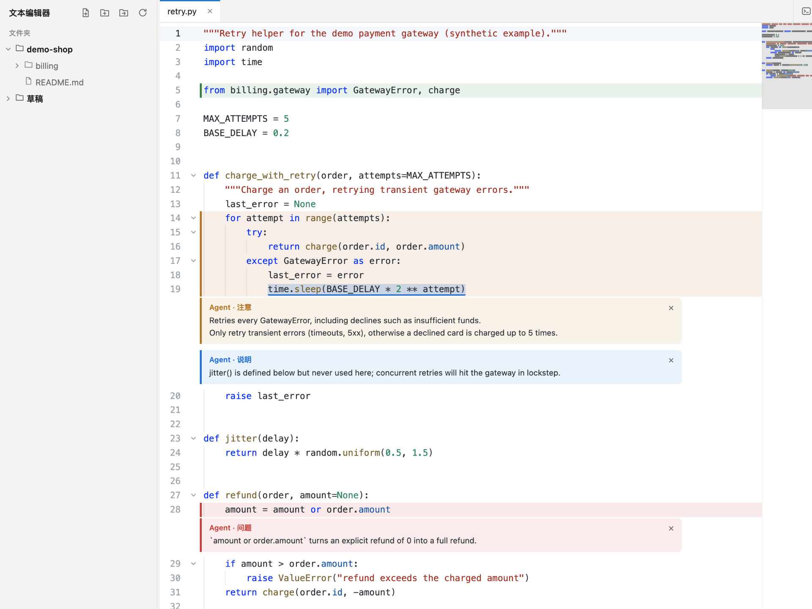

# 文本编辑器

[English](README.md) | 简体中文

一个 Sublime 风格的本地文本编辑器，由你和 MiniMax Code 的 Agent 一起使用。双方编辑的是同一份实时缓冲区：Agent 通过 MCP 工具读取、修改、新建和保存文件，你能实时看到每一处改动。Review 代码时，Agent 还可以高亮代码并附上注释，这些都不会写进文件。

作者：[TrentChou](https://github.com/TrentChou) · 版本：`1.3.1`

## 安装与使用

1. 把整个目录（包括隐藏的 `.minimax-plugin/`）复制到 `<dataDir>/plugins/text-editor/`（默认是 `~/.minimax/plugins/text-editor/`），然后重启 MiniMax Code。
2. 从右侧面板的「+」打开，或在对话里 `@文本编辑器`，也可以直接对 Agent 说「打开文本编辑器，加载当前项目」。
3. 在侧边栏添加文件夹，或者让 Agent 把当前对话的工作区加进来。安装之后，从下一轮对话开始，Agent 就能使用编辑器的 MCP 工具。

## 功能

- 多标签、侧边栏文件树、快速打开（`⌘P`）、跳转到行（`⌃G`）、命令面板（`⇧⌘P`）、查找替换、多光标（`⌘D`、`⇧⌘L`）、代码折叠、小地图、缩进参考线。
- 约 40 种语言和格式的语法高亮，包括 JSON、YAML、TOML、Markdown、JavaScript/TypeScript、Python、Go、Rust、Java、C/C++、SQL、Shell 等。
- 热退出：关闭页面或重启 MiniMax Code 后，未保存的修改仍然保留。
- 感知磁盘变化：其他程序修改了文件时自动重新加载；如果你也有未保存的修改，会提示冲突。被删除的文件保存后会重新创建。
- 跟随对话：打开编辑器时，你最近使用的对话的工作区会排到侧边栏最上方。

## Agent 工具（MCP）

| 工具 | 作用 |
| --- | --- |
| `get_editor_state` | 侧边栏文件夹、已打开的标签（未保存/冲突标记、高亮数）、当前文件、用户选区、高亮设置 |
| `list_directory` | 列出侧边栏文件夹内的目录 |
| `read_file` | 读取文件；文件已打开时返回实时缓冲区，包括未保存的修改 |
| `create_file` | 新建文件并在标签中打开 |
| `write_file` / `edit_file` | 替换用户看到的缓冲区的全部内容或一段精确文本；除非传 `save: true`，否则保持未保存 |
| `save_file` | 保存缓冲区；如果磁盘上的文件已被其他程序修改，除非明确要求，否则拒绝覆盖 |
| `open_in_editor` | 打开文件并跳到指定行，或把文件夹加入侧边栏 |
| `highlight_code` | 按行、字符范围或精确片段高亮代码，可附带注释和类型（`info`、`warning`、`error`、`success`） |
| `list_highlights` / `clear_highlights` | 查看还存在哪些高亮（用户可以自行关掉），以及清除高亮 |

这些工具只能访问侧边栏文件夹内的文件，并且拒绝读写 `.env`、`.secrets/`、`.ssh/`、私钥等凭据类文件。这类文件你仍然可以自己打开。

## Review 高亮

高亮只是叠加显示，不会修改缓冲区或磁盘上的文件。代码被编辑时，高亮会跟着移动；注释以卡片形式显示在被高亮的代码下面。按 `F8` / `⇧F8` 在高亮之间跳转，状态栏会显示高亮数，点击可以打开菜单。

高亮的生命周期由你决定，可以在状态栏菜单或设置里切换：

- **保留高亮，直到手动清除**（默认关闭）：关闭时，被高亮的代码一旦被编辑（你改、Agent 改、从磁盘重新加载都算，紧贴边缘的修改也算），或者文件被关闭，这处高亮就自动消失。打开时，高亮会一直保留，重启后也在，直到你或 Agent 清除；如果文件在关闭期间被改过，高亮会重新定位到原样未变的代码上，那段代码被改写时则失效并提示你。
- **显示 Agent 高亮**：只控制显示或隐藏，不会删除任何高亮。

单条注释可以点它的 × 关掉，也可以从状态栏菜单清除当前文件或全部高亮。

## 数据与访问

- **读取的文件**：你打开的文件，以及你加入侧边栏的文件夹内的文件。已打开的文件每 1.5 秒 `stat` 一次，用来发现其他程序做的修改。
- **写入的文件**：只在你或 Agent 保存（`⌘S`、`save_file` 或 `save: true`）以及新建文件、文件夹时写入。保存时先在目标所在目录写一个临时文件（`.<文件名>.<pid>.<序号>.tmp`），复制原文件的权限位，再重命名覆盖目标。软链接会被跟随：链接本身保持不变，更新的是它指向的目标。指向旧文件的硬链接会保留旧内容，扩展属性不会复制。如果目录不可写但文件可写，会改为直接覆盖写入。新建文件采用独占方式创建，不会覆盖已有文件。高亮不会向你的文件写入任何内容。
- **状态**（存放在 Mini App 数据目录）：`state.json`（侧边栏文件夹、标签、设置）、`hot/`（热退出用的未保存内容）、`drafts/`（默认的「草稿」文件夹）、`highlights.json`（只在开启「保留高亮」时存在，关闭后删除）。
- **Hook**：在 `SessionStart` 和 `UserPromptSubmit` 时，`hooks/record-workspace.sh`（Windows 上是 `record-workspace.ps1`）把当前对话的工作区路径写入 `<PLUGIN_DATA>/active-workspace`，不读取其他内容，也不输出任何东西。编辑器从自己数据目录旁边的 Hook 数据目录读取这个文件。
- **子进程**：执行 `git -C <侧边栏文件夹> ls-files -co --exclude-standard -z`（参数以数组传递，超时 5 秒）生成快速打开列表；没有 Git 时改为遍历目录，跳过 `node_modules`、构建产物等目录。Hook 会运行 `sh` 或 `powershell`。
- **网络**：无。页面和 MCP 端点只在宿主分配的 `127.0.0.1` 端口上提供服务，跨站请求和来自其他网页来源的 MCP 调用都会被拒绝。

## 测试环境

- macOS 26.5（Apple 芯片）上的 MiniMax Code 3.1.1：完成安装、打开，在亮色和暗色主题下通过页面使用，并在真实对话中通过 Agent 的 MCP 工具使用。
- 隔离的运行时测试覆盖了：高亮工具、编辑后的位置映射、两种生命周期、重启后恢复、文件关闭期间的外部修改，以及原子保存（权限位、软链接、不残留临时文件、只读目录）。
- 未在 Windows 和 Linux 上测试，Windows 的 Hook 脚本也没有实际运行过。

## 构建内置的第三方代码

`miniapp/client/vendor/codemirror.js` 和 `miniapp/node/vendor/cm-state.mjs` 是预先构建好的 CodeMirror 6 包。重新构建方法：`cd vendor-src && npm ci && node build.mjs ../miniapp`。版本锁定在 `vendor-src/package-lock.json`。

## 许可证

[MIT](./LICENSE)。内置的第三方代码沿用各自的许可证：CodeMirror 6、Lezer、小地图与缩进参考线扩展（MIT，见 `miniapp/client/vendor/THIRD_PARTY_LICENSES.txt` 和 `miniapp/node/vendor/THIRD_PARTY_LICENSES.txt`）；JetBrains Mono（SIL Open Font License 1.1，见 `miniapp/client/fonts/OFL.txt`）。
