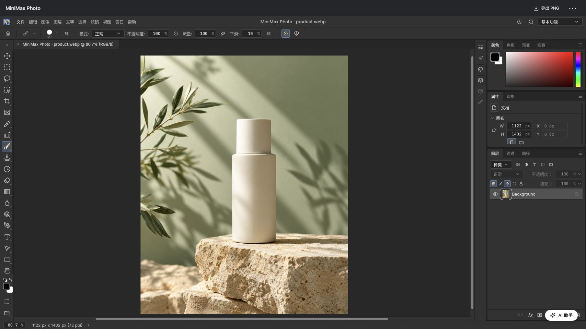

# MiniMax Photo

[简体中文](README.zh-CN.md)

An image-editing MiniApp for MiniMax Code. Edit layers, selections and colors yourself, or ask the in-app assistant to inspect the canvas, perform reversible edits and generate images with the tools available in your Host.

The main editor is an adapted [PhotoCraft](https://github.com/storytold/photocraft) WebAssembly build. The MiniApp adds onboarding examples, a movable and collapsible assistant, recovery snapshots, image-result handling and programmatic tool composition. It does not bundle Electron, model weights or API keys. This is a community project, not an Adobe product or an official MiniMax app.

## Features

- Layered editing with import, undo/redo, project saving and flattened PNG export.
- Three bundled AI-generated examples: product photography, portrait and coffee poster.
- In-app Agent chat with tool progress, permission prompts, cancellation, retained drafts and conversation continuation.
- MCP tools for image requests, canvas inspection, editor commands and programmatic composition in an isolated QuickJS worker. See [tool guide](docs/agent-tools.zh-CN.md).
- Local recovery of the active artwork and assistant state.
- Simplified Chinese, Traditional Chinese, English and Japanese in the main interface and help. The optional legacy editor remains Chinese.

## Install and open

Requires MiniMax Code **3.1.2 or later**. Copy this entire directory, including `.minimax-plugin`, to `<dataDir>/plugins/minimax-photo/` while the client is closed. The default data directory is `~/.minimax`; use your configured directory if different. Do not copy the `webguhui` author directory. Restart the client, enable the plugin and ask it to open **MiniMax Photo**.

No dependency installation or compilation is needed to use the committed runtime files. The GitHub plugin-import flow does not install these MiniApp packages; follow the repository's manual installation instructions.

Open an image or example, edit it, then use **More → Save project** to retain layers, or **Export PNG** for a flattened image. The `.pcraft` project format is inherited from PhotoCraft. Open the AI assistant and send a request inside the app. Generated results open as new artworks; they do not replace the original automatically.

When updating, save important projects, stop active AI work and close the client before replacing the complete plugin directory. This public `minimax-photo` package is a separate installation from the development `retouch-lab` package: it does not migrate that package's private state. Saved `.pcraft` and legacy `.retouch.json` files remain supported. Uninstalling the plugin may leave its Host-managed private data behind.

The bundled [editing skill](skills/minimax-photo/SKILL.md) guides command discovery, batched edits, preview checks and recovery. It uses task-dependent strategies rather than subject-specific drawing templates.

## Tested environment

Tested on macOS Apple Silicon in MiniMax Code, initially with client **3.1.3-preview.4675**. Package **0.2.31** was installed on 2026-10-20; all 97 installed files matched the release. The runtime ZIP is **14,260,491 bytes**, without Electron or model weights.

- A single in-app request generated an image, returned it automatically and opened it as a new artwork. Semantic image editing also has a successful native Host test.
- Layered project reopening, recovery, four-language help, examples, draft retention and assistant collapse were exercised. Version-specific evidence is in [validation notes](docs/validation.md).
- A 4000×3000 canvas completed 100 strokes, one-stroke undo and PNG export. One export took about 1.33 seconds; drawing included display delays, so this is not a rendering benchmark or competitor comparison.
- In 0.2.31, unsupported export paths fail before a job is queued; valid exports return usable PNG paths. Package, PTC, drawing and all 69 community checks pass.

One historical open failure required a restart; its cause is unresolved. Natural-language tasks can still misuse tools and are not guaranteed to finish autonomously. A single-request reference sketch took 27 minutes 25 seconds. Windows, stable-client compatibility, complex PSD fidelity and every editor command have not been fully tested. This is not a claim of Photoshop parity or better performance than PhotoCraft.

## Data & access

The editor_open_file tool reads an explicitly supplied local PNG/JPEG/WebP/PSD/pcraft file (up to 32 MB), checks its header, and sends a private copy to the connected editor as a new document. It does not scan directories or modify the original file. The task payload is stored under the plugin data directory; tool replies omit the file bytes.

- The Node service binds only to the Host-provided loopback address. It reads bundled assets from the plugin directory and stores projects, recovery snapshots, assistant drafts/replies/session IDs, image requests/results, editor jobs and exports under opaque `context.dataDir` paths. It does not read Host configuration, credentials or conversation databases.
- Images selected through file inputs are read in the page. Save/export uses the browser download dialog. The backend can read a PNG path supplied to `submit_image_result`; this is a privileged Agent tool, not an arbitrary-file HTTP endpoint. The Agent may write generated files into its working directory before returning them.
- This package declares `agentAccess: ["session.run"]`. Sending a request runs a Host Agent that can access files, shell and MCP tools under Host permissions. Requests include the user's instructions and current artwork context; image tasks may include a reference image. Model/provider traffic is handled by the Host and its selected tools, not by an embedded API key.
- The MiniApp backend makes no direct external service requests. Provider destinations depend on the Host's enabled services; there is no fixed provider-host list in this package. The app does not automatically approve permission requests.
- PTC uses a Node worker thread with a QuickJS VM and a bounded editing API. It has no direct filesystem or network API. The MiniApp itself starts no shell subprocess; Host Agent tools may do so after a user request.
- Browser storage holds language/window preferences. Domain state is stored in the Node private directory. Recovery checks only the active document every few seconds and does not replace saving a project. Avoid editing the same assistant conversation in two windows; stale writes are rejected.
- Recovery and generated files are retained locally with no automatic retention cleanup. Back up important projects independently. A stopped or unknown-result request is not automatically resent.

## Development

See [build instructions](docs/build.md), [user guide](docs/user-guide.zh-CN.md) and [validation notes](docs/validation.md). A normal browser preview supports editing but cannot run Host Agent tasks.

## License and attribution

Original MiniApp code is MIT licensed; see [LICENSE](LICENSE). PhotoCraft is MIT OR Apache-2.0 and retains its own credits. Its pinned source and our patch are documented in [build instructions](docs/build.md). Third-party fonts, icons, UI dependencies and QuickJS retain their licenses in [licenses/](licenses/). The example images were generated with Codex's image-generation tool, not supplied by PhotoCraft or Adobe. They are illustrative single-layer images, not editable design templates. No proprietary RetouchPi source or assets are included.

AI edits show a short completion replay: brush paths and their bounding area, or a canvas highlight for other edits. Toggle it in More → Show AI edit activity. This is a visual overlay after an edit succeeds, not an animated mouse or incremental pixel execution; it does not enter exports or undo history.

### Visible drawing

PTC `await editor.draw({strokes, intervalMs:550})` draws an array of `paint.stroke` parameters in order (1–96 strokes, 100–600 ms between strokes). Every stroke updates the real canvas and has its own undo step. Failures preserve completed strokes. `editor.edit` continues to commit atomically. The bundled Skill covers reference composition and tonal drawing.

Strokes also accept absolute SVG-style path command arrays (`M`, `L`, `Q`, `C`, `Z`), sampled by the tool. This avoids repeatedly implementing curve interpolation in Agent scripts.

### Canvas recording

More → Record drawing process records the editor's own canvas at up to 20 fps, including its editor controls, without desktop capture permissions or other windows. Stop recording, then use More → Save recording to download a WebM video. The recording stays in memory so a cancelled save can be retried; clear the buffer after saving to begin another recording. Closing/reloading the app loses unsaved video and prompts before leaving. Recording stops at 60 minutes or 256 MiB. Browser background throttling can reduce frame rate. It records actual rendered changes; it does not reconstruct missed strokes or turn atomic edits into animation.
