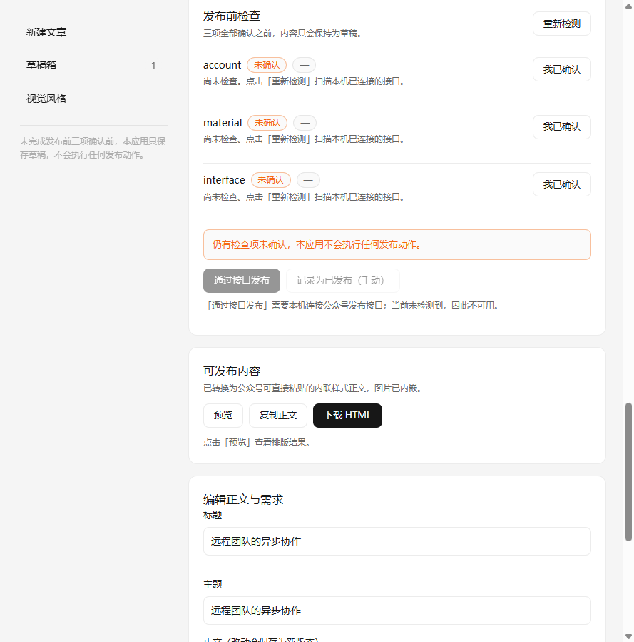

# 公众号图文工作台 (WeChat Official Account Article Studio)

English | [简体中文](README.zh-CN.md)

Turns an article topic, body text, cover and illustration requirements, and a visual style into a
cover/illustration plan, a duplication check against your previous article, a versioned draft list,
and a paste-ready WeChat Official Account (公众号) body.

## What it does

- **Plan** — enter a topic, the body, a cover requirement, an illustration requirement, and pick one
  of the built-in visual styles or create your own. The app derives a cover slot (2.35:1 or 1:1) and
  one illustration slot per `##` section, each with its ratio, pixel target, generation prompt, and a
  short checklist.
- **Render** — every slot can be rendered as a real image through the `matrix` Connector
  (`connector__matrix__generate_image`). Each slot is a separate call at 1K, so one slow image
  cannot cancel the rest.
- **Duplication check** — the draft is compared with the previous draft and with the previous
  published article (title, body, and key-point overlap) and reports a percentage plus a verdict.
- **Versions and states** — editing the body creates a new version of the same article and keeps the
  older ones. A version is `草稿`, `待发布`, `已发布（接口）`, or `已发布（手动）`.
- **Cleanup** — select several versions and delete them together. A published record is protected
  unless you confirm the deletion.
- **Publish gate** — before anything is published the app checks account authorisation, material
  access scope, and an available publish interface. It reports only what it actually detects: with no
  WeChat interface connected it keeps everything as a draft and never claims to have published.
  A tool only counts when its *identity* says so — see [How the publish gate decides](#how-the-publish-gate-decides).
- **Publish-ready content** — the body becomes inline-styled HTML that 公众号 accepts (no class
  selectors, no `<style>` block), with the images embedded as data URIs. Preview it, copy it, or
  download it as a standalone HTML file. 「复制正文」 copies the plain body instead, with every
  image named by its local path on a line of its own, which is what an interface that uploads
  images expects.
- **Re-render one image** — the cover and each illustration can be re-rendered on its own, with the
  requirements that are current for this version. The prompt of every slot is shown before it is
  generated.
- **Agent polish (optional)** — hand the body to the Agent for rewriting. The result is saved as a
  new version and the original version is kept. A turn that asks a question is answered and then
  saved exactly like a turn that did not, and the page says so only when a version was really saved.
- **A damaged state file** — if `state.json` cannot be read it is never overwritten. Its bytes are
  kept under `state.corrupt-<stamp>.json`, the page shows a notice that names the copy, and the
  workbench starts empty.

## Screenshots

The article below is synthetic sample content.




## Install and open

1. Copy this directory into `plugins/<your-github-username>/<plugin-id>/` of your MiniMax Code
   MiniApps clone, or install the plugin directory directly as a MiniMax Code plugin.
2. Restart MiniMax Code, then open the plugin from the plugin list. The app opens in the side
   panel at `/dashboard`; you can also pop it out into its own window.

The app has no build step and no runtime dependencies. Node.js 22 or later is only needed to run the
repository's own `npm run check` and this package's own tests:

```sh
node --test "tests/**/*.test.mjs"
```

## How the publish gate decides

The gate never trusts a tool's prose and never trusts a cached answer.

- **Identity only.** A tool is matched on `provider`, `server` and `tool` — the runtime name an
  Agent sees. Its `description` is never read, because a description that happens to mention
  "WeChat official account draft" says nothing about what the tool does.
- **Whole words.** Every keyword is matched on whole tokens, so `immediate` is not `media` and
  `publisher` is not `publish`. Camel case is split first, so `freePublish` is `free` + `publish`.
- **The role comes from the operation.** A tool must be named 公众号 — in its namespace
  (`wechat`, `weixin`, `gzh`, `mp_weixin`, `公众号`) or in its own name — *and* its operation name
  must carry the role (`publish`, `freepublish`, `发布`, `群发` for the publish gate;
  `material`, `thumb`, `media` for the asset gate). A draft interface (`draft_add`, `add_news`) is
  not a publish interface, so it can never open the gate. A generic `submit` operation does not
  name a publish role either, so it is not treated as one.
- **The live list is re-read.** When you press 「通过接口发布」 the inventory is listed and classified
  again, and the tool is picked from that fresh result — never from the label shown earlier. An
  interface that is no longer in the fresh list publishes nothing.
- **You name the interface.** When more than one publish interface is detected, the page lists them
  and you pick the one to publish through; until that pick is made nothing is published, and the
  publish button stays disabled. The confirmation dialog names the chosen interface, and only that
  interface is called — it is never quietly swapped for another one.
- **Only declared fields are sent.** The arguments are built from the target tool's own
  `inputSchema`. A tool that declares no field for the article body is not called at all, so the
  article is never handed to a tool that cannot receive it.
- **The arguments follow the detected interface.** Each part of the article has a role — the title,
  the digest, the body, the cover, the images, the kind of message, what to do with it — and every
  role is known by a list of names. The first name *that interface itself declares* is the one that
  is filled, so an interface that calls its cover `cover_image` is served exactly like one that
  calls it `thumb_media_id`, and one that calls its body `article_content` like one that calls it
  `content`. The value follows the schema too: the kind is the enum value that means an article,
  the action is the enum value that means publish, and the body is the styled HTML unless the
  interface takes the images separately or the HTML does not fit its declared limit — then it is
  the plain body with the images named inside it.
- **A missing argument stops the publish.** An interface that asks for something this draft cannot
  provide — a draft id that only the console knows, for instance — is not called at all, and the
  page says which argument was missing.
- **The answer decides.** Success is read from what the interface returned, not from the absence of
  a transport error: an MCP result is a failure when `isError` is set or when its
  `structuredContent` or content blocks carry an error code, and a Connector result is a failure
  when its payload carries a non-zero `errcode` / `code`, `success: false`, or a non-empty
  `failed_items`. A zero result code wins over the status string next to it — 公众号 answers a
  successful publish with `{errcode: 0, errmsg: "ok"}`, and that is a success. Only then is the
  version written as `已发布（接口）`.

## Tested environment

- MiniMax Code 3.1.19 on Windows 11 (x64)
- Minimum client version: **MiniMax Code 3.1.6** — the manifest declares `toolAccess`, which older
  clients reject. `agentAccess` and `surface.window` need 3.1.2.
- Client acceptance exercised in the app's own Browser tab: created a draft, rendered a cover
  (11.9 s, `200 image/jpeg` served from the app), inspected the cover/illustration plan, ran the
  publish check against the live tool inventory, previewed the exported HTML (cover embedded as a
  base64 JPEG, inline styles only), and deleted drafts both singly and in bulk. The console showed
  no errors and the network log no failed request.
- The publish gate was re-run against the live inventory of this machine twice. With no 公众号
  interface connected (203 tools) all three checks report 「未接入」 and both publish buttons stay
  disabled, with no console error. With a 公众号 interface connected, all three are confirmed by
  detection, the page lists the two publish interfaces it found and lets you pick one, and the
  publish button stays disabled until you do.
- The interface picker was exercised in the app's own Browser tab against a draft whose check record
  listed two publish interfaces: the picker is rendered, the publish button stays disabled until an
  interface is picked, the pick is sent to the server, and the confirmation dialog names the picked
  interface.
- The arguments were built against the live schema of a connected 公众号 interface that publishes a
  article from a title, a cover file and a body: the payload carries the title, the digest, the
  cover as a local path, the plain body (1,137 characters, inside the 20,000 the interface
  declares), the kind, the action and the confirmation — with no required argument missing and
  nothing over a declared limit. The interface that can only publish an existing draft id is
  refused instead of called.
- 「复制正文」 was exercised in the app's own Browser tab: the clipboard holds the plain body with
  the four illustrations named by their local paths, and 「预览」 still shows the styled HTML.
- The damaged-state path was exercised on a throwaway data directory: the damaged file keeps its
  exact bytes under `state.corrupt-<stamp>.json`, the page shows the notice that names the copy,
  and a later write leaves that copy untouched.
- This package's own tests: `node --test "tests/**/*.test.mjs"` — 76 checks covering the publish
  gate's matching, the interface answer, the durable state, the questionnaire flow, the download
  allowlist, the plain body, and the page.
- Not verified: the Agent polish turn and the interface publish path were implemented but never
  triggered, because this machine has no WeChat publish interface and the polish turn was not
  submitted.

## Data & access

- **Files read and written** — reads and writes only inside `context.dataDir`: `state.json` (drafts,
  custom styles, publish checks), `state.backup.json` (the previous good state), `assets/<id>.jpg`
  (rendered images), and `state.corrupt-<stamp>.json` (a state file that could not be read).
  `state.json` is replaced atomically with a temporary file plus rename, and the previous state is
  kept as `state.backup.json`. A state file that cannot be read is moved aside under its own name
  instead of being overwritten, and the page is told about it. No Host or user files are read or
  written.
- **Network hosts** — the app makes no request of its own. It calls the Connector tools listed below
  and fetches the short-lived signed URL that `connector__matrix__get_asset_url` returns. That URL
  must be HTTPS and its host must be the pinned bucket
  (`matrix-internal-cn.oss-<region>.aliyuncs.com`, in practice
  `matrix-internal-cn.oss-cn-shanghai.aliyuncs.com`); a literal address, a loopback or link-local
  host, and any other host — including another bucket on the same domain — are refused. Redirects are
  followed by hand: every hop is checked against the same rule *and* against the host the first URL
  named, so a 302 cannot move the request to another bucket or another region.
- **Spawned processes** — none. No CLI, no shell, no child process.
- **Agent turns** — declares `agentAccess: ["session.run"]` and runs one Agent turn when you press
  「交给 Agent 润色」. The turn is asked to rewrite only the article body and to return nothing else;
  the result is saved as a new draft version. If the turn asks a question, the questionnaire is
  answered by its `requestId` and the continuation is saved the same way. If the Agent asks for a
  tool permission, the app shows the request in the page and answers it only after you choose Allow
  once or Deny.
- **Conversations read** — none. The app does not declare `session.read` and never reads your other
  conversations.
- **Tools called** — `connector__matrix__generate_image` to render a cover or illustration, and
  `connector__matrix__get_asset_url` to turn the resulting node id into a download URL. The asset-URL
  tool is looked up in the live inventory by provider `matrix` and its argument key is read from the
  tool's own schema, so a renamed argument does not break the app. The app also calls
  `context.tool.list()` to read the inventory for the publish check, and calls the detected WeChat
  publish tool only when the publish gate confirms one exists and that tool declares a field for the
  article body. That call carries the rendered cover and the rendered illustrations as file paths
  inside this plugin's own `dataDir`, and the body as text — no file outside the plugin's own
  directory is ever named. Every call is judged by your own permission rules; if the tool list
  contains a WeChat account, material, or publish interface, the publish check reports it as
  detected evidence.
- **Microphone, camera, notifications** — not used.
- **Host navigation read** — not used. The page only follows the Host's light/dark theme, which
  needs no permission.
- **Where state is stored** — in the Host-owned `context.dataDir` for this plugin. Nothing is sent
  anywhere except the Connector calls listed above. Drafts stay on your machine.

## Notes

- The app is designed for Chinese WeChat Official Account articles. The body parser understands a
  small Markdown subset: `##` and `###` headings, `>` quotes, `-` lists, and `**bold**`.
- The duplication check is a deterministic text-overlap heuristic, not a semantic comparison. Treat
  the percentage as a prompt to look, not as a verdict.
- The publish gate is checked against the tool inventory of the running client. On a machine with no
  WeChat Connector or MCP server connected, all three checks report 「未接入」 and the two publish
  buttons stay disabled.
