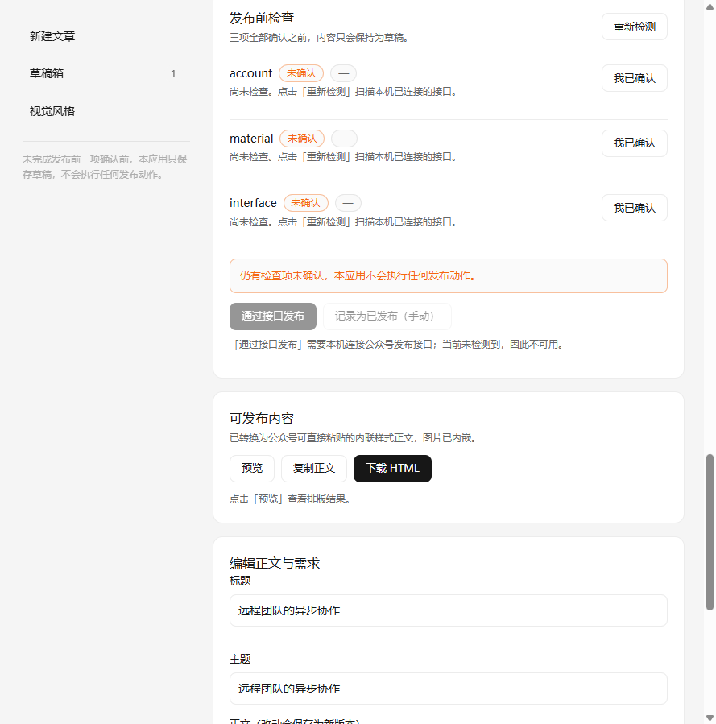

# 公众号图文工作台

[English](README.md) | 简体中文

把一篇文章的主题、正文、封面与插图需求和一个视觉风格，变成封面与插图方案、与上一篇的查重结论、
带版本与发布状态的草稿箱，以及可以直接粘贴进公众号的可发布内容。

## 它做什么

- **方案** — 填写主题、正文、封面需求、插图需求，选一个预置视觉风格或自建一个。应用会推导出封面
  位（2.35:1 或 1:1）以及每个 `##` 小节对应的一张插图位，每张都给出比例、目标像素、生成提示词和
  一份验收清单。
- **渲染** — 每个图位都能通过 `matrix` Connector（`connector__matrix__generate_image`）渲染出真实
  图片。每张图单独调用并使用 1K 尺寸，一张慢图不会拖垮整批。
- **查重** — 新草稿会与上一条草稿、上一篇已发布文章比对标题、正文和要点重合度，给出百分比和结论。
- **版本与状态** — 改正文会生成同一篇文章的新版本，旧版本保留。版本状态为 `草稿`、`待发布`、
  `已发布（接口）` 或 `已发布（手动）`。
- **清理** — 可以多选版本后批量删除；已发布记录默认受保护，需要额外确认。
- **发布门禁** — 发布前会检查公众号账号授权、素材访问范围和可用发布接口，只报告实际检测到的情况。
  没有接公众号接口时，内容始终保持为草稿，应用不会声称已发布。判定只看工具的**身份**，不看它的
  描述文字，详见[发布门禁如何判定](#发布门禁如何判定)。
- **可发布内容** — 正文转成公众号接受的内联样式 HTML（没有 class 选择器、没有 `<style>` 块），图片
  以 base64 内嵌。可以预览、复制，或下载成独立 HTML 文件。「复制正文」复制的是纯文本正文，每张插图
  以本地路径单独成行标注 —— 需要自己上传图片的接口要的就是这个形态。
- **单张重渲** — 封面和每张插图都能单独按当前版本的要求重新生成，生成前的提示词就在卡片里写着。
- **Agent 润色（可选）** — 把正文交给 Agent 改写，结果保存为新版本，原版本保留。Agent 中途提问时，
  问卷回答完同样会存成新版本；页面只在真的存成功时才说「已保存为新版本」。
- **状态文件损坏** — `state.json` 读不出来时不会被覆盖：原始字节保留为 `state.corrupt-<时间戳>.json`，
  页面提示这份副本的名字，工作台以空白重新开始。

## 界面预览

下面的文章是合成的示例内容。




## 安装与打开

1. 把本目录复制到你的 MiniMax Code MiniApps 仓库的 `plugins/<你的-github-用户名>/<plugin-id>/`，
   或者直接把插件目录作为 MiniMax Code 插件安装。
2. 重启 MiniMax Code，在插件列表里打开它。应用会在侧边面板的 `/dashboard` 打开，也可以弹出成独立
   窗口。

应用没有构建步骤，也没有运行时依赖。仓库自己的 `npm run check` 需要 Node.js 22 或更高版本。本包
自带的回归测试这样跑：

```sh
node --test "tests/**/*.test.mjs"
```

## 发布门禁如何判定

门禁既不信工具的描述文字，也不信上一次的结果。

- **只看身份。** 只匹配 `provider`、`server`、`tool` 这三个字段，也就是 Agent 看到的运行时名字。
  `description` 一律不读 —— 描述里恰好出现「WeChat official account draft」并不能说明这个工具做什么。
- **按整词匹配。** 每个关键词都按整词比对，所以 `immediate` 不是 `media`，`publisher` 不是 `publish`。
  驼峰会先拆开，`freePublish` 拆成 `free` + `publish`。
- **角色来自操作名。** 工具必须先被点名是公众号（命名空间里的 `wechat`、`weixin`、`gzh`、`mp_weixin`、
  `公众号`，或者它自己的名字里带这些），**并且**操作名里带着对应角色（发布门禁认 `publish`、
  `freepublish`、`发布`、`群发`；素材门禁认 `material`、`thumb`、`media`）。草稿类接口
  （`draft_add`、`add_news`）不算发布接口，永远打不开这道门。泛用的 `submit` 操作名同样不算发布角色。
- **重新读实时清单。** 点「通过接口发布」时会重新列一次工具清单并重新分类，目标工具从这次的新结果里
  挑，不会用界面上显示过的旧名字。新清单里已经找不到的接口不会发布任何内容。
- **接口由你来点名。** 检测到多个发布接口时，页面会把它们列出来让你选一个；没选之前不会发布，发布按钮
  保持禁用。确认框里会写明选的是哪一个，也只会调用这一个 —— 不会被悄悄换成别的接口。
- **只发接口声明过的字段。** 参数按目标工具自己的 `inputSchema` 生成。接口没有声明能承载正文的字段时
  根本不会调用，正文不会被送给一个接不住它的工具。
- **参数跟着检测到的接口走。** 文章的每一部分都有角色 —— 标题、摘要、正文、封面、图片、消息类型、
  要做什么 —— 每个角色都有一组常见叫法。哪个叫法是**这个接口自己声明的**，就填那一个：叫
  `cover_image` 的接口和叫 `thumb_media_id` 的接口待遇完全一样，叫 `article_content` 的和叫 `content`
  的也一样。取值同样看 schema：消息类型取枚举里表示文章的那一项，动作取枚举里表示发表的那一项；
  正文默认给内联样式 HTML，但如果接口自己收图片、或者 HTML 超了它声明的长度上限，就换成纯文本正文
  并把图片按位置写在里面。
- **列表参数逐项构造。** 有的接口把文章放在只含一项的列表里，而不是顶层正文字段。列表项只按它自己的
  schema 声明的名字填（`title`、`article_content`、`thumb_media_id`……），列表项的正文同样走上面那条
  规矩 —— 用它自己的 `maxLength`，接口自己收图片时同样换成纯文本正文。接口同时声明顶层正文和列表时，
  两处拿到的是同一份选定的正文。列表项里没有任何正文字段时，这一项不会被塞进一个工具没声明过的名字；
  列表项要求某个这篇稿件给不出的字段时，同样不调用。
- **缺参数就不发。** 接口要求一个这篇稿件给不出的东西（比如只有后台自己知道的草稿 id），那就不调用，
  并在页面上说清缺的是哪个参数。
- **以对方的返回为准。** 成败看接口实际返回了什么，而不是「没报错就算成功」：MCP 结果在 `isError`
  为真、或 `structuredContent` 与内容块里带错误码时算失败；Connector 结果在负载里带非零
  `errcode` / `code`、`success: false`、或 `failed_items` 非空时算失败。结果码为零时，旁边那句状态串
  只是状态 —— 公众号发布成功时回的正是 `{errcode: 0, errmsg: "ok"}`，这算成功。只有真的成功，版本才会
  被写成 `已发布（接口）`。

## 测试环境

- MiniMax Code 3.1.19，Windows 11（x64）
- 最低客户端版本：**MiniMax Code 3.1.6** —— 清单里声明了 `toolAccess`，更旧的客户端会直接拒绝安装；
  `agentAccess` 与 `surface.window` 需要 3.1.2。
- 在应用自己的 Browser 标签页里做过的客户端验收：新建草稿、渲染封面（11.9 秒，应用自身返回
  `200 image/jpeg`）、查看封面与插图方案、对实时工具清单跑发布检查、预览导出 HTML（封面以 base64
  JPEG 内嵌、只有内联样式）、单个删除与批量删除草稿；控制台无报错，网络无失败请求。
- 发布门禁在本机的实时清单上重跑过两次：没有公众号接口时（203 个工具）三项都显示「未接入」，两个
  发布按钮保持禁用，控制台无报错；接上公众号接口后，三项都由接口检测确认，页面列出检测到的两个
  发布接口让你选一个，没选之前发布按钮保持禁用。
- 接口选择器在应用自己的 Browser 标签页里对着一条「检测到两个发布接口」的检查记录跑过：选择器渲染
  出来，没选之前发布按钮保持禁用，选定之后会发给服务端，确认框里写明选的是哪一个。
- 参数按本机真实接上的那个公众号接口的 schema 造过一遍：载荷带标题、摘要、以本地路径给出的封面、
  1137 字的纯文本正文（在接口声明的 20000 字上限之内）、消息类型、动作和确认标志；没有缺必填参数，
  也没有超出任何声明的上限。而那个只能发表已存在草稿 id 的接口，被拒绝而不是被调用。
- 「复制正文」在应用自己的 Browser 标签页里跑过：剪贴板里是纯文本正文，四张插图各以本地路径单独
  成行；「预览」仍然是内联样式的 HTML。
- 状态文件损坏这条路径在一个一次性 dataDir 上跑过：损坏文件按原字节保留为
  `state.corrupt-<时间戳>.json`，页面提示了这份副本的名字，之后再写也不会动到它。
- 本包自带的测试：`node --test "tests/**/*.test.mjs"` —— 93 项，覆盖发布门禁的匹配、接口返回的判定、
  持久化状态、问卷流程、下载白名单、纯文本正文、素材路径边界、列表参数和页面。
- 未验证：「通过接口发布」这次调用本身没有真的发出，所以这篇应用没有真的发布过任何文章，也没有从一次
  真实发布里读回结果码。Agent 润色这一轮在应用自己的 Browser 标签页里触发过一次，结果存成了新版本；
  Agent 反问的那个分支没有跑过，因为那一轮它没有提问。

## 数据与权限

- **读取与写入的文件** — 只在 `context.dataDir` 内读写：`state.json`（草稿、自定义风格、发布检查）、
  `state.backup.json`（上一份完好的状态）、`assets/<id>.jpg`（渲染出的图片），以及
  `state.corrupt-<时间戳>.json`（读不出来的状态文件）。`state.json` 用临时文件加 rename 的方式原子替换，
  替换前把旧状态留一份 `state.backup.json`。读不出来的状态文件会被移到自己的文件名下，而不是被覆盖，
  页面也会收到提示。不读取也不写入任何 Host 或用户文件。
- **素材路径有边界** — 交给发布接口的路径只由素材记录的 id 与扩展名拼出，两者都要过关：id 必须是渲染器
  自己写的那种纯名字（`randomUUID()`，不含分隔符），扩展名必须是 `.jpg`、`.jpeg`、`.png`、`.webp` 之一，
  拼出来的文件还必须落在 `dataDir/assets` 里面。指向别处的记录 —— 比如手改过的状态文件里写成
  `../secret` 或 `../../outside` 的 id —— 拼不出路径，发布会直接以「没有指向本应用的素材目录」拒绝，
  而不是把这个路径发出去。正文里本来就有的图片引用（从别处粘进来的 `` 或
  ``）只有在落在 `dataDir/assets` 内时才保留，否则整条引用去掉；`https:`、`data:` 和相对
  路径一律不会被当成文件路径。所以无论状态文件或正文里写了什么，交给接口的都不会是插件自己 `dataDir`
  以外的文件。
- **网络主机** — 应用自身不发请求。它只调用下面列出的 Connector 工具，并获取
  `connector__matrix__get_asset_url` 返回的短时签名地址。该地址必须是 HTTPS，主机必须是写死的那一个
  存储桶（`matrix-internal-cn.oss-<region>.aliyuncs.com`，实际是
  `matrix-internal-cn.oss-cn-shanghai.aliyuncs.com`）；字面量地址、回环与链路本地地址、以及其它主机
  —— 同一域名下的另一个存储桶也算 —— 一律拒绝。302 由程序自己跟，每一跳既按同一条规则检查，也必须
  留在第一个地址指定的那台主机上，所以重定向没法把请求带到别的桶或别的地域。
- **启动的子进程** — 无。不启动 CLI、不经过 shell、没有子进程。
- **Agent 轮次** — 声明 `agentAccess: ["session.run"]`，只有你点「交给 Agent 润色」时才会跑一轮。
  这一轮只被要求改写正文、别输出别的东西；结果保存为新版本。如果 Agent 中途提问，问卷用它的
  `requestId` 回答，回答后的续写同样会存成新版本。如果 Agent 申请工具权限，应用会在页面
  上把这个请求显示出来，只有你选择「允许一次」或「拒绝」后才会回应。
- **读取的会话** — 无。应用没有声明 `session.read`，也不会读取你的其它会话。
- **调用的工具** — `connector__matrix__generate_image` 用来渲染封面或插图，
  `connector__matrix__get_asset_url` 用来把生成的节点 id 换成下载地址。取地址那个工具是在实时工具清单里
  按 provider `matrix` 查出来的，参数名也从它自己的 schema 读，所以上游改名不会让应用失效。应用还会调用
  `context.tool.list()` 读取工具清单，用于发布检查；只有在门禁确认存在发布接口、且该接口声明了能承载
  正文的字段时，才会真正调用它。这次调用里带的是本插件自己 `dataDir` 里渲染好的封面与插图的**文件
  路径**，以及纯文本正文 —— 永远不会提到插件自己目录以外的任何文件。每次调用都走你自己的权限规则；
  如果工具清单里存在公众号的账号、素材或发布接口，发布检查会把它作为检测到的证据列出来。
- **麦克风、摄像头、通知** — 未使用。
- **Host 导航读取** — 未使用。页面只跟随 Host 的明暗主题，这不需要权限。
- **状态存放位置** — 这个插件的 Host 私有 `context.dataDir`。除了上面列出的 Connector 调用，不向任何
  地方发送数据，草稿留在你的机器上。

## 说明

- 应用面向中文公众号文章。正文解析器支持一个小的 Markdown 子集：`##` 与 `###` 标题、`>` 引用、
  `-` 列表、`**加粗**`。
- 查重是确定性的文本重合度启发式，不是语义比较。这个百分比是提醒你去看一眼，不是最终结论。
- 发布门禁按运行中客户端的工具清单判定。机器上没有接公众号 Connector 或 MCP 服务器时，三项检查都会
  显示「未接入」，两个发布按钮保持禁用。
