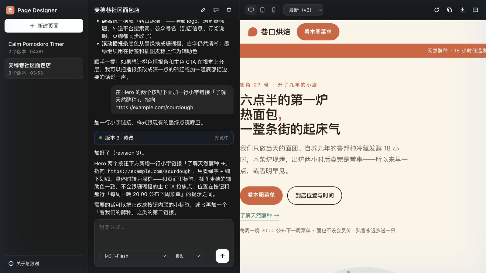

# Page Designer (`page-designer`)

English | [简体中文](README.zh-CN.md)

Describe a page and an Agent writes it as one self-contained HTML file. The page shows up in a
live, sandboxed preview next to the chat, every version is kept, and you can copy or download the
HTML. The Agent is your own MiniMax Code Agent, running the model you pick.

Page Designer is a MiniMax Code port of [fx0](https://github.com/vercel-labs/fx0), the
open-source design agent by Vercel Labs. See [Credits](#credits).



## What you can do

- **Describe a page**: a landing page, a small tool, a game, an explainer, a résumé. The Agent
  picks reasonable details and builds it right away, then you ask for changes in plain words.
- **Start from a style**: six built-in starting styles written for this package (quiet minimal,
  editorial, soft and friendly, bold poster, night console, pocket arcade), or upload your own
  `design.md`.
- **Pick the model**: any model your MiniMax Code can use, with its thinking level. The choice is
  kept per page.
- **Every version**: each publish or edit is a new version. Open any of them from the chat or the
  version menu, and copy or download its HTML.
- **Preview widths**: desktop, tablet and phone, plus reload. Links in the page open outside it.
- **Approvals and questions**: when the Agent asks to use a tool, the page shows a card with
  Allow once and Deny, or you can decide in the conversation. Agent questions are answered in a form
  above the composer, or skipped.
- **Pop out**: open the Mini App in its own window when the side panel feels narrow.
- English and Chinese interface, light and dark themes following the system.

## Install

Requires MiniMax Code 3.1.2 or later, because the package declares `agentAccess`,
`agentConcurrency` and `surface.window`; earlier versions cannot install it.

Copy this directory, including the hidden `.minimax-plugin/`, into the MiniMax Code plugins
directory as `page-designer/` (`~/.minimax/plugins/page-designer/` by default; see the root README's
Install section). Restart MiniMax Code, then open "Page Designer" from the Mini App entry in the
right panel or ask the Agent to "Open Page Designer".

## Tested environment

- MiniMax Code 3.1.4-preview.4694 on macOS 27.0, an internal preview build of the desktop app
  that ships the 3.1.2 Mini App Agent API. Installed through the Host publish flow, opened in the
  right panel, and opened by link (`/studio?p=<id>`).
- Real Agent runs with MiniMax-M3.1-Flash picked in the model menu (the turn reported that model):
  a new page from a Chinese description with the "Soft & friendly" style (version 1, title set by
  the Agent), two follow-up edits through `edit_design` (versions 2 and 3, the preview switched to
  each new version by itself), a second page from an English description, and Stop pressed during
  a run (the run ended with "Stopped." and the composer worked again). None of these runs raised a
  permission request. After the loopback check was added, a rename and one more `edit_design` turn
  on the English page (version 3) were repeated in the real Host and still worked.
- In the real page: version chips and the version menu, preview widths, Copy HTML (the clipboard
  held the raw HTML of version 3), "Show conversation" (the call resolved), and a click on an
  `https://` link inside the preview reaching `window.open`. No console errors or failed requests.
- In Google Chrome 155 (headless) against the same Node entry with a scripted Agent: the 420 px
  layout with Chat and Preview tabs, the 900 px layout with the page drawer, light and dark themes,
  the permission card, the questionnaire form, the About dialog, Download (file name and raw
  content), a page that navigates itself away (restored), and a page that blocks for 1.5 s while
  loading (loaded once, no reload loop).
- `npm test`: 18 `node:test` cases that run the Node entry with a scripted Agent, covering the MCP
  tools and validation, approvals relaying only the user's decision, questionnaire continuation,
  a lost session replaced once, Stop before and during a turn, the loopback and same-origin JSON
  guards (a DNS-rebound hostname is refused on every route), and persistence across a restart.
- Not verified: a permission request or questionnaire raised by a real Agent run (covered with the
  scripted Agent only), the pop-out window, where MiniMax Code opens a link clicked in the preview,
  Download inside MiniMax Code, and Windows.

## Data & access

- **State**: everything is stored under the Host-provided `context.dataDir`, one folder per page:
  `projects/<id>/project.json` (title, chat transcript, run records, chosen model and style, the
  linked session id) and `projects/<id>/v<n>.html` (each version exactly as published). Deleting a
  page in Page Designer removes its folder; the linked Agent conversation stays in MiniMax Code.
  The page keeps only the model choice and preview width in `localStorage`.
- **Files read outside `dataDir`**: none. Uploaded `design.md` files are read by the page and sent
  to the Node process as text; they are stored inside the page's `project.json`.
- **Files written outside `dataDir`**: none by Page Designer. Download saves the HTML through the
  browser's normal download flow.
- **Agent turns** (`agentAccess: ["session.run"]`): each page gets one hidden session created with
  `context.agent.create()`, and every message you send is one turn in it, run from Node so it keeps
  going when the panel closes. These sessions use your primary MiniMax Code Agent, so its own
  settings and memory apply, and they work in this Mini App's own Agent directory. The first turn
  carries the design brief (adapted from fx0), the chosen style and your message; later turns carry
  a short reminder and your message. The brief asks
  the Agent to work only through Page Designer's MCP tools, to stay away from files, the shell and
  subagents, and allows web search and web fetch for reference material. Your message is passed as
  marked user text; what the Agent sends back is shown as text and only the HTML it passes to the MCP
  tools, after validation, becomes a version. If the linked session has disappeared, Page Designer
  creates a new one once and sends the brief again.
- **Permissions**: every `permission.requested` in a Page Designer run is shown as a card with
  Allow once, Deny and "Decide in conversation". Page Designer never answers a request by itself:
  Allow once and Deny relay your click for that one request. "Decide in conversation" opens the
  session in the chat side panel, where MiniMax Code's own card decides.
- **MCP**: the package declares an MCP server served by the Mini App itself at
  `/mcp/page-designer`, with `publish_design`, `edit_design`, `read_design` and `list_designs`.
  Agents can also call them from ordinary chats while the Mini App runs; `publish_design` without a
  `project_id` starts a new page, and every result carries `open_path` (`/studio?p=<id>`), the
  route that opens that page.
- **Validation**: a version must be one complete HTML document of at most 512 KiB with inline
  scripts and styles, embedded `data:` assets, no HTML comments, no forms, no nested frames, no
  external `src`, and only `#fragment` or `https://` links (fx0's rules). Rejected HTML is returned
  to the Agent with the reason and stored nowhere.
- **Preview sandbox**: versions render in an iframe with `sandbox="allow-scripts"` (opaque origin,
  no access to the Mini App, its storage or the `window.mcode` bridge) and fx0's content security
  policy, which blocks every network request, form, frame, worker and external asset. WebRTC is
  switched off before the page runs. A page that navigates itself away is restored. A clicked
  `https://` link is handed to the Mini App page, which opens it with `window.open`; MiniMax Code
  decides where it opens. The raw-HTML route used for
  copy and download is served with a `sandbox` CSP, so a direct visit never runs the page with the
  Mini App's origin.
- **Loopback only**: every route, the MCP endpoint included, answers only when the Host header names
  this machine (`127.0.0.1`, `localhost`, `::1`) and a browser Origin, when sent, is this listener,
  so a web page whose hostname was re-pointed at 127.0.0.1 cannot reach it. Writes must also be
  JSON (415 otherwise) and not marked cross-site by the browser.
- **Network**: the Node process makes no outbound requests. Web search and web fetch, when the
  Agent uses them, run inside the Agent's own tools.
- **Processes**: none spawned.

## Differences from fx0

- The Agent is MiniMax Code's, not libfx, and it uses the models configured in MiniMax Code instead
  of Vercel AI Gateway. There is no sign-in, billing, free trial or BotID.
- Pages live on this computer in the Mini App's data folder instead of Redis and Neon. A run that is
  interrupted by a restart is marked interrupted rather than resumed.
- The Agent writes through MCP tools, so the preview updates when a version is published or
  edited, not while the HTML streams in.
- Messages sent while the Agent works are not steered into the running turn; stop it or wait.
  Image attachments are not supported.
- The ten brand-inspired `design.md` styles bundled with fx0 are not included. The six built-in
  styles are original, and you can still upload any `design.md` you like.

## Credits

Page Designer exists because Vercel Labs published [fx0](https://github.com/vercel-labs/fx0) under
the Apache License 2.0. These parts are adapted from fx0 at commit `e584782`, and each adapted file
names its source and the changes at its top:

- `miniapp/node/artifact.mjs`: the HTML validation rules, the preview content security policy and
  sandbox bootstrap (`lib/design-artifact.ts`), and the exact-replacement edits (`lib/agent.ts`).
- `miniapp/node/prompts.mjs`: the design instructions (`DESIGN_INSTRUCTIONS` in `lib/agent.ts`).
- `miniapp/node/server.mjs`: the descriptions of the page tools (`lib/tools.ts`).

The Mini App runtime, the page, the style presets and the icon were written for this package.
Thank you to the fx0 authors. Page Designer is an independent community project and is not
affiliated with or endorsed by Vercel. See [NOTICE](./NOTICE).

## Files

```text
.minimax-plugin/plugin.json   Plugin manifest (declares the MCP server)
package.json                  Mini App declaration
servers.mcp.json              MCP server entry; its URL is a placeholder that the Host binds to the
                              Mini App's /mcp/page-designer route (miniapp.json mcpEndpoints)
miniapp/miniapp.json          Payload roots, Node entry, page route, MCP endpoint, agentAccess
miniapp/client/               The page (index.html, app.js, app.css)
miniapp/node/server.mjs       Node entry: HTTP routes, SSE, MCP tools
miniapp/node/runs.mjs         Agent sessions and turns, approvals, questions
miniapp/node/store.mjs        Projects and versions under dataDir
miniapp/node/artifact.mjs     HTML validation, preview sandbox, exact edits (adapted from fx0)
miniapp/node/prompts.mjs      The design brief (adapted from fx0)
miniapp/node/styles.mjs       Built-in starting styles
miniapp/node/mcp.mjs          Minimal MCP (JSON-RPC over HTTP) handler
miniapp/*/*.ts                Type declarations for the runtime APIs; not loaded at runtime
tests/                        node:test suites (`npm test`, Node 22 or later)
docs/preview.jpg              README screenshot
LICENSE, NOTICE               Apache License 2.0 and attribution
icon.png                      Plugin icon
```

## License

[Apache License 2.0](./LICENSE), the license of fx0. See [NOTICE](./NOTICE) for attribution.
