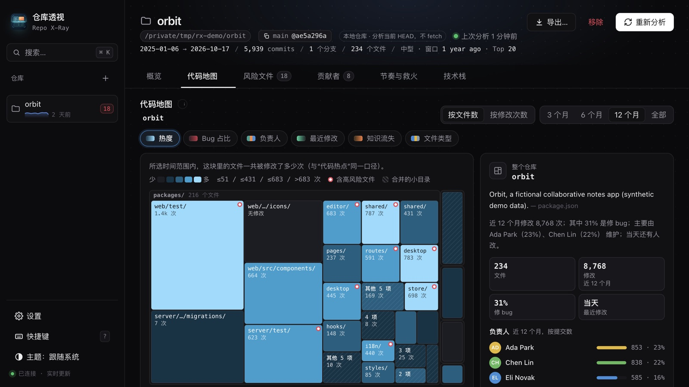

# 仓库透视 Repo X-Ray (`repo-xray`)

English | [简体中文](README.zh-CN.md)

Understand an unfamiliar codebase from its Git history before you read any code. Add a GitHub or
GitLab repository, or pick one on your machine, and Repo X-Ray turns the commit log into a code map
you can drill into, a short list of high-risk files, who maintains what, how the team ships, and
what the project is built with.

Analysis runs locally with your own `git`. Nothing is uploaded, and the page loads no remote
resources. The metrics follow the rules of
[codebase-recon-skill](https://github.com/yujiachen-y/codebase-recon-skill), and the Markdown export
uses that skill's report format. The interface is in Chinese.



*Preview uses synthetic data: a fictional monorepo generated for the screenshot.*

## What you can do

- **Overview**: key numbers, the main problems found by deterministic rules, recommendations, what
  changed since the previous analysis, and a small code map that links into the full one.
- **Code map**: a treemap of the repository's directories that you can drill into. Colour it by
  change heat, bug-fix share, owner, last change, knowledge loss (the share of a directory's history
  written by people with no commits in the last 3 months), or file type. Size blocks by file count
  or by changes, and limit the window to 3, 6, or 12 months or all history. Works with the keyboard.
- **High-risk files**: files that rank both as change hotspots and as bug magnets (most often
  touched by commits whose message mentions fix, bug, or broken), with their owners.
- **Contributors**: ranking by non-merge commits, how concentrated the work is, who was active in
  the last 3 months, and bots and token accounts listed separately. Identities with the same name or
  email are merged by default; you can switch to one identity per author name.
- **Rhythm and firefighting**: monthly commit trend, a commit calendar, and revert, hotfix,
  emergency, and rollback commits.
- **Tech stack**: languages, frameworks, and tools detected from manifests such as `package.json`,
  `go.mod`, `Cargo.toml`, `pyproject.toml`, `pom.xml`, and `Gemfile`.
- Search repositories, every file in history, and contributors with ⌘K. Copy or download the report
  as Markdown, or put a prepared prompt into the conversation input so the Agent reads the riskiest
  files for you; you review the text and send it yourself.
- Suggestions of recently used local repositories, light and dark themes, keyboard shortcuts (press
  `?`), and `prefers-reduced-motion` support.

## Requirements

- `git` on `PATH`. Remote repositories need Git 2.31 or later, because credentials and the proxy are
  passed to git through `GIT_CONFIG_COUNT` environment variables.
- Private repositories: if the `gh` (GitHub) or `glab` (GitLab) CLI is installed and logged in, the
  app reuses that login. Otherwise paste an access token for the host in Settings.

## Install

Copy this directory, including the hidden `.minimax-plugin/`, into the MiniMax Code plugins
directory as `repo-xray/` (`~/.minimax/plugins/repo-xray/` by default; see the root README's Install
section). Restart MiniMax Code, then open 仓库透视 from the Mini App entry in the right panel or ask
the Agent to "打开仓库透视".

## Tested environment

- MiniMax Code 3.1.3-preview.4675 on macOS 27 with Git 2.54. Installed through the Host publish flow
  (also re-installed directly from this repository directory), opened in the right panel.
- Exercised: a public GitHub repository, a self-hosted GitLab repository using the `glab` login, and
  local repositories, including re-analysis; every tab; every code-map colouring, size, and time
  option, drilling in and out with the mouse and the keyboard; the ⌘K search; the Markdown export;
  light and dark themes. No console errors or failed requests.
- Not exercised: popping the page out into its own window (`surface.window`, sized 1360×900); the
  append into the conversation input, which asks the Host for confirmation; `prefers-reduced-motion`;
  Windows and Linux.

## Data & access

- Files read:
  - Repositories you add. A local repository is read in place with the read-only git commands
    below; the app only looks at the history of `HEAD`, never fetches, and never writes into it.
  - Local repository suggestions: lists directories under the scan roots (default `~/Workspace`,
    `~/workspace`, `~/code`, `~/Code`, `~/src`, `~/Projects`, `~/projects`, `~/Developer`, `~/dev`,
    `~/repos`, `~/GitHub`, `~/git`; up to 10 custom roots can be set in Settings), at most 4 levels
    deep, 4000 directories, and 300 repositories, skipping hidden directories and folders such as
    `node_modules`. For each directory it only checks for a `.git` entry and the modification times
    of `.git/FETCH_HEAD`, `.git/index`, and `.git/HEAD`.
  - The host names in `glab`'s config file (`$GLAB_CONFIG_DIR/config.yml`,
    `~/.config/glab-cli/config.yml`, or `~/Library/Application Support/glab-cli/config.yml`) and in
    `gh`'s `hosts.yml` (`$GH_CONFIG_DIR`, `$XDG_CONFIG_HOME/gh`, or `~/.config/gh`), to know which
    hosts these CLIs are logged in to. Tokens are not read from these files.
  - Whether `gh` and `glab` exist on `PATH`, `/opt/homebrew/bin`, `/usr/local/bin`, `/usr/bin`,
    `~/.local/bin`, or `~/.local/share/mise/shims`.
- Files written, all inside the Host-provided `context.dataDir` (atomic write through a temporary
  file; JSON files are owner-only, mode `0600`):
  - `config.json`: the repository list and settings (scan roots, proxy, and any access tokens you
    paste in Settings, stored in plain text in this file).
  - `reports/<id>.json`: the analysis result for each repository.
  - `repos/<id>.git`: a bare, blob-less clone of each remote repository. It holds commits and trees,
    plus only the manifest and README-type files used for the tech stack and directory descriptions.
  - Removing a repository deletes its report and, for a remote repository, its clone. Local
    repositories are never modified.
- Network: only `git` goes online, over HTTPS, to the host of each remote repository you add: clone
  and fetch, `ls-remote` to follow a renamed default branch, and fetching the few manifest and README
  files above. `git@host:path` and `ssh://` addresses are converted to HTTPS URLs; host names are
  validated first. If a proxy is set, git connects through it; the proxy comes from Settings, then
  `HTTPS_PROXY` / `https_proxy` / `HTTP_PROXY` / `http_proxy`, then the macOS system HTTPS proxy.
  The page loads only the app's own same-origin files and `/api/` routes. Links to repository pages
  on GitHub or GitLab open in your browser only when you click them. No telemetry.
- Local server: it answers only requests whose `Host` is a loopback name and whose `Origin`, when
  sent, is the page itself; anything else gets `403`.
- Processes, all started with an argument array and never through a shell. Addresses and paths you
  enter are validated and passed as separate arguments, never in an option position:
  - `git`: `clone --bare --filter=blob:none`, `fetch`, `ls-remote`, `log`, `ls-tree`, `cat-file`,
    `rev-parse`, `for-each-ref`, `symbolic-ref`, and `config` (reads `remote.origin.url` of a local
    repository to build web links; sets `remote.origin.fetch` and `HEAD` only inside the app's own
    clones). Inherited variables that would point git at another repository (`GIT_DIR` and the rest
    of `git rev-parse --local-env-vars`) or trace requests (`GIT_TRACE*`) are removed.
  - `gh auth token --hostname <host>` for `github.com` and hosts in `gh`'s `hosts.yml`, and
    `glab config get token --host <host>` for hosts in `glab`'s config, only when those CLIs are
    installed, to reuse your existing login.
  - `/usr/sbin/scutil --proxy` on macOS, only when no proxy is set in Settings or the environment.
- Credentials: tokens from `gh`, `glab`, or Settings stay in the Node process. They reach git as an
  `http.extraHeader` through `GIT_CONFIG_*` environment variables, never in command-line arguments,
  repository config, the page, logs, or the event stream. While a token is attached, git does not
  follow HTTP redirects (`http.followRedirects=false`), so the token is only ever sent to the host
  you added; a repository that redirects (renamed or moved) has to be added again with its new
  address. Tokens from `gh` and `glab` are cached in memory only. Git credential helpers and
  interactive prompts are turned off for these commands.
- Agent turns: none. No `agentAccess` and no MCP endpoints. "发到对话…", "让 Agent 讲解…", and
  "让 Agent 读高风险文件…" call `window.mcode.miniapp.message.append` to place a prepared prompt (a
  summary of the report and some file paths) in the conversation input after the Host asks you to
  confirm; you decide whether to send it. Where that API is unavailable, the text is copied to the
  clipboard instead.
- Clipboard: written only when you click a copy action (a SHA, a path, the Markdown report).
- Browser storage: `localStorage` keeps only the theme, the last opened repository, and the identity
  merge preference.
- Reset: remove a repository with 移除 on its page; access tokens can be cleared in Settings. Deleting
  the app's data directory removes everything it stored.

## Files

```text
.minimax-plugin/plugin.json   Plugin manifest
package.json                  Mini App declaration
miniapp/miniapp.json          Payload roots, Node entry, page route, pop-out window size
miniapp/client/index.html     Page shell served at /dashboard
miniapp/client/app.js         Page logic: routing, tabs, code map, dialogs (no dependencies)
miniapp/client/charts.js      Hand-written SVG charts and the treemap layout
miniapp/client/styles.css     Styles, light and dark themes
miniapp/client/icon.svg       App icon used inside the page
miniapp/node/server.mjs       Node entry: start(context) → { dispose }, routes, jobs, SSE
miniapp/node/git.mjs          git runner, address parsing, clone and fetch, credentials and proxy
miniapp/node/analyze.mjs      Reads the history and computes the report
miniapp/node/codemap.mjs      Code map: directory tree, colourings, directory descriptions
miniapp/node/techstack.mjs    Tech stack detection from manifests
miniapp/node/util.mjs         Date helpers, JSON read and atomic write
miniapp/node/miniapp-api.ts   Type declarations for the runtime context
icon.png                      Plugin icon
docs/preview.jpg              README preview (synthetic data)
```

## License

[MIT](./LICENSE)
