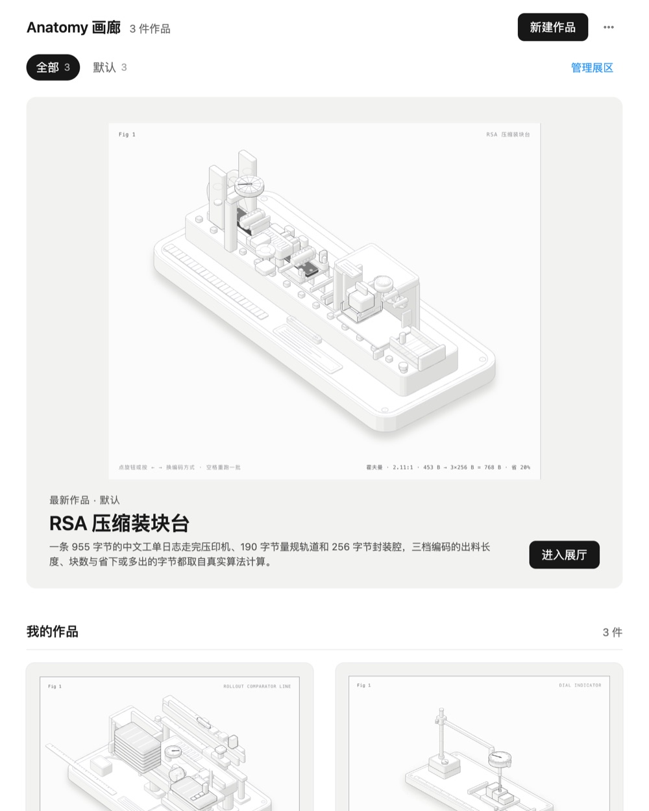

# Anatomy Gallery (`anatomy-gallery`)

English | [简体中文](README.zh-CN.md)

A gallery for interactive isometric figures made with the
[anatomy](https://github.com/wheresryan22/anatomy) skill. Every figure hangs on a wall in its room,
opens full screen in an exhibit view with its light and dark editions, and keeps every version.
New figures and edits are made by an Agent that the gallery runs for you; when the Agent finishes,
it registers the result back into the gallery through the gallery's own MCP tool.

The anatomy skill is bundled, so the gallery works without installing it first. If you already
have a standalone anatomy skill, the gallery keeps using yours. The interface is in Chinese.



## What you can do

- **Browse**: a featured figure on top and every other figure framed on the wall below, with live
  miniatures of the real pages. The skill's own examples are shown as a reference set.
- **Rooms**: sort figures into rooms you create, rename and reorder ("默认" is built in and cannot be
  removed). Removing a room moves its figures back to "默认". Move a figure from its Info tab.
- **Exhibit view**: the interactive page full screen, light/dark edition switch, version picker,
  filmstrip and arrow keys to walk through the current room.
- **Create**: describe what the figure should explain, pick a size, a model and thinking effort,
  optionally a reference example and a room. The gallery starts an Agent turn that builds the
  figure with anatomy and registers it.
- **Edit**: write what to change in the drawer's Edit tab; the Agent edits the source and registers
  a new version. Imported figures are copied before the first edit, never edited in place.
- **Process**: a timeline of each run made from the gallery: the request and full instruction, the
  model, every Agent message, grouped tool steps, permission requests and decisions, and the end
  state. Model names match the model picker.
- **Import**: add an existing anatomy page by absolute path (its `-light.html` sibling comes along).
- Theme menu: follow system, light or dark.

## Install

Requires MiniMax Code 3.1.2 or later, because the package declares `agentAccess`,
`agentConcurrency` and `surface.window` (the size of the pop-out window); earlier versions cannot
install it.

Copy this directory, including the hidden `.minimax-plugin/`, into the MiniMax Code plugins
directory as `anatomy-gallery/` (`~/.minimax/plugins/anatomy-gallery/` by default; see the root
README's Install section). Restart MiniMax Code, then open "Anatomy 画廊" from the Mini App entry in
the right panel or ask the Agent to "打开 Anatomy 画廊".

Building figures needs what the anatomy skill needs: Node.js 20.10 or later, and Chrome or
Chromium for its screenshot checks.

## Tested environment

- MiniMax Code 3.1.1-preview.4625 on macOS 27.0, an internal preview build that already ships the
  3.1.2 Mini App Agent API (`context.agent`, `window.mcode.miniapp.agent`). Installed through the
  Host publish flow and opened in the right panel.
- Exercised with real Agent runs: creating figures from the gallery end to end (two figures, one
  of them with MiniMax-M3.1-Flash-Preview; the run log and the session both confirmed the selected
  model), an edit run that registered a second version, registration through
  `register_figure_version`, the Process tab, and the model labels.
- Exercised in the real runtime without an Agent run: rooms (create, rename, reorder, move a
  figure, remove a room, the built-in room cannot be removed), import, version switching, light
  and dark editions, the theme menu in light and dark, the narrow side-panel layout. No console
  errors or failed requests.
- The bundled skill: checked by resolving the skill with `HOME` pointed at an empty directory (the
  gallery picked the bundled copy for prompts and examples) and by building
  `examples/dial-indicator` from a copy of the bundled skill.

## Data & access

- **State**: everything the gallery stores is under the Host-provided `context.dataDir`:
  `gallery.json` (figures, versions, rooms, run records), `figures/<id>/v<n>/` (copies of each
  version's dark and light pages and screenshots) and `runs/<runId>.jsonl` (process logs, at most
  3,000 entries per run). Removing a figure from the gallery deletes its copies and logs there; the
  Agent's source folder and the linked session are left alone. The page keeps only the theme
  choice in `localStorage`.
- **Files read outside `dataDir`**:
  - The anatomy skill. The gallery looks for a standalone install at these fixed paths under the
    home directory, in order: `.minimax/skills/anatomy`, `.agents/skills/anatomy`,
    `.claude/skills/anatomy`, `.codex/skills/anatomy`, `.config/opencode/skills/anatomy`. This
    relies on an unspecified layout. If none has a `SKILL.md`, it uses the copy bundled in this
    package. It reads the skill's examples and preview images to show them, and passes the skill
    directory to the Agent.
  - Pages registered by the Agent or imported by you: the absolute HTML paths (and screenshots)
    given to `register_figure_version` or typed into Import, plus a sibling `-light.html`. Pages must
    carry anatomy's `class="iso"` marker. The gallery copies them into `dataDir` and never writes to
    the originals.
- **Files written outside `dataDir`**: none by the gallery itself. The Agent writes the figure's
  source in the working directory the Host assigns to the gallery's sessions (see Agent turns).
- **Agent turns** (`agentAccess: ["session.run"]`): each figure gets one hidden session created with
  `context.agent.create()`. Creating asks the Agent to build the figure with anatomy in
  `figures/<figureId>/` of that working directory, make dark and light pages and screenshots, check
  them, and call `register_figure_version`. Editing asks it to change only that figure's source
  folder (or a copy for imported figures) and register a new version. The Agent has its normal
  abilities (files, shell, MCP). Agent text and logs are shown as data; the gallery acts only on
  what `register_figure_version` receives, after validating it. Agent output language follows the
  language of your request.
- **Permissions**: every permission request in a gallery run is shown as a card with Allow, Deny
  and "本次运行都允许" (allow for this run). Nothing is allowed unless you click. If you choose
  "allow for this run", later requests in the same run are answered with `allowOnce` on your behalf
  until the run ends; the next run asks again. Agent questions are answered in the chat side panel.
- **MCP**: the package declares an MCP server served by the Mini App itself at
  `/mcp/anatomy-gallery`, with `register_figure_version` and `list_figures`. Agents can call them
  while the gallery runs, including from ordinary chats.
- **Network**: the gallery's Node process makes no outbound requests. The Agent's own tool use is
  up to the Agent.
- **Processes**: the gallery spawns none. Builds and screenshot checks run inside the Agent's turn.
- Figure pages are rendered in sandboxed iframes (`allow-scripts`, opaque origin).

## Third-party code

`skills/anatomy/` is [anatomy](https://github.com/wheresryan22/anatomy) at commit `bc943e4`, MIT
License, Copyright (c) 2026 Ryan; see `skills/anatomy/LICENSE`. The only change is one sentence
added at the start of the `description` in `skills/anatomy/SKILL.md`, telling Agents to prefer a
standalone anatomy install when there is one.

## Files

```text
.minimax-plugin/plugin.json   Plugin manifest (declares the MCP server and the bundled skill)
package.json                  Mini App declaration
servers.mcp.json              MCP server entry; its URL is a placeholder that the Host binds to the
                              Mini App's /mcp/anatomy-gallery route (miniapp.json mcpEndpoints)
miniapp/miniapp.json          Payload roots, Node entry, page route, MCP endpoint, agentAccess
miniapp/client/               The gallery page (index.html, app.js, app.css)
miniapp/node/server.mjs       Node entry: HTTP routes, SSE, MCP endpoint
miniapp/node/store.mjs        gallery.json, rooms, version copies
miniapp/node/runs.mjs         Agent runs, prompts, permission cards, process logs
miniapp/node/mcp.mjs          Minimal MCP (JSON-RPC over HTTP) handler
miniapp/node/examples.mjs     Locates the anatomy skill and lists its examples
miniapp/node/*.ts             Type declarations for the runtime APIs; not loaded at runtime
skills/anatomy/               Bundled anatomy skill (third-party, MIT)
docs/preview.jpg              README screenshot
icon.png                      Plugin icon
```

## License

[MIT](./LICENSE). The bundled anatomy skill keeps its own MIT license.
