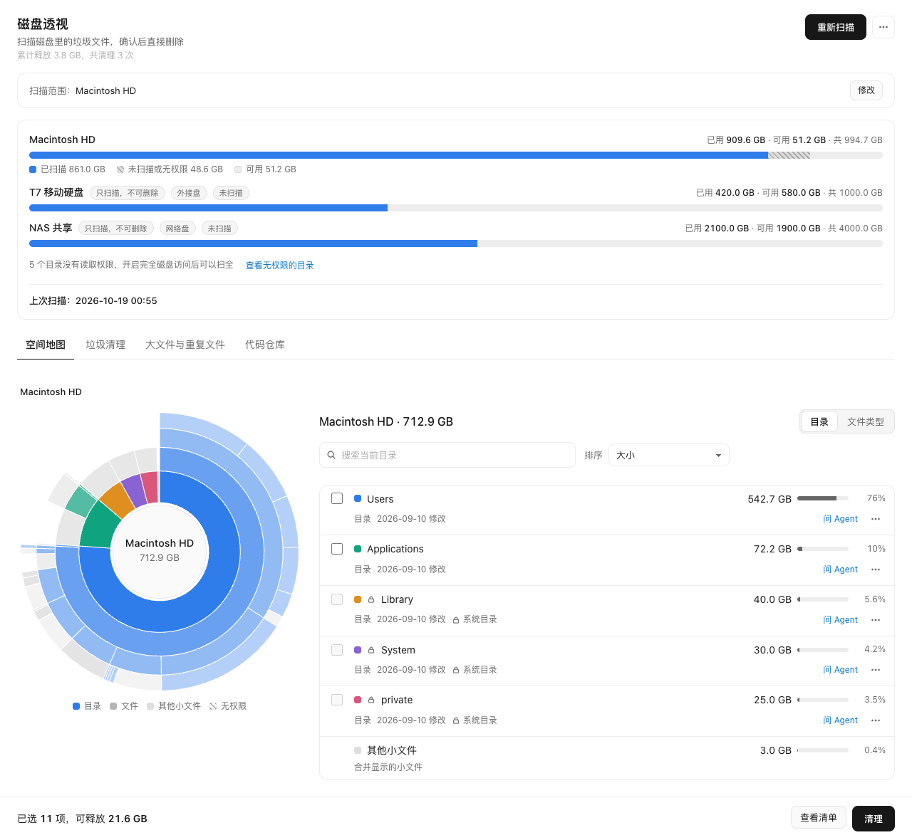
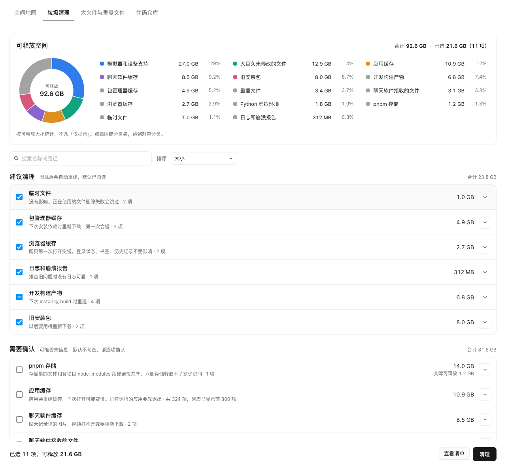

# Disk Insight (`disk-insight`)

English | [简体中文](README.zh-CN.md)

A disk space viewer and cleaner for macOS and Windows. Choose a disk or a folder, and Disk Insight
shows where the space went: a sunburst space map, junk files sorted by how safe they are to remove,
large and duplicate files, and how much your code repositories and their Git worktrees take. You can
ask an Agent what an item is before deciding. Items you select are **deleted permanently** after a
confirmation dialog that lists them; nothing goes to the Trash or Recycle Bin. The interface is in
Chinese.

The previews below use synthetic data.





## What you can do

- **Space map** (空间地图, the home view): a sunburst of the scanned scope next to the current
  folder's children, with search and sort. Click to drill down. The "文件类型" switch totals the
  space by file type (video, images, audio, disk images, archives, installers, virtual machine disks,
  development caches, other).
- **Explicit scope**: nothing is scanned until you choose what to scan, one or more disks or folders.
  Pick a folder with the system folder dialog or paste its path. A quick pass shows the first
  results while the full scan continues.
- **Junk cleanup** (垃圾清理): rule-based categories such as temporary files, package manager
  caches, browser caches, logs, build outputs, old installers, app and chat caches, Python virtual
  environments, simulators, large old files and duplicates, in three tiers:
  - **建议清理** (recommended): rebuilt automatically after deletion, selected by default (build
    outputs only when their project has not changed for 90 days).
  - **需要确认** (needs review): may lose information, never selected by default.
  - **仅提示** (info only): system junk, the Trash or Recycle Bin, Docker disk images and the Go
    module cache. Shown with their size and how to clean them elsewhere; they cannot be selected.

  A pie chart shows reclaimable space by category. The list has search, sort, and an ignore list
  (忽略名单) for items you never want suggested again.
- **Large and duplicate files** (大文件与重复文件): files of 500 MB or more; duplicates of 1 MB or
  more, confirmed by SHA-256, with "每组只保留最新的一份" (keep only the newest copy in each group).
  Files inside Git work trees are not compared.
- **Code repositories** (代码仓库): each repository's size, its worktrees (count and size), Git data
  and dependencies. "勾选依赖和构建产物" selects a repository's dependencies and build outputs.
  "清理失效 worktree" removes worktree records whose folder no longer exists. A worktree with
  uncommitted changes or unpushed commits is locked and cannot be selected.
- **Ask the Agent** (问 Agent): on any item, ask an Agent what it is, what deleting it would break,
  and whether to delete it. The answer streams into a side panel.
- **Clean history and stats**: every deleted item with its time, size and result (更多 → 清理记录),
  and the total space freed and number of cleanups in the header.
- **Folders without permission** (更多 → 无权限的目录): the folders the scan could not read. On
  macOS the page explains how to grant Full Disk Access and opens that System Settings page.
- Reveal an item in Finder or File Explorer, and Quick Look a file (macOS). The theme follows the
  system.

## Install

Requires MiniMax Code 3.1.2 or later, because the package declares `agentAccess`,
`agentConcurrency` and `surface.window` (the size of the pop-out window); earlier versions cannot
install it.

Copy this directory, including the hidden `.minimax-plugin/`, into the MiniMax Code plugins
directory as `disk-insight/` (`~/.minimax/plugins/disk-insight/` by default; see the root README's
Install section). Restart MiniMax Code, then open "磁盘透视" from the Mini App entry in the right
panel or ask the Agent to "打开磁盘透视".

On macOS, give MiniMax Code Full Disk Access (System Settings → Privacy & Security → Full Disk
Access) and restart it to scan everything. Without it, protected folders are listed as unreadable
and their space is counted as "未扫描或无权限".

## Tested environment

- MiniMax Code 3.1.3-preview.4684 (an internal preview build) on macOS 27.0 (Apple Silicon).
  Installed through the Host publish flow and opened in the right panel.
- A full scan of the home directory with Full Disk Access granted: about 762 GB and about 73
  million files; peak memory of the Mini App process 561 MB. The quick scan showed its first results
  in about 0.2 seconds.
- Code repositories: the detected worktrees matched `git worktree list` (58 in one repository).
  "清理失效 worktree" was run once on a real repository; it removed 13 stale records, checked with
  git afterwards.
- Permanent deletion was run in the real desktop app on five `__pycache__` folders in a project
  untouched for more than 170 days. Afterwards the folders were gone, the `.py` files were still
  there, and the Git status was clean. An end-to-end test also deletes a folder containing symbolic
  links that point outside it; all link targets are left intact.
- Ask the Agent: run three times with a real Agent, the last one with the current prompt layout
  (the data section described under Data & access); the answer kept the three-part format.
- The list of folders without permission was checked before and after granting Full Disk Access.
  Quick Look and Reveal in Finder were tried. The system folder dialog opens (only cancelling it was
  tried).
- 53 unit tests, all passing (`npm test` in this directory).
- Not yet verified: everything on Windows; the dark theme in the real desktop app (checked only in
  a mock environment); choosing a folder in the system folder dialog; how long deleting a very large
  `node_modules` takes; permission requests during a real Agent run.

## Data & access

- **State**: everything Disk Insight stores is under the Host-provided `context.dataDir`. Each file
  is written to a `.tmp` file first and then renamed.
  - `scan-v4.ndjson.gz`: the last scan result as gzip-compressed NDJSON: the scanned folder tree
    with sizes, the items found, duplicate groups, repositories and worktrees. It contains the paths
    of scanned files and folders.
  - `selection-v1.json`: the current selection (item ids and paths).
  - `history-v1.json`: the clean history: time, path, freed size and result of each deleted item.
  - `stats-v1.json`: total space freed, number of cleanups, and the last cleanup's summary.
  - `scope-v1.json`: the last scan scope (disk ids and folder paths).
  - `ignore-v1.json`: the ignore list (paths).

  The page keeps nothing in `localStorage` or other browser storage.
- **Files read**:
  - Everything inside the scope you choose: the metadata of every file and folder (`lstat`: name,
    size, timestamps, device and inode), not the contents. Symbolic links and junctions are not
    followed. A whole-disk scan on macOS skips `/System/Volumes`, `/Volumes`, `/dev`, `/net`,
    `/home`, `/.vol`, `/.resolve` and `/.nofollow`. iCloud Drive (`~/Library/Mobile Documents`),
    `~/Library/CloudStorage` and OneDrive folders are not listed at all, because listing them can
    trigger cloud downloads.
  - Duplicate detection reads file contents to hash them: the first and last 64 KB of files of the
    same size, then the whole file (SHA-256) when those match. Only files of 1 MB or more are
    compared; files in Git work trees, caches and build outputs, protected folders, `~/Library` and
    the macOS system folders (macOS), and `AppData` (Windows) are skipped.
  - Git metadata of repositories in the scope: a worktree's or submodule's `.git` file,
    `<git dir>/worktrees/*/gitdir`, `HEAD` (for the branch name), and the modification time of
    `<git dir>/index` (last activity). `git status` also reads the work tree (see Processes).
  - The Trash (`~/.Trash`) and Recycle Bin are only measured.
  - The fixed locations of the cleanup rules, listed in `miniapp/node/rules.mjs` (macOS) and
    `miniapp/node/rules-win.mjs` (Windows): for example `~/Library/Caches`, `~/Library/Logs`,
    `~/.npm`, Xcode `DerivedData`, chat app folders under `~/Library/Containers` and
    `~/Library/Application Support`, `/Library/Caches` and `/private/var/log` on macOS;
    `%TEMP%`, caches under `%LOCALAPPDATA%` and `%APPDATA%`, chat app folders under
    `%USERPROFILE%\Documents`, and `%SystemRoot%\SoftwareDistribution\Download` on Windows. At the
    start of a scan each location is checked with `realpath`, and the folders that a `*` stands for
    (for example one per chat account) are listed.
  - Other fixed locations: `~/Library/Safari` and `~/Library/Mail` are listed only to check whether
    Full Disk Access is granted; `/usr/share/firmlinks`, `/System/Volumes/Data` and `/Volumes` to
    find the data volume and other disks; the home, Desktop, Downloads and Documents folders are
    checked for existence to offer them as scope shortcuts.
  - The MiniMax Code data directory is located from `context.dataDir`: the nearest parent folder
    whose name starts with `.minimax`, or `~/.minimax` when there is none. This relies on an
    unspecified layout. It is used only to add that directory to the protection list; nothing in it
    is read.
  - A folder you type or pick is checked with `realpath` and `stat` before it is accepted. For
    "问 Agent", the item's largest children come from the scan result; when the scan did not keep
    them, the folder is listed on the spot (at most 2,000 entries and 20,000 `lstat` calls).
- **Files deleted or written outside `dataDir`**:
  - Cleaning **permanently deletes** the items you selected and confirmed, with `fs.rm`
    (recursive; symbolic links are removed themselves and never followed, so their targets are left
    intact). Nothing goes to the Trash or Recycle Bin, there are no backups, and deleted items cannot
    be restored.
  - Protected paths can never be selected or deleted: system folders (macOS `/System`, `/Library`,
    `/usr`, `/bin`, `/sbin`, `/private`, Safari and `/Applications/Utilities`; Windows
    `%SystemRoot%`, `Program Files`, `Program Files (x86)`, `ProgramData`, `%APPDATA%\Microsoft`, and
    `System Volume Information`, `$Recycle.Bin`, `pagefile.sys`, `hiberfil.sys`, `swapfile.sys` on
    every disk), credentials (`~/Library/Keychains`, `~/.ssh`, `~/.gnupg`), cloud drives (iCloud
    Drive, `~/Library/CloudStorage`, OneDrive), the Trash, the Go module cache, the MiniMax Code data
    directory, this Mini App's own `dataDir`, every `.git` folder itself, disk roots, and any folder
    that contains a protected path. The home folder, `~/Library` (Windows: `AppData` and its `Local`,
    `LocalLow` and `Roaming` folders) and the standard Desktop, Documents, Downloads, Pictures,
    Movies or Videos, and Music folders are protected themselves; items inside them can be selected.
  - Right before deleting each item, Disk Insight checks five things again and skips the item if
    any of them fails: the path exists; it is not a symbolic link, and its device, inode and
    modification time match the scan; its `realpath` equals the scanned path; it is not locked; its
    disk allows deletion.
  - Items on external and network disks are only scanned, never deleted.
  - The confirmation dialog lists every selected item and says the deletion cannot be undone. Items
    that contain a Git repository or chat files are listed one by one with a warning; the others are
    grouped by source.
  - "清理失效 worktree" runs `git -C <main repository> worktree prune` after you confirm the list of
    stale records in a dialog. Git removes only records whose worktree folder no longer exists.
- **Processes**: every command is started with an argument array (`child_process.spawn` or
  `execFile`), never through a shell, and with a timeout; `dispose` ends those still running. A
  command line holds only fixed text and paths taken from the scan result (the page sends item ids,
  not paths).

  | Command | Platform | When and why |
  | --- | --- | --- |
  | `/bin/df -k <volume>` | macOS | Listing disks: each volume's used and free space. |
  | `/sbin/mount` | macOS | Listing disks, when `/Volumes` holds other volumes: tells external disks from network disks. |
  | `/bin/ps -axco comm` | macOS | After a scan: marks caches of running apps as in use. |
  | `tasklist.exe /fo csv /nh` | Windows | Same as `ps`. |
  | `powershell.exe -NoProfile -NonInteractive -Command "Get-CimInstance Win32_LogicalDisk \| Select-Object DeviceID,DriveType,Size,FreeSpace,VolumeName \| ConvertTo-Json -Compress"` | Windows | Listing disks. |
  | `go env GOMODCACHE` | both | Once, when the page first loads: finds the Go module cache to protect it. Tries `go` on `PATH`, then `/usr/local/go/bin/go`, `/opt/homebrew/bin/go`, `/usr/local/bin/go` (Windows: `go.exe`, `C:\Program Files\Go\bin\go.exe`), with `GOTOOLCHAIN=local` so it never downloads a toolchain, run in `dataDir`. Falls back to `$GOPATH/pkg/mod`, then `~/go/pkg/mod`. |
  | `/usr/bin/xcode-select -p` | macOS | Before using `/usr/bin/git`: makes sure the Command Line Tools exist, so macOS does not pop up an install prompt. Git is looked up on `PATH`, then in `/opt/homebrew/bin`, `/usr/local/bin` and `/usr/bin` (Windows: `git` on `PATH`). |
  | `git -C <worktree> status --porcelain=v1 --branch` | both | "检查状态" in the repository view, and before a worktree can be selected: finds uncommitted changes and unpushed commits. Run with `GIT_OPTIONAL_LOCKS=0` and `GIT_TERMINAL_PROMPT=0`, at most four at a time. |
  | `git -C <main repository> worktree prune` | both | After you confirm "清理失效 worktree": removes stale worktree records. |
  | `/usr/bin/open -R <path>` | macOS | "在访达中显示". |
  | `/usr/bin/open x-apple.systempreferences:com.apple.settings.Storage` | macOS | "打开存储设置" on the system junk category. |
  | `/usr/bin/open x-apple.systempreferences:com.apple.preference.security?Privacy_AllFiles` | macOS | Opens the Full Disk Access page. |
  | `/usr/bin/osascript -e 'POSIX path of (choose folder with prompt "选择要扫描的文件夹")'` | macOS | The folder dialog. The script is fixed. |
  | `/usr/bin/qlmanage -p <file>` | macOS | Quick Look; closed after 10 minutes at most. |
  | `powershell.exe -STA -NoProfile -Command <script>` | Windows | The folder dialog. The script is a fixed `FolderBrowserDialog` script; the chosen path comes back base64-encoded. |
  | `explorer.exe /select,"<path>"` | Windows | Reveal in File Explorer. The path is passed as one verbatim argument. |
  | `explorer.exe ms-settings:storagesense` | Windows | Opens Storage settings. Exposed as a system action route; the page does not offer it at present. |
  | `cleanmgr.exe` | Windows | "打开磁盘清理" on the system junk category. |
- **Network**: none. The Node process only serves the page on `context.listen`, and the page only
  calls its own relative routes.
- **Agent turns** (`agentAccess: ["session.run"]`, `agentConcurrency: 2`): each "问 Agent" runs one
  Agent turn from the page, in a new session. The prompt holds the item's path, the operating
  system, its size and reclaimable size, last modification date, scan category and what deleting it
  does, its tags (contains a Git repository, chat files, possibly in use), and up to 10 of its
  largest children with sizes. Paths and names read from disk are untrusted: they go into a section
  between `<<<条目信息` and `条目信息>>>` markers that the prompt labels as data only, each one
  written as an escaped JSON string (so a file name cannot add a line or a fake end marker), and the
  Agent is told not to follow any instruction found there. It asks the Agent only to analyse: not to
  delete, move or modify any file, nor run commands that change files (read-only commands to look at
  the folder are allowed);
  to answer in three parts (what it is, what deleting it does, a recommendation with the reason); to
  say so when unsure; and to reply in the language of the request in at most 300 characters. The
  Agent keeps its normal abilities (files, shell, MCP), so that instruction is a request, not a
  sandbox. Disk Insight never acts on the answer.
- **Permissions**: every permission request in an ask is shown as a card with "允许一次" (allow once)
  and "拒绝" (deny). Disk Insight never answers a request on its own: the buttons relay your click
  for that one request, and nothing happens until you click. A question from the Agent is shown with
  a pointer to "在对话中打开", which opens the session in the chat side panel. "停止" cancels the
  turn.
- The Agent's answer is rendered as a safe Markdown subset: the text is HTML-escaped first, then
  headings, lists, quotes, code, bold and italics become fixed tags; links are shown as text with
  their URL and never become clickable.

## Files

```text
.minimax-plugin/plugin.json   Plugin manifest
package.json                  Mini App declaration and the npm test script
miniapp/miniapp.json          Payload roots, Node entry, page route, pop-out window size, agentAccess
miniapp/client/               The page (index.html, assets/app.js, assets/app.css)
miniapp/node/server.mjs       Node entry: starts the HTTP server, returns dispose
miniapp/node/routes.mjs       HTTP routes; http.mjs serves the page and server-sent events
miniapp/node/app*.mjs         State and the scan, clean, repository, selection and extra operations
miniapp/node/scan-engine.mjs  Scan phases (quick, full, duplicates); scanner.mjs walks folders
miniapp/node/rules*.mjs       Cleanup categories and fixed locations (macOS, Windows)
miniapp/node/protect.mjs      Protection list and lock reasons
miniapp/node/cleaner.mjs      Pre-delete checks and permanent deletion
miniapp/node/repos.mjs        Repository and worktree detection
miniapp/node/platform.mjs     Disks, Full Disk Access, running apps, dialogs, system settings
miniapp/node/exec.mjs         Child processes: argument arrays, timeouts, cleanup on dispose
miniapp/node/prompt.mjs       The "问 Agent" prompt
miniapp/node/store.mjs        State files in dataDir
miniapp/node/*.ts             Type declarations for the runtime APIs; not loaded at runtime
tests/                        Unit tests (node --test); fixtures go to a temporary folder
docs/                         README screenshots
icon.png                      Plugin icon
```

Run the tests with `npm test` in this directory. Fixtures are created under
`~/Library/Caches/disk-insight-test` on macOS and the system temporary folder elsewhere; set
`DISK_INSIGHT_TEST_TMP` to use another folder.

## License

[MIT](./LICENSE).
