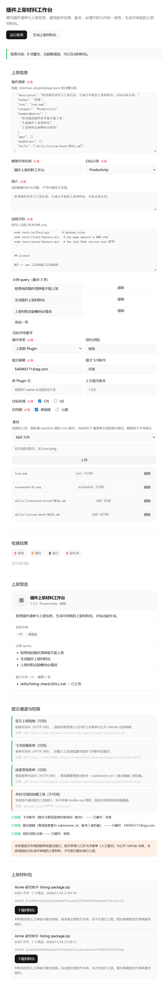

# Plugin Listing Workbench (submission-workbench)

A Mini App for preparing a MiniMax Plugin submission: fill in the plugin manifest and the
listing fields, check the name, version, required fields and cross-file consistency item by
item, and download a reviewable listing package that names every missing item.

中文名：插件上架材料工作台



[简体中文](README.zh-CN.md)

## What it does

The page has four blocks:

1. **Listing information** — paste the full `.minimax-plugin/plugin.json`, then set the expected
   market name, the target category, the summary, the documentation (written into the package
   `README.md`) and up to 3 example queries.
2. **Target market requirements** — a new submission or an update of an existing plugin (on an
   update the original plugin name must stay the same and the last submitted version is
   required), the submission email, the submitting Feishu account, the target region (CN/US) and
   the enabled clients (desktop/cloud). Region and enabled clients are **two independent
   dimensions** managed by the Marketplace catalog; they are not written into `plugin.json`.
3. **Assets** — upload by role: icon (the path the manifest declares), screenshots, and
   Skill/MCP/App files.
4. **Results** — *Check results* lists the missing items and the content conflicts, *Listing
   preview* shows the market card, *Submission channel and permissions* shows the intake
   channels this machine can reach, and *Listing package* lets you download the packaged ZIP.

## Install

**From a Git repository** (MiniMax Code 3.1.11 or later): in the plugin market choose
**Create → Mini App → Import from Git repository** and paste

```
https://github.com/zhuyankarl/mcode-plugins/tree/main/plugins/submission-workbench
```

**Manually**: copy the whole `plugins/submission-workbench` directory, including the hidden
`.minimax-plugin` directory, into `<dataDir>/plugins/submission-workbench/`, then restart
MiniMax Code.

**The whole repository**: clone <https://github.com/zhuyankarl/mcode-plugins> and run
`install.ps1` (Windows) or `install.sh` (macOS/Linux). It installs this plugin together with the
`groundtruth` plugin and then self-checks the installation.

## Use

Open the app in MiniMax Code; the page is served at `/dashboard`. You can also ask the Agent
directly: "check whether my plugin manifest can be submitted" or "generate the listing package".

## Bundled Skill

The package ships one Skill, `listing-check`
(`skills/listing-check/SKILL.md`): it gives the Agent the same checklist the page applies —
required manifest fields, the fixed categories, the "at least one capability" rule, the version
bump rule, the package limits and the two official intake channels — so the Agent can answer
"can my plugin be submitted" without opening the page.

## Tested environment

- MiniMax Code 3.1.16 on Windows 11.
- Node.js 24.15.0 — any LTS release works, because the Node payload is a plain Node process.

## Required configuration

- Node.js must be on `PATH`. The payload uses Node built-in modules only (`node:http`,
  `node:fs`, `node:zlib`, `node:crypto`, …): the host installs no dependencies and runs no build
  step, so the package runs as it is.
- The page is plain HTML, CSS and JavaScript with no build step.

## Data & access

- **Files it reads**: only the files inside its own package.
- **Files it writes**: the working draft, the uploaded assets and the generated listing packages,
  under the writable data directory the Host provides for this plugin
  (`<dataDir>/v2/plugin-data/liveboards/submission-workbench/`). It never writes into the plugin
  package itself. Every asset and package id is a UUID this server generates; an id that is not one
  is refused before it can name a file, and the resolved path is checked to stay inside the asset
  and package directories.
- **Network requests**: when you run a check, the Node service makes three HTTPS `GET` requests
  to see whether the documented intake channels are reachable — the submission guide on
  `code.minimax.cn` and two Feishu form URLs on `vrfi1sk8a0.feishu.cn`. There is no other
  outbound traffic. The Node service itself listens on the loopback port the Host assigns it.
- **Agent turns it runs**: none. `miniapp/miniapp.json` declares no `agentAccess`.
- **Conversations it reads**: none.
- **Tools it calls**: none. `miniapp/miniapp.json` declares no `toolAccess`.
- **Microphone, camera, notifications**: none.
- **Which MiniMax Code page you are on**: not read. `miniapp/miniapp.json` declares no
  `hostAccess`.

## What it does not do

The app never submits anything on your behalf. The official intake channels are a Feishu form (a
human submits it in a logged-in browser) and a public GitHub repository, so the app only produces
materials you can review — and it says exactly that in its own report.

## Tests

Run these inside the package directory:

```bash
node tests/selftest.mjs        # backend rules
node tests/client-harness.mjs   # the page against a DOM stub
node tests/server-harness.mjs   # the real Node service over HTTP
node tests/path-traversal.mjs   # id handling on the two id-taking routes
```

## License

MIT — see [LICENSE](LICENSE).
