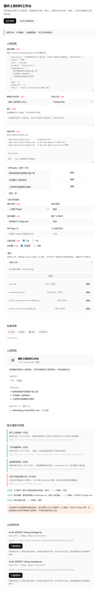

# 插件上架材料工作台（submission-workbench）

一个 Mini App：填写插件清单与上架信息，逐项核对名称、版本、必填字段与内容一致性，
一键生成可审核的**上架材料包**，并标出还缺哪些必填项。

English name: Plugin Listing Workbench

[English](README.md)



## 它做什么

页面上分四块：

1. **上架信息** —— 粘贴 `.minimax-plugin/plugin.json` 全文，填期望市场名称、目标分类、
   简介、说明文档（会写进包的 README.md）、最多 3 条示例 query。
2. **目标市场要求** —— 上架新 Plugin 还是更新已有 Plugin（更新时原 Plugin 名必须不变、
   并填上次提交版本）、提交邮箱、提交飞书账号、目标区域（CN/US）、启用端（桌面端/云端）。
   区域与启用端是**两个独立维度**，由 Marketplace catalog 管理，不写进 `plugin.json`。
3. **素材** —— 按角色上传：图标（对应 manifest 里的 `icon` 路径）、截图、Skill/MCP/App 文件。
4. **结果区** —— 「检查结果」列出缺失项与内容冲突，「上架预览」给出市场卡片预览，
   「提交通道与权限」显示探测到的提交通道，「上架材料包」可下载打包好的 ZIP。

## 安装

**从 Git 仓库导入**（MiniMax Code 3.1.11 及以上）：在插件市场点击「创建」→ Mini App →
「从 Git 仓库导入」，填入

```
https://github.com/zhuyankarl/mcode-plugins/tree/main/plugins/submission-workbench
```

**手动安装**：把 `plugins/submission-workbench` 整个目录（含隐藏的 `.minimax-plugin`）复制到
`<dataDir>/plugins/submission-workbench/`，再重启 MiniMax Code。

**整仓安装**：克隆 <https://github.com/zhuyankarl/mcode-plugins> 后执行 `install.ps1`（Windows）
或 `install.sh`（macOS/Linux），会一并装上本插件与 `groundtruth` 插件并做安装后自检。

## 怎么用

装好后在 MiniMax Code 里打开这个 Mini App，页面地址是 `/dashboard`。
也可以直接对 Agent 说「检查我的插件清单能不能上架」「生成插件上架材料包」。

## 内置 Skill

包内自带一个 Skill：`listing-check`（`skills/listing-check/SKILL.md`）。它把页面上那套检查
规则交给 Agent——清单必填字段、固定分类、「至少一种能力」、包内容变化必须提版本、包体上限、
两个官方受理入口——所以不用打开页面，Agent 也能直接回答「我这个插件能不能上架」。

## 测试环境

- MiniMax Code 3.1.16，Windows 11。
- Node.js 24.15.0（任意 LTS 版本均可，Node 载荷是纯 Node 进程）。

## 运行环境

- 需要 **Node.js**（任意 LTS 版本），因为 Node 载荷是纯 Node 进程。
- **零第三方依赖**：只用 Node 内置模块（`node:http`、`node:fs`、`node:zlib`、`node:crypto` 等），
  宿主不装依赖、不跑构建，所以包体可以直接运行。
- 页面是原生 HTML/CSS/JS，无构建步骤。

## 数据与权限

- **读取的文件**：只有本插件包内的文件。
- **写入的位置**：草稿、上传的素材与生成的上架材料包，写在宿主为该插件提供的可写数据目录里
  （`<dataDir>/v2/plugin-data/liveboards/submission-workbench/`），不写插件包本身。
- **网络请求**：运行检查时，Node 服务会发三次 HTTPS GET，用来判断官方受理通道是否可达 ——
  `code.minimax.cn` 上的上架指南，以及 `vrfi1sk8a0.feishu.cn` 上的两个飞书表单地址。
  除此之外没有任何对外流量。Node 服务自身监听宿主分配的回环端口。
- **Agent 运行**：无，`miniapp/miniapp.json` 未声明 `agentAccess`。
- **读取会话**：无。
- **调用工具**：无，未声明 `toolAccess`。
- **麦克风、摄像头、通知**：无。
- **读取当前 MiniMax Code 页面**：不读，未声明 `hostAccess`。

## 它不做什么

本应用不会代替你提交任何东西。官方受理入口是飞书表单（人工在已登录的浏览器里提交）和公开
GitHub 仓库，所以它只产出可审核的材料——并在报告里如实写明这一点。

## 自测

在插件目录下执行：

```bash
node tests/selftest.mjs        # 后端规则
node tests/client-harness.mjs   # 页面 DOM 打桩
node tests/server-harness.mjs   # 真实 Node 服务的 HTTP 集成
```

## 许可证

MIT，见 [LICENSE](LICENSE)。
